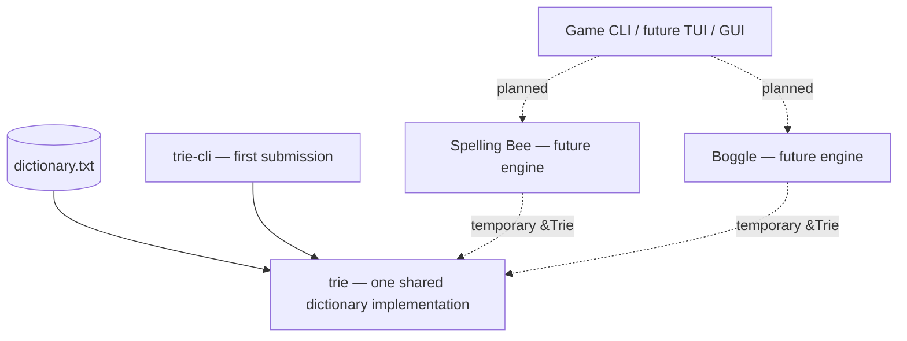

# Word Trie and Word Games in Rust

> **Repository status: DESIGN/PRE-IMPLEMENTATION.** This document ships with the planning packet, **not** a completed Rust repository. The trie, `trie-cli`, and games have **not been implemented or executed in this document bundle**. A coding agent must replace this status and accurately document working behavior as the repository develops. Do not claim that any Cargo command below has been run merely because it is listed here.

## Project overview

This project is intended to deliver one reusable, memory-resident Rust trie dictionary, a first-submission management CLI, and later independent word-game engines (Spelling Bee and Boggle). The architecture separates dictionary storage from game rules and user interfaces, allowing future Wordle, richer terminal applications, or GUIs without duplicating the trie.

**The first mandatory assignment is `Word Games.pdf`: finish the `trie` library and the `trie-cli` binary, including comprehensive tests, before starting any game.** Spelling Bee and Boggle are independently authorized later stages.

### Milestones

| Milestone | Scope | Status in this packet |
|---|---|---|
| Assignment 1 | `trie` + `trie-cli`: create, insert, lookup, delete, bulk load/delete, normalization, found/missing lists | **Planned; not implemented** |
| Assignment 2 | Spelling Bee engine + terminal adapter | **Future; not authorized to implement yet** |
| Assignment 3 | Boggle engine + terminal adapter | **Future; not authorized to implement yet** |
| Extensions | Wordle, TUI, GUI, alternative trie representations, generation-quality studies | **Ideas; out of scope** |

## Document map

- [`docs/DESIGN_SPECIFICATION.md`](docs/DESIGN_SPECIFICATION.md): approved architecture, data types, ownership/mutability, API contracts, node reclamation, and future game design.
- [`docs/IMPLEMENTATION_PLAN.md`](docs/IMPLEMENTATION_PLAN.md): executable implementation phases, requirement acceptance tests, Git workflow, and hard stop rules.
- [`docs/TESTING.md`](docs/TESTING.md): exhaustive test matrix, reproducibility conventions, and **honest recorded test status**.
- [`AGENT_PROMPT.md`](AGENT_PROMPT.md): ready-to-copy instructions for an autonomous coding agent.
- Input references included in this pack: [`assignments/Word Games.pdf`](assignments/Word%20Games.pdf), [`assignments/Spelling Bee.pdf`](assignments/Spelling%20Bee.pdf), [`assignments/Boggle.pdf`](assignments/Boggle.pdf), and [`assets/dictionary.txt`](assets/dictionary.txt).

## Design at a glance

The initial trie will be a private indexed arena of nodes with 26 fixed child indices each, `u32` IDs, terminal-word flags, subtree word counts, a reusable free list, and automatic threshold-based compaction. Public methods accept borrowed `&str`, normalize ASCII casing, use `&Trie` for reads and `&mut Trie` for writes, and return `Result` when validation or I/O can fail. Future games will borrow `&Trie` temporarily during puzzle setup, then own their frozen solution sets and mutable guess state.



## Baseline dictionary facts

The provided `dictionary.txt` contains **178,691 unique uppercase ASCII words**, is alphabetically sorted, and has no final newline. Word lengths range from 2 to 15. An uncompressed trie for that input has **395,185 nodes** including its root. These are **input observations, not claims that an implemented Rust trie has passed its regression tests**.

## Planned development prerequisites

- Rust stable toolchain, `cargo`, and Git.
- The four source files included in `assignments/` and `assets/`.
- A terminal capable of providing standard input to `trie-cli`.

After the agent creates the workspace, the **expected** validation commands will be:

```bash
cargo fmt --all -- --check
cargo check --workspace
cargo clippy --workspace --all-targets -- -D warnings
cargo test --workspace
cargo build --workspace --release
```

**Not yet executable in this documentation-only packet.** The agent must replace this note with actual verified commands/output upon the first completed checkpoint.

## Planned first-submission CLI (not yet implemented)

```text
help
new
load <path>
add-file <path>
insert <word>
contains <word>
remove <word>
remove-file <path>
present <path>
absent <path>
normalize <word>
stats
quit
```

Expected CLI semantics: `load` replaces the current dictionary; `add-file` extends it; `contains` returns membership; `present`/`absent` preserve token order and duplicates; lowercase ASCII input is normalized; invalid words cause friendly errors and do not corrupt state. All these are **requirements to be verified, not current behavior**.

## Test strategy and evidence

Testing will cover simple unit tests, reference-model randomized operations against `HashSet<String>`, live-node invariants, free-list reuse, force-compaction, failure atomicity, generated mixed-format files, real-dictionary regression, CLI subprocess interaction, and release checks. `docs/TESTING.md` will explicitly distinguish *planned* from *actually run* evidence.

## Current limitations / future directions

- No Rust source code or executable is included in this initial document pack.
- No benchmarks or tests have been executed as part of producing the plan.
- Game engines, word generators, advanced terminal interfaces, GUI, and Wordle are deferred.
- For future Boggle, proper-noun metadata is unavailable in this dictionary; `Qu` tiles will initially not handle spellings with `Q` not followed by `U`. Timed play is deferred.

## Contributor / agent workflow

Work only on the active assignment; commit in small coherent increments with Conventional Commits; test each change; keep this README and `docs/TESTING.md` true to the actual repository at every stage. Independently reverify both documents at each assignment checkpoint and **stop for user approval before moving to the next assignment**.

## Asset origin and license review

The PDFs and dictionary were supplied for this assignment. Before publishing a public repository, verify redistribution rights for the full dictionary and course handouts; if rights are uncertain, do not publish those files. The provided sources are packaged under `assignments/` and `assets/` for the recipient; a public clone may need instructions for acquiring them separately. No license for the produced code has been selected in this planning packet.
