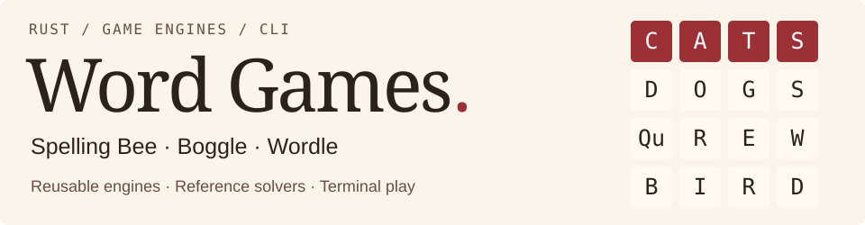
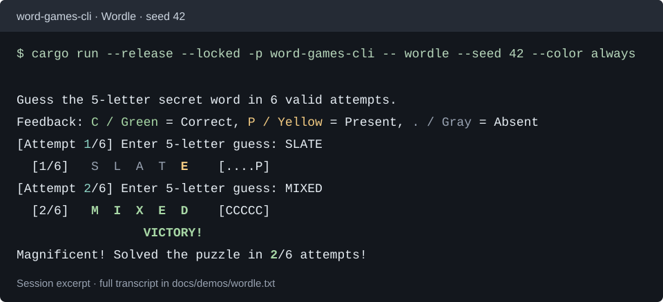

<picture>
  <source media="(prefers-color-scheme: dark)" srcset="docs/assets/header-dark.svg">
  <source media="(prefers-color-scheme: light)" srcset="docs/assets/header-light.svg">
  
</picture>

[](https://github.com/ironLegion88/word-games/actions/workflows/ci.yml)

Three playable terminal games and a reusable dictionary engine, written in Rust. The project keeps independent reference algorithms alongside optimized implementations, with tests for their agreement, input validation, and game state.

## Play

Install [stable Rust with Cargo](https://rust-lang.org/tools/install/), then run these commands from the repository root. The dictionary and curated Wordle answers are bundled.

```sh
git clone https://github.com/ironLegion88/word-games.git
cd word-games
cargo run --release --locked -p word-games-cli -- wordle --seed 42
```

Choose another game, or inspect the trie directly.

```sh
cargo run --release --locked -p word-games-cli -- spelling-bee --difficulty easy --seed 42
cargo run --release --locked -p word-games-cli -- boggle --generator dice --seed 42
cargo run --release --locked -p trie-cli -- --dictionary assets/dictionary.txt
```

Use `/help` during a game. The command-line help lists fixed puzzles, solver choices, custom dictionaries, and answer overrides.

```sh
cargo run --locked -p word-games-cli -- --help
```

`--color never` gives plain-text feedback. See the [CLI guide](docs/CLI_GUIDE.md) for commands, rules, and replay controls.

## In the terminal



The example is captured from the CLI. [Full session and reproduction command](docs/demos/wordle.txt).

| Game | Implemented features | Independent comparison |
| --- | --- | --- |
| **Spelling Bee** | Seven letters with a required center, pangram scoring, hints, seeded generation, and difficulty presets | Full dictionary filtering vs. trie traversal |
| **Boggle** | 4×4, 5×5, and 6×6 boards, eight-way adjacency, `Qu` tiles, scoring, and three generators | Dictionary scan and per-word path search vs. trie-guided DFS |
| **Wordle** | Six attempts, duplicate-letter feedback, keyboard state, and separate guess/answer vocabularies | Marker matching vs. a 26-entry frequency array |

## How it is built

The workspace separates the game engines from terminal input and output.

| Crate | Responsibility |
| --- | --- |
| [`trie`](trie) | Dictionary storage, normalization, loading, traversal, deletion, and compaction |
| [`spelling-bee`](spelling-bee) | Puzzle generation, solutions, hints, and scoring |
| [`boggle`](boggle) | Boards, generators, path validation, solvers, and round state |
| [`wordle`](wordle) | Five-letter lexicons, feedback, keyboard state, and round state |
| [`word-games-cli`](word-games-cli) | Game selection, terminal presentation, and replay |
| [`trie-cli`](trie-cli) | Interactive dictionary inspection and editing |

The trie owns a `Vec<Node>` arena with typed indices and 26-way child arrays. Deletion prunes unused branches and recycles their slots. Compaction remaps live nodes when fragmentation crosses its threshold. Query cursors borrow the trie, and mutations use `&mut Trie`.

Spelling Bee and Boggle use read-only dictionary access. Wordle builds an owned five-letter lexicon and selects answers from a curated subset. Its feedback scorers use fixed arrays.

## Verification

```sh
cargo fmt --all -- --check
cargo clippy --workspace --all-targets --locked -- -D warnings
cargo test --workspace --locked
cargo test --workspace --release --locked
```

The suite includes:

- Seeded trie operations compared with a `HashSet` reference model, plus pruning, slot reuse, compaction, and malformed-input checks.
- A regression against the bundled **178,691-word dictionary**.
- Spelling Bee and Boggle comparisons of complete solution sets.
- **59,049 Wordle guess–target pairs** over a three-letter alphabet, checked against both scorers and an independent oracle.
- CLI subprocess tests for commands, invalid input, replay, and EOF.

The [CI workflow](https://github.com/ironLegion88/word-games/actions/workflows/ci.yml) checks formatting, strict Clippy, and debug/release tests on Ubuntu and Windows. Ubuntu also exercises the benchmark commands. [Testing details and recorded checks](docs/TESTING.md).

## Benchmarks

The stable Rust harnesses use `Instant` and `black_box`. Each comparison checks equal outputs before recording timings.

```sh
cargo bench --locked -p spelling-bee --bench algorithms -- --quick
cargo bench --locked -p boggle --bench algorithms -- --quick --suite all
cargo bench --locked -p wordle --bench algorithms -- --quick
```

Use `--full` for the larger workloads. Spelling Bee prints its summary to the terminal. Boggle and Wordle write each new run to its own directory under `target/benchmarks/`, with the observed compiler, Cargo version, timestamp, OS, and architecture.

[Benchmark methods and recorded runs](docs/BENCHMARKS.md) explain the comparisons. Timings apply to the recorded inputs and environment.

## Documentation

- [CLI guide](docs/CLI_GUIDE.md) — commands, game rules, and examples.
- [Architecture and design](docs/DESIGN_SPECIFICATION.md) — representations, invariants, and game contracts.
- [Testing](docs/TESTING.md) — coverage, reference models, and verification records.
- [Benchmarks](docs/BENCHMARKS.md) — workloads, output locations, and archived reports.
- [Wordle answer curation](docs/WORDLE_CURATION_PROVENANCE.md) — vocabulary policy and fixture hashes.
- [Mastermind reuse map](docs/MASTERMIND_REUSE_MAP.md) — provenance of adapted Wordle components.

## Project context

Developed from a series of Rust word-game assignments at Ashoka University, with Wordle added as an extension. The [assignment specifications](assignments), [implementation history](docs/IMPLEMENTATION_PLAN.md), and [review records](docs/reviews) are retained. Future directions include a richer terminal interface, a graphical interface, and alternative trie representations.
