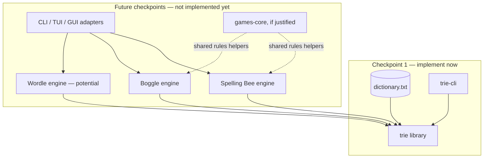
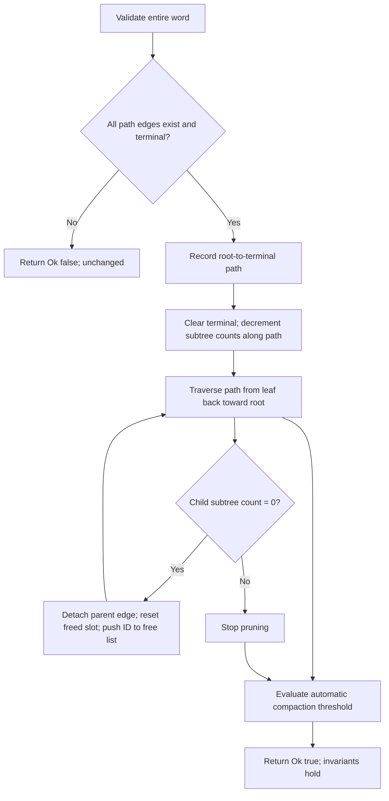
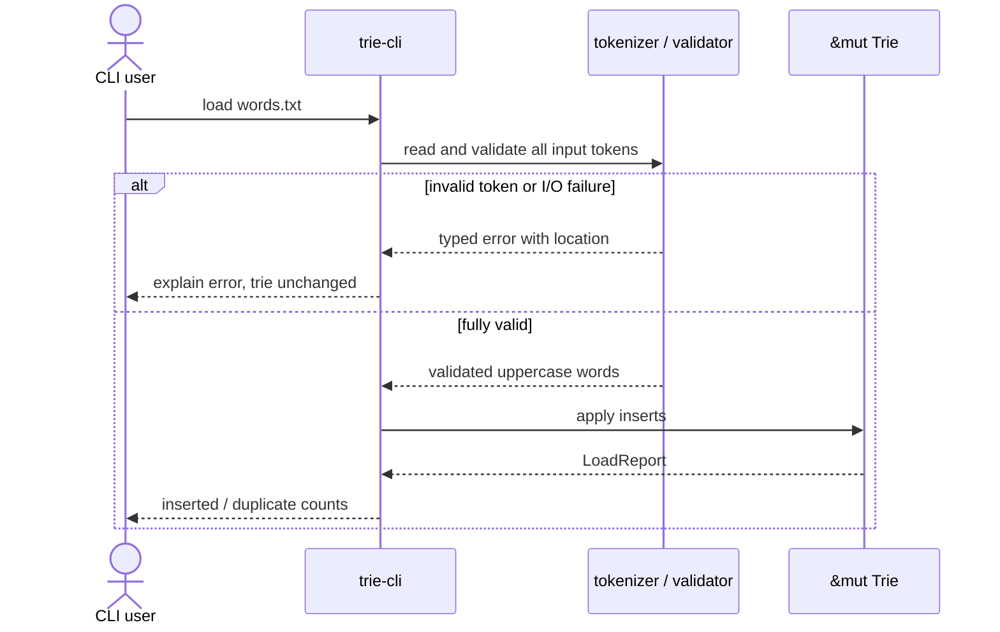
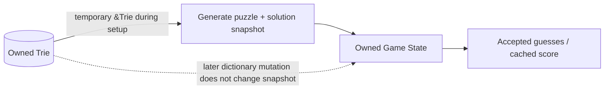

# Word Trie and Word Games — Architecture & Design Specification

**Status:** Approved design for implementation; no code is asserted to exist.  
**First required release checkpoint:** Assignment 1, **Word Games** (`trie` + `trie-cli`) only.  
**Planned subsequent checkpoints:** Assignment 2, Spelling Bee; Assignment 3, Boggle. Wordle, sophisticated TUIs and GUIs are future extensions, not assigned work.  
**Authority:** The three supplied PDFs (`Word Games.pdf`, `Spelling Bee.pdf`, `Boggle.pdf`), the supplied `dictionary.txt`, and the user's recorded design decisions. Where this document goes beyond the PDFs, it is explicitly a project design decision.

## 1. Goals, scope, and delivery boundaries

1. Create one well-encapsulated **Rust trie implementation** that is reused by all present and potential future word games.
2. Fully satisfy **every operation explicitly requested in `Word Games.pdf`** and its `trie`/`trie-cli` workspace shape **before writing any game implementation**.
3. Design clean library boundaries so the trie can be replaced or benchmarked against alternative implementations without rewriting game rules or presentation code.
4. Teach and demonstrate intentional data structures, Rust ownership/borrowing/mutability, `Option`, `Result`, structs/enums, testing, documentation, and Cargo workflows.
5. Support reliable CLI interaction now and eventually separate engine crates, TUI, GUI, and perhaps Wordle.
6. Avoid presenting planned game capabilities as currently implemented in the README, CLI, help text, or test reports.

**Hard stage gate:** An implementing agent MUST finish, test, document, verify, commit, report, and **STOP** after the `trie`/`trie-cli` assignment. Spelling Bee begins only on an explicit subsequent user instruction. Repeat the same stop after Spelling Bee and Boggle. Preparation of this spec is not authorization to implement future stages.

## 2. Assignment traceability and what is not specified

### Assignment 1 — `Word Games.pdf`

The PDF explicitly requires: new empty trie; boolean word lookup; one-word insertion; file-based construction using one word/line **or** comma/whitespace-separated words; lowercase-to-uppercase conversion; one-word deletion; list deletion; filtering an input file into present and absent words. It also requires extensive tests (including manual and generated guesses), modular Rust implementation, ownership/mutability choices, documentation, test-process documentation, and proper Cargo build/check/test/release. Its illustrative layout has a root Cargo workspace with `trie` and `trie-cli` packages. **All these are mandatory in checkpoint 1.**

The PDF does **not** prescribe a child representation, duplicate semantics, malformed-input policy, batch atomicity, concurrency, benchmark thresholds, specific CLI grammar, or physical-reclamation strategy. The rules below are decisions made for this project, not quotations from the instructor.

### Assignment 2 — `Spelling Bee.pdf` (planned; do not implement in checkpoint 1)

Seven **distinct** letters with one central letter; minimum word length four; letter reuse permitted; center mandatory; enumerate all valid words from the dictionary; per-word scoring and bonus for using all seven letters (pangram); unique accepted guesses; alphabetical three-column display; end at all solutions (Queen Bee); reveal score and missed solutions on early quit; optional initial-letter-by-length hint grid and two-letter-prefix counts; polite CLI feedback. Project additions: pangram-anchored seed generation, configurable difficulty/target word count, independent filtering oracle vs trie-pruned enumerator, cached score, deterministic RNG.

### Assignment 3 — `Boggle.pdf` (planned; do not implement in checkpoints 1–2)

Generate an `N×N` board for `N ∈ {4,5,6}`; allow repeated tiles; valid words have at least three letters; each next tile is one of eight adjacent positions; no revisiting **the same tile instance** along a path; dictionary validation; scoring; robust comma/space/newline guess parsing; exit mid-round; non-retractable evaluated guesses; interactive CLI. Timer and `Qu` tiles are optional in the PDF. Project additions: `Qu` counts as two *letters* while using one *cell*; precomputed adjacency; `u64` visited mask; trie-guided DFS primary and on-demand search oracle; immediate feedback; later board-generation methods and quality benchmarks; no timed mode initially.

The Boggle PDF only explicitly specifies **nine-letter words as two points per letter**; the user's extensions fix 9–12 at `2 × length`, 13–14 at `3 × length`, and 15 at `4 × length`. Words >15 are not present in the supplied dictionary; any generalized policy requires a deliberate follow-up decision, not an undocumented guess.

## 3. Verified dictionary facts (input baseline)

The provided `dictionary.txt` is ASCII, alphabetically sorted, uppercase, and one word per line. It contains **178,691 unique words**; `wc -l` reports **178,690 newline characters** because the final line has no trailing newline. Do **not** use `wc -l` as the word-count assertion. The mean word length is approximately **8.867**; lengths range **2–15**. An ordinary, uncompressed trie over the exact data has **395,185 reachable nodes including its root**. The degree distribution: 116,079 nodes with zero children, 214,926 with one, 39,966 with two. Approximately 93.87% have at most two children. These are regression reference values for the supplied, unmodified dictionary; do not make them hard-coded product limits.

A `u32` node ID accommodates this dictionary. This empirical fit does not remove the need for capacity-overflow checks.

## 4. Evolutionary workspace structure

**Checkpoint 1 only (must exist for first submission):**

```text
word-trie/
├── Cargo.toml                         # [workspace] members = ["trie", "trie-cli"]
├── Cargo.lock
├── README.md                          # accurate CURRENT state, not a roadmap disguised as features
├── docs/
│   ├── DESIGN_SPECIFICATION.md
│   ├── IMPLEMENTATION_PLAN.md
│   └── TESTING.md
├── assets/
│   └── dictionary.txt                 # provided fixture (review size/license handling)
├── trie/
│   ├── Cargo.toml
│   ├── src/{lib.rs,node.rs,letter.rs,error.rs,loading.rs,traversal.rs}
│   └── tests/{operations.rs,loading.rs,regression.rs,randomized.rs}
└── trie-cli/
    ├── Cargo.toml
    ├── src/{main.rs,commands.rs,repl.rs}
    └── tests/cli.rs
```

**Future evolution (ONLY after explicit authorization):**

```text
word-trie/
├── word-games-core/                   # create ONLY when verified shared game concerns arise
├── spelling-bee/                      # independent game engine, no UI dependency
├── boggle/                            # independent game engine, no UI dependency
├── wordle/                            # possible extension, not requested now
├── word-games-cli/                    # terminal presentation/interactive driver
├── word-games-tui/                    # potential future rich terminal UI
└── word-games-gui/                    # potential future GUI
```

The earlier “Option C” was interpreted as **granular, extensible engine/UI separation**, *not* creating empty crates up front. Never add an empty crate simply to make the directory tree look finished. Keep `trie-cli` independently runnable as required by the original PDF.



## 5. Trie representation — chosen initial implementation

**Selected:** indexed arena, fixed 26-slot alphabet lookup, `u32` IDs, subtree word counts, bottom-up pruning, free-slot reuse, and threshold-based automatic compaction.

Illustrative *private*, not public, types:

```rust
const ALPHABET_SIZE: usize = 26;
const NO_CHILD: u32 = u32::MAX;

#[derive(Clone, Copy, Debug, Eq, PartialEq)]
struct NodeId(u32);

struct Node {
    children: [u32; ALPHABET_SIZE], // NO_CHILD means absent
    is_word: bool,
    subtree_words: u32,             // active words in this node's subtree
}

pub struct Trie {
    nodes: Vec<Node>,                // root always NodeId(0)
    free_list: Vec<NodeId>,          // indices ready for safe reuse
    word_count: usize,
    live_node_count: usize,
}
```

The sentinel is a design choice to avoid a typical eight-byte `Option<u32>` slot. An `Option<NonZeroU32>` representation could also be compact, but would require an off-by-one ID mapping. Expose neither sentinel nor indices publicly. `[u32;26]` costs 104 bytes; with `u32` count and `bool` flag the `Node` is typically **112 bytes on conventional 64-bit targets** (verify by `size_of::<Node>()`; do not assert a cross-target ABI guarantee). At 395,185 live nodes the nominal payload is about 42.2 MiB, excluding vector capacity and temporary allocations.

**Rationale:** direct child lookup is O(1) per ASCII letter; contiguous arena storage eliminates hundreds of thousands of per-node heap allocations; all nodes are owned by exactly one `Trie`; safe indices avoid self-referential borrowing and raw pointers; game clients never rely on representation specifics.

**Deliberately deferred comparisons:** boxed `[Option<Box<Node>>;26]`, a sparse adaptive `SmallVec` child container, and map-based children (`HashMap`/`BTreeMap`). Benchmark later against identical dictionary and workloads; do not build them in checkpoint 1. The original dictionary's highly sparse nodes make adaptive children a plausible memory win, not an assumed one.

### 5.1 Invariants (assert/test continuously)

1. Slot 0 always contains the root and is never on the free list.
2. Every live reachable child ID is valid (`< nodes.len()`), unique as a child edge, and **not** in the free list.
3. No freed slot is reachable from the root; no free-list index occurs twice.
4. Every live nonroot node has at least one active word in its subtree; the root may have zero.
5. `subtree_words(v) = is_word(v) as u32 + Σ subtree_words(child)` for reachable children.
6. `word_count == root.subtree_words as usize`; inserting a duplicate does not change counts; removing an absent word does not change counts.
7. Edges represent only ASCII `A`–`Z` indexed `0..26`; empty string is never a stored word.
8. All transient `NodeId`s stay inside the owning `Trie` or immutable cursors; no public persistable raw node ID.
9. If `nodes.len()` would make `NO_CHILD` a valid allocated index, return capacity error, do not wrap.
10. All public operations leave the trie valid after success or reported recoverable failure.

### 5.2 Insert algorithm and borrowing

Validate and ASCII-normalize the *entire input* before any mutation. Use index-based loops and short scopes rather than retaining references into `nodes` across a possible `push()`. Look up whether the entire word already exists; if so return `Ok(false)` with no count changes. For a new word, follow or create missing edges, preferring `free_list.pop()` to arena growth. Set terminal flag, increment counts once along the root-to-word path, and increment `word_count`. Boundary/capacity errors must not leave partial edges; either preflight resources/maximum IDs or implement rollback for failures after editing starts. The simplest first implementation can prepare the missing suffix and check caps before linking it.

### 5.3 Delete algorithm — physical pruning PLUS reclamation



*Immediate physical reclamation* means unlink dead nodes, clear their storage and place their actual arena slots on the free list for reuse **during the deletion operation**. This differs from merely flipping an `is_word` flag. However, free-list reuse alone does **not** return capacity to the operating system. To address the user's requirement for automatic memory reclamation more fully, employ **automatic compaction** when fragmentation is material: for example, `free_list.len() >= 4096` **and** `free_list.len() * 3 >= nodes.len()` (thresholds internal and testable). Compaction creates a new dense arena, traverses only reachable nodes, remaps every child ID and root, clears the free list, and attempts `shrink_to_fit()`. Prefer a single post-batch compaction check for a bulk-delete rather than compacting after every individual word. Compaction is O(number of live nodes + edges), can temporarily require extra memory, and is permitted only under `&mut self`. Document that `shrink_to_fit` requests capacity reduction but does not guarantee immediate OS RSS reduction. A compacting `Vec` must *never* simply remove a non-tail slot without remapping references.

Physical reclamation must be verifiable by tests: delete a unique branch -> reachable node count falls -> free-list count rises; reinsert -> freed IDs reused; trigger compaction -> arena length/capacity converge to active nodes and all words remain correct.

### 5.4 Asymptotic behavior

For word length `L`: `contains`, `insert` (without compaction), and `remove` (without compaction) are O(L), because each child lookup is fixed-width. Deletion can include occasional O(N) automatic compaction; **do not** advertise strict worst-case O(L) for every delete. Trie traversal is O(number of visited nodes/edges + emitted characters). Arena capacity is O(live nodes + reusable free nodes), with periodic compaction reducing fragmentation.

## 6. Canonical input, types, and mutability

- **Alphabet:** `Letter(u8)` newtype holding an index `0..=25`, with a validated ASCII constructor and methods `index()` and `to_char()`. It is `Copy`, `Clone`, `Eq`, `Hash`, `Debug` where useful; raw field is private.
- **Word inputs:** `&str` in public APIs; avoid cloning caller-owned strings just to lookup/insert. Implement ASCII normalization in one place. `contains` should not allocate on already-uppercase data; lowercase accepted. Reject digits, punctuation, hyphens, non-ASCII, and embedded whitespace as part of a *single word*. Empty word rejected for insert/remove; `contains("") == false`. The empty **prefix** is valid: `has_prefix("") == true` (even for an empty trie).
- **ASCII normalization:** `to_ascii_uppercase`, byte-wise lowercase conversion, or `Cow<'_, str>` only after validating ASCII. Do not use Unicode uppercase expansion or silently strip unwanted characters.
- **NodeId:** `u32` newtype privately; no `Rc`, `Arc`, raw pointers, or unsafe memory management inside initial trie.
- **Counts:** `subtree_words: u32`, `word_count: usize`, with capacity limits/overflow checked and documented; `usize` for in-memory vector indices after checked conversion.
- **Mutable:** the trie only through `&mut Trie` during insert, delete, batch updates/compaction; owned CLI input buffer; temporary DFS/path buffers; RNG internal state; game guesses and cached score (later).
- **Immutable:** constants; `&Trie` query borrows; final puzzle letters, board, solution sets; parsed `&str` view; validated configuration; immutable external cursor.
- **Output:** `Option` for absence, `Result` for invalid input/I/O/capacity errors, `bool` for membership and boolean changed/unchanged status; typed game outcomes later.

## 7. Proposed stable public interface for checkpoint 1

Signatures are contracts; an implementer may place them in distinct source files but must preserve semantics. Explicitly document any unavoidable signature adjustments before coding.

```rust
pub struct Trie { /* private */ }
pub struct TrieCursor<'a> { /* private, immutable cursor */ }

#[derive(Clone, Copy, Debug, PartialEq, Eq)]
pub enum Membership { Present, Absent }

impl Trie {
    pub fn new() -> Self;
    pub fn len(&self) -> usize;
    pub fn is_empty(&self) -> bool;
    pub fn contains(&self, word: &str) -> bool;
    pub fn try_contains(&self, word: &str) -> Result<bool, WordError>;
    pub fn has_prefix(&self, prefix: &str) -> bool;
    pub fn insert(&mut self, word: &str) -> Result<bool, WordError>;
    pub fn remove(&mut self, word: &str) -> Result<bool, WordError>;
    pub fn remove_words<'a, I>(&mut self, words: I) -> Result<BatchReport, WordError>
        where I: IntoIterator<Item = &'a str>;
    pub fn from_reader<R: std::io::BufRead>(reader: R) -> Result<Self, LoadError>;
    pub fn extend_from_reader<R: std::io::BufRead>(
        &mut self, reader: R
    ) -> Result<LoadReport, LoadError>;
    pub fn cursor(&self) -> TrieCursor<'_>;
    pub fn visit_words(&self, visitor: impl FnMut(&str));
    pub fn stats(&self) -> TrieStats;
}

impl<'a> TrieCursor<'a> {
    pub fn advance(self, letter: Letter) -> Option<Self>;
    pub fn is_word(&self) -> bool;
    pub fn has_children(&self) -> bool;
}
```

**`contains` behavior:** invalid words return `false` without panic; `try_contains` explains invalid input with a `WordError`. `has_prefix` returns `false` for invalid input; empty prefix is `true`. `insert`/`remove` reject malformed/empty words as `Err`, and return `Ok(true)` iff actual dictionary content changes; duplicate insert or absent delete returns `Ok(false)`.

**Batch semantics:** validate the whole batch before mutation; duplicate inputs counted but do not mutate twice; no partial mutation on malformed token/I/O failure. For very large inputs, explain temporary token buffering trade-offs. `LoadReport` should expose `tokens_seen`, `inserted`, `already_present`, and optionally source identifier. `BatchReport` should expose `requested`, `removed`, `not_found`, with well-defined duplicate semantics: `requested` counts every token, `removed` counts distinct successful removals, subsequent duplicate removals are `not_found`. Use consistent types/semantics across API, CLI, and tests.

**Membership file filtering:** provide reusable library helpers that load comma/ASCII-whitespace-separated tokens and return an ordered `Vec<String>` of present **or** absent normalized words. Preserve input order and duplicates, not set semantics. Validate inputs explicitly and include location in diagnostics. Make both modes accessible through `trie-cli`.

**Normalization helper:** expose an explicit public uppercase routine for assignment traceability (`normalize_word(&str) -> Result<Cow<'_, str>, WordError>` or equivalent) even if internal methods normalize automatically.

**Trait decision:** no `WordDictionary` trait in checkpoint 1; concrete `Trie` is enough. Preserve an encapsulated cursor/visitor interface so alternatives can be benchmarked later. Do not expose nodes, arena, or free list.

## 8. Parsing and error policy

- Accept one-word-per-line files, comma-separated files, and mixed ASCII-whitespace/comma separators, including `\r\n` and no final newline.
- Treat repeated separators and blank lines as separators, not empty words.
- Reject unknown separators such as `;`, digits, punctuation, and non-ASCII letters; do not silently drop invalid characters. Optionally tolerate one UTF-8 BOM at the beginning only, with tests and clear documentation.
- Use `BufRead` so memory use and I/O are separated cleanly; parsing should report line/column or line/token position for malformed tokens.
- For `from_reader`, build a new trie locally and only return it after successful validation/loading. For `extend_from_reader` and file-driven deletions, tokenize/validate first, then mutate so recoverable input errors leave the existing trie unchanged. Rust allocation failure is not promised as a recoverable transaction.
- Errors should be typed: `WordError` for empty/non-ASCII/invalid characters/capacity; `LoadError` for I/O plus source position/underlying `WordError`. Retain error chains where possible. Never panic for normal malformed user input.



## 9. CLI behavior for checkpoint 1

Keep CLI presentation separate from `trie` internals. A small interactive REPL and optional command-line `--dictionary <path>` startup load satisfy the terminal interface. No heavy UI framework is needed yet. Suggested commands:

```text
help                        show commands
new                         replace dictionary with empty trie
load <path>                 replace with freshly loaded trie (atomic)
add-file <path>             validate then append all tokens
insert <word>               insert one word
contains <word>             boolean membership, with informative error
remove <word>               remove one word
remove-file <path>          delete list of words
present <path>              print ordered words found in trie
absent <path>               print ordered words missing from trie
normalize <word>            show uppercase conversion
stats                       words, reachable nodes, arena slots, free slots
quit / exit                 terminate gracefully
```

For file commands, treat the rest of the line as path so spaces in filenames are supported; support optional matching surrounding quotes if implementing quoted paths. Commands are case-insensitive, dictionary words are case-normalized, and `Ctrl+D`/EOF exits cleanly. Never reserve an unprefixed dictionary word as a game command in future game CLIs; prefer slash commands such as `/quit` there.

CLI errors should neither panic nor corrupt the dictionary. File filtering should report outputs clearly and preserve input sequence. Programmatic parsing functions and CLI subprocess tests should verify exact behavior.

## 10. Ownership and lifetime boundary for later games

**Two explicit decisions are compatible:** the dictionary is passed as immutable **`&Trie`**, and each completed **game session owns its precomputed solution set**. A game's constructor or solution-generator borrows `&Trie` temporarily and produces owned `GameState`; the resulting game need not contain `&Trie` or a lifetime parameter. A later mutation to the dictionary does **not** update an already-started session's solution snapshot. This must be documented in games' UI/help and verified by tests.



Rust borrowing limitation: while a shared `&Trie` borrow is live, code cannot take `&mut Trie`. The short-lived setup borrow minimizes that limitation. To edit the dictionary during a round, either finish and regenerate the round or deliberately introduce more advanced snapshot/versioning logic later. Do not introduce `Rc`, `Arc`, `RefCell`, `Mutex`, or `RwLock` preemptively.

## 11. Spelling Bee future design (checkpoint 2 only)

- Engine crate `spelling-bee` has no terminal input/output dependency. Store an immutable `[Letter;7]` in center-first display order, center `Letter`, `u32` allowed-bitmask, immutable sorted `Vec<String>` solutions, mutable `BTreeSet<String>` accepted guesses, cached `u32` running score.
- Word mask is `OR(1 << Letter.index())`, allowing repeated letters; accepted words have length at least four, contain center, and have no bits outside allowed. Pangram iff distinct-letter mask matches allowed mask.
- Implement (a) exhaustive `visit_words` filtering **as a correctness oracle first**, then (b) pruned trie cursor traversal **as production**. Tests must compare **complete sorted sets** for random/fixed puzzles, including zero-solution cases. Benchmark setup runtime/memory for both.
- Puzzle generator chooses an existing dictionary word with **exactly seven distinct letters** as a pangram anchor, extracts its seven-letter set, selects a center, computes solutions, and accepts/grades puzzle by configurable difficulty and target count range. Use injected seedable RNG, bounded retry count, deterministic fallback or clear `NoSuitablePuzzle` error. Pangram anchor guarantees at least one potential pangram given the chosen center (since it contains all seven). Distribution is **not uniform**; bias must be documented. Different centers for the same letters may give different solution counts.
- Difficulty is a versioned configuration based on observable quantities (solution count, length mix, pangram count, letter frequency or score potential), not an unexplained magic label; keep thresholds configurable.
- Score: 4-letter = 1, length ≥5 = length, plus configurable 7-point pangram bonus (project default; PDF leaves choice open). Cache running total only after a **new** accepted guess. Invariant `cached_score == Σscore(accepted)`; duplicate/invalid submissions must not change it. Completion iff accepted set equals solution set; early quit reports missed words and score.
- Generate optional hints from frozen solutions, not from guessed words or a new trie traversal; render sorted guesses alphabetically in three terminal columns. Give immediate typed feedback.

## 12. Boggle future design (checkpoint 3 only)

- Engine `boggle` stores immutable validated `Grid { size: usize, tiles: Vec<Tile> }`, size in `{4,5,6}`, `Tile::Letter(Letter) | Tile::Qu`, precomputed adjacency vectors (at most eight neighbors/cell), immutable sorted solution snapshot, mutable accepted guesses and cached score.
- Index cells by `r*N+c`. A `u64` visited mask holds up to 36 cell flags. Passing a mask by value into DFS preserves branch independence. In `Qu`, advance trie cursor by `Q` **then** `U`, visit the tile once, and count two spelled letters for minimum length/scoring.
- Preferred solver: trie-guided DFS from each starting cell, stopping when the prefix cursor fails, recording terminal words length ≥3, deduplicating paths by word. Build a simpler **on-demand per-guess DFS validator** as an independent oracle/backup; compare identical results for fixed boards and generated boards. Benchmark both over varying sizes, vowel distributions, and repeated-letter boards; report worst-case search-work/latency.
- Generate boards with (1) uniform letter sampling first; (2) frequency-weighted later; (3) dice-like sampling later. Compare quality using valid-solution count, reachable score, word-length mix, vowel balance, solve time and repeatability; do not assert one distribution is better without measurement. Allow deterministic seed injection.
- Scoring from project decision: lengths 3–4 →1; 5→2; 6→3; 7→5; 8→11; 9–12→`2*len`; 13–14→`3*len`; 15→`4*len`. Reject/deliberately specify behavior for >15-letter words if later dictionaries permit them.
- Case-normalize guesses and reject punctuation/hyphens; supplied dictionary lacks metadata to identify proper nouns, so proper-noun exclusion cannot be reliable. Q-without-U spellings are initially unsupported by `Qu` board tiles (and this limitation must appear in docs). Untimed game first; optional timeouts, difficulty-based board generation, and size-dependent timers later.
- Precompute all solutions with a temporary `&Trie`, own solutions afterward, and give immediate feedback. No retracting accepted/evaluated guesses. Robust mixed-delimiter batch input and graceful `/quit`.

## 13. Automated testing and release documentation contracts

Every crate and phase must have small deterministic unit tests, integration tests, generated/reference-model tests, invalid-input tests, invariant tests, and (where justified) benchmark artifacts. Core trie oracle: `HashSet<String>` with deterministic seeds; compare every operation and sorted final word set. Test free-list double-free and index integrity under repeated delete/reinsert, compaction triggers, preserved prefixes, and bulk-input failures. Verify the entire supplied dictionary and exact baseline statistics. Document randomized seeds, test quantities, commands, outcomes, benchmark environment, and limitations.

**Authoritative documentation files:** `README.md` is the landing page describing what **actually works now** (features, installation, commands, running examples, tests); `docs/TESTING.md` records what **has actually been executed**, its evidence and the planned test matrix. `docs/DESIGN_SPECIFICATION.md` contains architecture/decisions and `docs/IMPLEMENTATION_PLAN.md` has tasks/gates. Keep all four accurate with every material change.

**Mandatory checkpoint re-verification:** At each of the three assignment checkpoints, inspect source/Cargo workspace/CLI help/tests, reconcile claims in README and TESTING, run documented commands, correct inaccurate sections, update dated checkpoint evidence, and only then commit/finalize the checkpoint. A green test run is not a substitute for checking documentation against repository behavior.

## 14. Decisions explicitly deferred

1. Future boxed/adaptive/map trie implementations and their performance comparison.
2. New traits if/when there is a real alternative backend.
3. Rich TUI/GUI, concurrent game sessions, persistence, distribution, networking.
4. Wordle and any game-specific vocabulary curation.
5. Timed Boggle, later Boggle generation methods, puzzle difficulty/timer tuning.
6. Policy for >15-letter Boggle words on dictionaries other than the supplied input.
7. Any dictionary modification during an already-started game's immutable solution snapshot.

The implementing agent may identify additional questions but must choose the smallest safe and documented assumption **only where this spec does not already settle behavior**. A material deviation from a selected design requires explicit user authorization.
