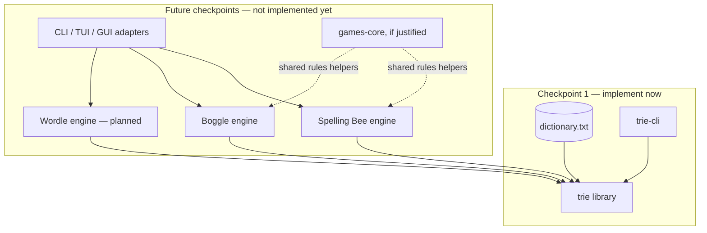
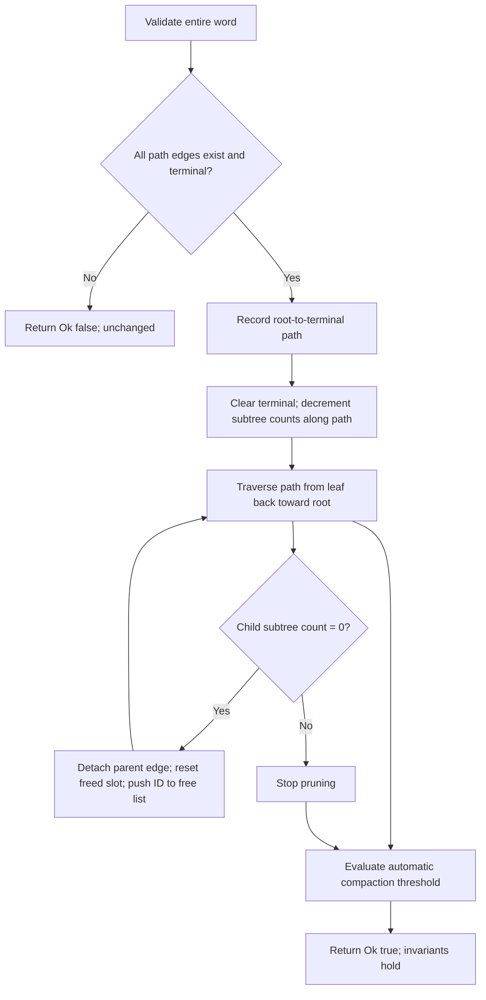
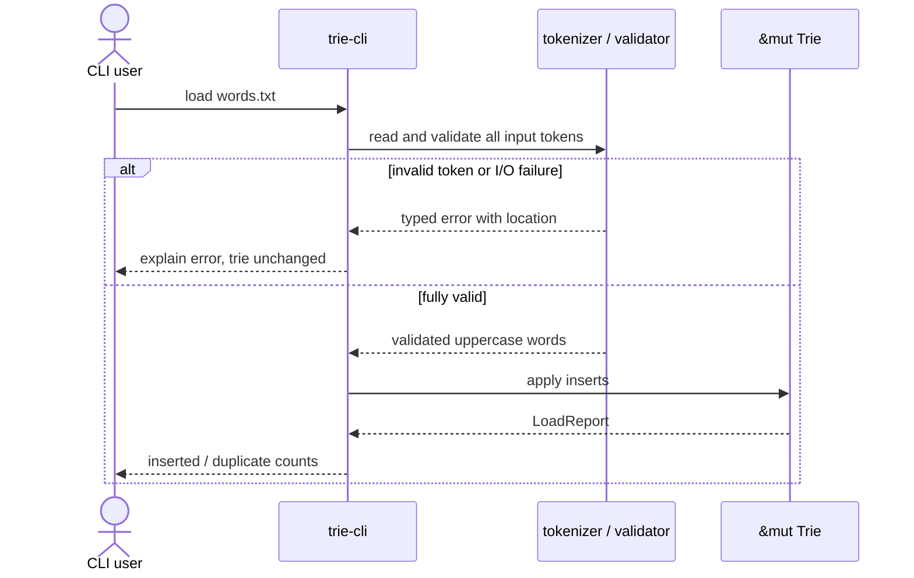
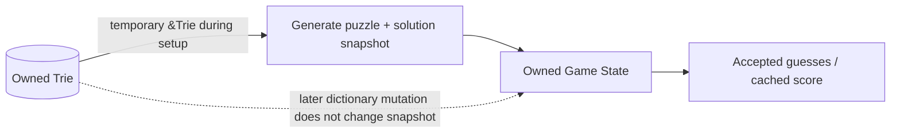
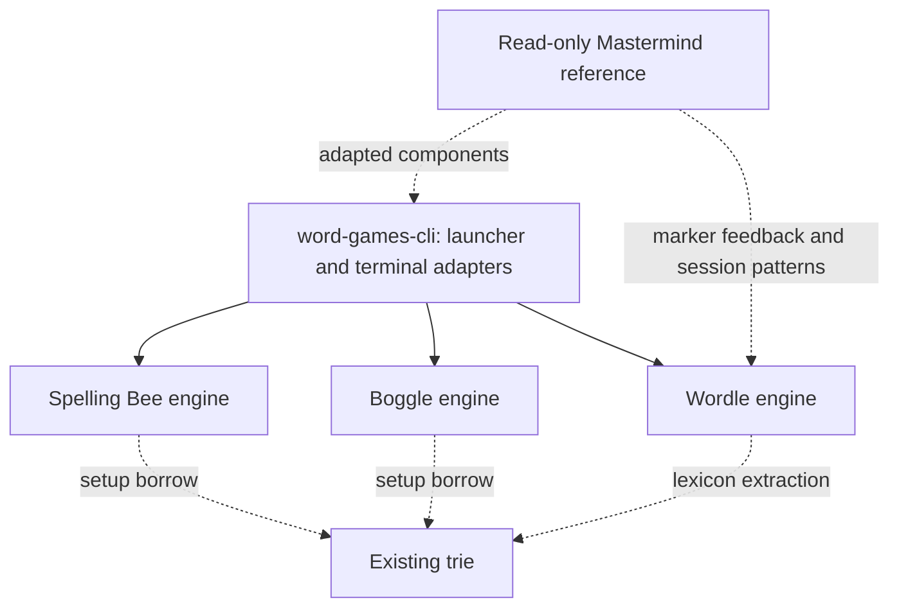

# Word Trie and Word Games — Architecture & Design Specification

**Status:** Approved design; Assignment 1 (`trie` + `trie-cli`) fully implemented and verified.<br>
**First required release checkpoint:** Assignment 1, **Word Games** (`trie` + `trie-cli`) only — **COMPLETED**.<br>
**Approved subsequent checkpoints (code not yet implemented):** Spelling Bee, Boggle, then Wordle as a project extension. Dedicated prompts activate one game at a time. Rich TUI/GUI applications remain future scope.
**Scope revision:** 2026-11-02; additive game contracts begin at section 15. Earlier trie design and checkpoint history are retained.
**Authority:** The three supplied PDFs (`Word Games.pdf`, `Spelling Bee.pdf`, `Boggle.pdf`), the supplied `dictionary.txt`, and the user's recorded design decisions. Where this document goes beyond the PDFs, it is explicitly a project design decision.

## 1. Goals, scope, and delivery boundaries

1. Create one well-encapsulated **Rust trie implementation** that is reused by all present and potential future word games.
2. Fully satisfy **every operation explicitly requested in `Word Games.pdf`** and its `trie`/`trie-cli` workspace shape **before writing any game implementation**.
3. Design clean library boundaries so the trie can be replaced or benchmarked against alternative implementations without rewriting game rules or presentation code.
4. Teach and demonstrate intentional data structures, Rust ownership/borrowing/mutability, `Option`, `Result`, structs/enums, testing, documentation, and Cargo workflows.
5. Support reliable CLI interaction now and eventually separate engine crates, TUI, GUI, and perhaps Wordle.
6. Avoid presenting planned game capabilities as currently implemented in the README, CLI, help text, or test reports.

**Stage gate:** Assignment 1 is complete. Invoking a dedicated game prompt authorizes only that game on its own branch, including the documented independent subagent review and local merge into `main`. Finish the current game, resolve review findings, verify documentation and checks, merge, report, and **STOP**. Boggle requires merged Spelling Bee; Wordle requires both games merged. This documentation update itself does not implement a game.

## 2. Assignment traceability and what is not specified

### Assignment 1 — `Word Games.pdf`

The PDF explicitly requires: new empty trie; boolean word lookup; one-word insertion; file-based construction using one word/line **or** comma/whitespace-separated words; lowercase-to-uppercase conversion; one-word deletion; list deletion; filtering an input file into present and absent words. It also requires extensive tests (including manual and generated guesses), modular Rust implementation, ownership/mutability choices, documentation, test-process documentation, and proper Cargo build/check/test/release. Its illustrative layout has a root Cargo workspace with `trie` and `trie-cli` packages. **All these are mandatory in checkpoint 1.**

The PDF does **not** prescribe a child representation, duplicate semantics, malformed-input policy, batch atomicity, concurrency, benchmark thresholds, specific CLI grammar, or physical-reclamation strategy. The rules below are decisions made for this project, not quotations from the instructor.

### Assignment 2 — `Spelling Bee.pdf` (planned; do not implement in checkpoint 1)

Seven **distinct** letters with one central letter; minimum word length four; letter reuse permitted; center mandatory; enumerate all valid words from the dictionary; per-word scoring and bonus for using all seven letters (pangram); unique accepted guesses; alphabetical three-column display; end at all solutions (Queen Bee); reveal score and missed solutions on early quit; optional initial-letter-by-length hint grid and two-letter-prefix counts; polite CLI feedback. Project additions: pangram-anchored seed generation, configurable difficulty/target word count, independent filtering oracle vs trie-pruned enumerator, cached score, deterministic RNG.

### Assignment 3 — `Boggle.pdf` (planned; do not implement in checkpoints 1–2)

Generate an `N×N` board for `N ∈ {4,5,6}`; allow repeated tiles; valid words have at least three letters; each next tile is one of eight adjacent positions; no revisiting **the same tile instance** along a path; dictionary validation; scoring; robust comma/space/newline guess parsing; exit mid-round; non-retractable evaluated guesses; interactive CLI. Timer and `Qu` tiles are optional in the PDF. Project additions: `Qu` counts as two *letters* while using one *cell*; precomputed adjacency; `u64` visited mask; trie-guided DFS primary and on-demand search oracle; immediate feedback; later board-generation methods and quality benchmarks; no timed mode initially.

The Boggle PDF only explicitly specifies **nine-letter words as two points per letter**; the user's extensions fix 9–12 at `2 × length`, 13–14 at `3 × length`, and 15 at `4 × length`. Words >15 are not present in the supplied dictionary. The approved extension for custom dictionaries is `4 × length` for **every length ≥15**, with checked score arithmetic.

## 3. Verified dictionary facts (input baseline)

The provided `dictionary.txt` is ASCII, alphabetically sorted, uppercase, and one word per line. It contains **178,691 unique words**; `wc -l` reports **178,690 newline characters** because the final line has no trailing newline. Do **not** use `wc -l` as the word-count assertion. The mean word length is approximately **8.867**; lengths range **2–15**. An ordinary, uncompressed trie over the exact data has **395,185 reachable nodes including its root**. The degree distribution: 116,079 nodes with zero children, 214,926 with one, 39,966 with two. Approximately 93.87% have at most two children. These are regression reference values for the supplied, unmodified dictionary; do not make them hard-coded product limits.

A `u32` node ID accommodates this dictionary. This empirical fit does not remove the need for capacity-overflow checks.

## 4. Evolutionary workspace structure

**Checkpoint 1 only (must exist for first submission):**

```text
word-trie/
├── Cargo.toml                         # [workspace] members = ["trie", "trie-cli"]
├── Cargo.lock
├── README.md                          # accurate CURRENT state, not a roadmap disguised as features
├── docs/
│   ├── DESIGN_SPECIFICATION.md
│   ├── IMPLEMENTATION_PLAN.md
│   └── TESTING.md
├── assets/
│   └── dictionary.txt                 # provided fixture (review size/license handling)
├── trie/
│   ├── Cargo.toml
│   ├── src/{lib.rs,node.rs,letter.rs,error.rs,loading.rs,traversal.rs}
│   └── tests/{operations.rs,loading.rs,regression.rs,randomized.rs}
└── trie-cli/
    ├── Cargo.toml
    ├── src/{main.rs,commands.rs,repl.rs}
    └── tests/cli.rs
```

**Approved evolution (create each crate only when its game prompt is invoked):**

```text
word-trie/
├── word-games-core/                   # create ONLY when verified shared game concerns arise
├── spelling-bee/                      # independent game engine, no UI dependency
├── boggle/                            # independent game engine, no UI dependency
├── wordle/                            # approved extension after both earlier games
├── word-games-cli/                    # terminal presentation/interactive driver
├── word-games-tui/                    # potential future rich terminal UI
└── word-games-gui/                    # potential future GUI
```

The earlier “Option C” was interpreted as **granular, extensible engine/UI separation**, *not* creating empty crates up front. Never add an empty crate simply to make the directory tree look finished. Keep `trie-cli` independently runnable as required by the original PDF.



## 5. Trie representation — chosen initial implementation

**Selected:** indexed arena, fixed 26-slot alphabet lookup, `u32` IDs, subtree word counts, bottom-up pruning, free-slot reuse, and threshold-based automatic compaction.

Illustrative *private*, not public, types:

```rust
const ALPHABET_SIZE: usize = 26;
const NO_CHILD: u32 = u32::MAX;

#[derive(Clone, Copy, Debug, Eq, PartialEq)]
struct NodeId(u32);

struct Node {
    children: [u32; ALPHABET_SIZE], // NO_CHILD means absent
    is_word: bool,
    subtree_words: u32,             // active words in this node's subtree
}

pub struct Trie {
    nodes: Vec<Node>,                // root always NodeId(0)
    free_list: Vec<NodeId>,          // indices ready for safe reuse
    word_count: usize,
    live_node_count: usize,
}
```

The sentinel is a design choice to avoid a typical eight-byte `Option<u32>` slot. An `Option<NonZeroU32>` representation could also be compact, but would require an off-by-one ID mapping. Expose neither sentinel nor indices publicly. `[u32;26]` costs 104 bytes; with `u32` count and `bool` flag the `Node` is typically **112 bytes on conventional 64-bit targets** (verify by `size_of::<Node>()`; do not assert a cross-target ABI guarantee). At 395,185 live nodes the nominal payload is about 42.2 MiB, excluding vector capacity and temporary allocations.

**Rationale:** direct child lookup is O(1) per ASCII letter; contiguous arena storage eliminates hundreds of thousands of per-node heap allocations; all nodes are owned by exactly one `Trie`; safe indices avoid self-referential borrowing and raw pointers; game clients never rely on representation specifics.

**Deliberately deferred comparisons:** boxed `[Option<Box<Node>>;26]`, a sparse adaptive `SmallVec` child container, and map-based children (`HashMap`/`BTreeMap`). Benchmark later against identical dictionary and workloads; do not build them in checkpoint 1. The original dictionary's highly sparse nodes make adaptive children a plausible memory win, not an assumed one.

### 5.1 Invariants (assert/test continuously)

1. Slot 0 always contains the root and is never on the free list.
2. Every live reachable child ID is valid (`< nodes.len()`), unique as a child edge, and **not** in the free list.
3. No freed slot is reachable from the root; no free-list index occurs twice.
4. Every live nonroot node has at least one active word in its subtree; the root may have zero.
5. `subtree_words(v) = is_word(v) as u32 + Σ subtree_words(child)` for reachable children.
6. `word_count == root.subtree_words as usize`; inserting a duplicate does not change counts; removing an absent word does not change counts.
7. Edges represent only ASCII `A`–`Z` indexed `0..26`; empty string is never a stored word.
8. All transient `NodeId`s stay inside the owning `Trie` or immutable cursors; no public persistable raw node ID.
9. If `nodes.len()` would make `NO_CHILD` a valid allocated index, return capacity error, do not wrap.
10. All public operations leave the trie valid after success or reported recoverable failure.

### 5.2 Insert algorithm and borrowing

Validate and ASCII-normalize the *entire input* before any mutation. Use index-based loops and short scopes rather than retaining references into `nodes` across a possible `push()`. Look up whether the entire word already exists; if so return `Ok(false)` with no count changes. For a new word, follow or create missing edges, preferring `free_list.pop()` to arena growth. Set terminal flag, increment counts once along the root-to-word path, and increment `word_count`. Boundary/capacity errors must not leave partial edges; either preflight resources/maximum IDs or implement rollback for failures after editing starts. The simplest first implementation can prepare the missing suffix and check caps before linking it.

### 5.3 Delete algorithm — physical pruning PLUS reclamation



*Immediate physical reclamation* means unlink dead nodes, clear their storage and place their actual arena slots on the free list for reuse **during the deletion operation**. This differs from merely flipping an `is_word` flag. However, free-list reuse alone does **not** return capacity to the operating system. To address the user's requirement for automatic memory reclamation more fully, employ **automatic compaction** when fragmentation is material: for example, `free_list.len() >= 4096` **and** `free_list.len() * 3 >= nodes.len()` (thresholds internal and testable). Compaction creates a new dense arena, traverses only reachable nodes, remaps every child ID and root, clears the free list, and attempts `shrink_to_fit()`. Prefer a single post-batch compaction check for a bulk-delete rather than compacting after every individual word. Compaction is O(number of live nodes + edges), can temporarily require extra memory, and is permitted only under `&mut self`. Document that `shrink_to_fit` requests capacity reduction but does not guarantee immediate OS RSS reduction. A compacting `Vec` must *never* simply remove a non-tail slot without remapping references.

Physical reclamation must be verifiable by tests: delete a unique branch -> reachable node count falls -> free-list count rises; reinsert -> freed IDs reused; trigger compaction -> arena length/capacity converge to active nodes and all words remain correct.

### 5.4 Asymptotic behavior

For word length `L`: `contains`, `insert` (without compaction), and `remove` (without compaction) are O(L), because each child lookup is fixed-width. Deletion can include occasional O(N) automatic compaction; **do not** advertise strict worst-case O(L) for every delete. Trie traversal is O(number of visited nodes/edges + emitted characters). Arena capacity is O(live nodes + reusable free nodes), with periodic compaction reducing fragmentation.

## 6. Canonical input, types, and mutability

- **Alphabet:** `Letter(u8)` newtype holding an index `0..=25`, with a validated ASCII constructor and methods `index()` and `to_char()`. It is `Copy`, `Clone`, `Eq`, `Hash`, `Debug` where useful; raw field is private.
- **Word inputs:** `&str` in public APIs; avoid cloning caller-owned strings just to lookup/insert. Implement ASCII normalization in one place. `contains` should not allocate on already-uppercase data; lowercase accepted. Reject digits, punctuation, hyphens, non-ASCII, and embedded whitespace as part of a *single word*. Empty word rejected for insert/remove; `contains("") == false`. The empty **prefix** is valid: `has_prefix("") == true` (even for an empty trie).
- **ASCII normalization:** `to_ascii_uppercase`, byte-wise lowercase conversion, or `Cow<'_, str>` only after validating ASCII. Do not use Unicode uppercase expansion or silently strip unwanted characters.
- **NodeId:** `u32` newtype privately; no `Rc`, `Arc`, raw pointers, or unsafe memory management inside initial trie.
- **Counts:** `subtree_words: u32`, `word_count: usize`, with capacity limits/overflow checked and documented; `usize` for in-memory vector indices after checked conversion.
- **Mutable:** the trie only through `&mut Trie` during insert, delete, batch updates/compaction; owned CLI input buffer; temporary DFS/path buffers; RNG internal state; game guesses and cached score (later).
- **Immutable:** constants; `&Trie` query borrows; final puzzle letters, board, solution sets; parsed `&str` view; validated configuration; immutable external cursor.
- **Output:** `Option` for absence, `Result` for invalid input/I/O/capacity errors, `bool` for membership and boolean changed/unchanged status; typed game outcomes later.

## 7. Proposed stable public interface for checkpoint 1

Signatures are contracts; an implementer may place them in distinct source files but must preserve semantics. Explicitly document any unavoidable signature adjustments before coding.

```rust
pub struct Trie { /* private */ }
pub struct TrieCursor<'a> { /* private, immutable cursor */ }

#[derive(Clone, Copy, Debug, PartialEq, Eq)]
pub enum Membership { Present, Absent }

impl Trie {
    pub fn new() -> Self;
    pub fn len(&self) -> usize;
    pub fn is_empty(&self) -> bool;
    pub fn contains(&self, word: &str) -> bool;
    pub fn try_contains(&self, word: &str) -> Result<bool, WordError>;
    pub fn has_prefix(&self, prefix: &str) -> bool;
    pub fn insert(&mut self, word: &str) -> Result<bool, WordError>;
    pub fn remove(&mut self, word: &str) -> Result<bool, WordError>;
    pub fn remove_words<'a, I>(&mut self, words: I) -> Result<BatchReport, WordError>
        where I: IntoIterator<Item = &'a str>;
    pub fn from_reader<R: std::io::BufRead>(reader: R) -> Result<Self, LoadError>;
    pub fn extend_from_reader<R: std::io::BufRead>(
        &mut self, reader: R
    ) -> Result<LoadReport, LoadError>;
    pub fn cursor(&self) -> TrieCursor<'_>;
    pub fn visit_words(&self, visitor: impl FnMut(&str));
    pub fn stats(&self) -> TrieStats;
}

impl<'a> TrieCursor<'a> {
    pub fn advance(self, letter: Letter) -> Option<Self>;
    pub fn is_word(&self) -> bool;
    pub fn has_children(&self) -> bool;
}
```

**`contains` behavior:** invalid words return `false` without panic; `try_contains` explains invalid input with a `WordError`. `has_prefix` returns `false` for invalid input; empty prefix is `true`. `insert`/`remove` reject malformed/empty words as `Err`, and return `Ok(true)` iff actual dictionary content changes; duplicate insert or absent delete returns `Ok(false)`.

**Batch semantics:** validate the whole batch before mutation; duplicate inputs counted but do not mutate twice; no partial mutation on malformed token/I/O failure. For very large inputs, explain temporary token buffering trade-offs. `LoadReport` should expose `tokens_seen`, `inserted`, `already_present`, and optionally source identifier. `BatchReport` should expose `requested`, `removed`, `not_found`, with well-defined duplicate semantics: `requested` counts every token, `removed` counts distinct successful removals, subsequent duplicate removals are `not_found`. Use consistent types/semantics across API, CLI, and tests.

**Membership file filtering:** provide reusable library helpers that load comma/ASCII-whitespace-separated tokens and return an ordered `Vec<String>` of present **or** absent normalized words. Preserve input order and duplicates, not set semantics. Validate inputs explicitly and include location in diagnostics. Make both modes accessible through `trie-cli`.

**Normalization helper:** expose an explicit public uppercase routine for assignment traceability (`normalize_word(&str) -> Result<Cow<'_, str>, WordError>` or equivalent) even if internal methods normalize automatically.

**Trait decision:** no `WordDictionary` trait in checkpoint 1; concrete `Trie` is enough. Preserve an encapsulated cursor/visitor interface so alternatives can be benchmarked later. Do not expose nodes, arena, or free list.

## 8. Parsing and error policy

- Accept one-word-per-line files, comma-separated files, and mixed ASCII-whitespace/comma separators, including `\r\n` and no final newline.
- Treat repeated separators and blank lines as separators, not empty words.
- Reject unknown separators such as `;`, digits, punctuation, and non-ASCII letters; do not silently drop invalid characters. Optionally tolerate one UTF-8 BOM at the beginning only, with tests and clear documentation.
- Use `BufRead` so memory use and I/O are separated cleanly; parsing should report line/column or line/token position for malformed tokens.
- For `from_reader`, build a new trie locally and only return it after successful validation/loading. For `extend_from_reader` and file-driven deletions, tokenize/validate first, then mutate so recoverable input errors leave the existing trie unchanged. Rust allocation failure is not promised as a recoverable transaction.
- Errors should be typed: `WordError` for empty/non-ASCII/invalid characters/capacity; `LoadError` for I/O plus source position/underlying `WordError`. Retain error chains where possible. Never panic for normal malformed user input.



## 9. CLI behavior for checkpoint 1

Keep CLI presentation separate from `trie` internals. A small interactive REPL and optional command-line `--dictionary <path>` startup load satisfy the terminal interface. No heavy UI framework is needed yet. Suggested commands:

```text
help                        show commands
new                         replace dictionary with empty trie
load <path>                 replace with freshly loaded trie (atomic)
add-file <path>             validate then append all tokens
insert <word>               insert one word
contains <word>             boolean membership, with informative error
remove <word>               remove one word
remove-file <path>          delete list of words
present <path>              print ordered words found in trie
absent <path>               print ordered words missing from trie
normalize <word>            show uppercase conversion
stats                       words, reachable nodes, arena slots, free slots
quit / exit                 terminate gracefully
```

For file commands, treat the rest of the line as path so spaces in filenames are supported; support optional matching surrounding quotes if implementing quoted paths. Commands are case-insensitive, dictionary words are case-normalized, and `Ctrl+D`/EOF exits cleanly. Never reserve an unprefixed dictionary word as a game command in future game CLIs; prefer slash commands such as `/quit` there.

CLI errors should neither panic nor corrupt the dictionary. File filtering should report outputs clearly and preserve input sequence. Programmatic parsing functions and CLI subprocess tests should verify exact behavior.

## 10. Ownership and lifetime boundary for later games

**Two explicit decisions are compatible:** the dictionary is passed as immutable **`&Trie`**, and each completed **game session owns its precomputed solution set**. A game's constructor or solution-generator borrows `&Trie` temporarily and produces owned `GameState`; the resulting game need not contain `&Trie` or a lifetime parameter. A later mutation to the dictionary does **not** update an already-started session's solution snapshot. This must be documented in games' UI/help and verified by tests.



Rust borrowing limitation: while a shared `&Trie` borrow is live, code cannot take `&mut Trie`. The short-lived setup borrow minimizes that limitation. To edit the dictionary during a round, either finish and regenerate the round or deliberately introduce more advanced snapshot/versioning logic later. Do not introduce `Rc`, `Arc`, `RefCell`, `Mutex`, or `RwLock` preemptively.

## 11. Spelling Bee future design (checkpoint 2 only)

- Engine crate `spelling-bee` has no terminal input/output dependency. Store an immutable `[Letter;7]` in center-first display order, center `Letter`, `u32` allowed-bitmask, immutable sorted `Vec<String>` solutions, mutable `BTreeSet<String>` accepted guesses, cached `u32` running score.
- Word mask is `OR(1 << Letter.index())`, allowing repeated letters; accepted words have length at least four, contain center, and have no bits outside allowed. Pangram iff distinct-letter mask matches allowed mask.
- Implement (a) exhaustive `visit_words` filtering **as a correctness oracle first**, then (b) pruned trie cursor traversal **as production**. Tests must compare **complete sorted sets** for random/fixed puzzles, including zero-solution cases. Benchmark setup runtime/memory for both.
- Puzzle generator chooses an existing dictionary word with **exactly seven distinct letters** as a pangram anchor, extracts its seven-letter set, selects a center, computes solutions, and accepts/grades puzzle by configurable difficulty and target count range. Use injected seedable RNG, bounded retry count, deterministic fallback or clear `NoSuitablePuzzle` error. Pangram anchor guarantees at least one potential pangram given the chosen center (since it contains all seven). Distribution is **not uniform**; bias must be documented. Different centers for the same letters may give different solution counts.
- Difficulty is a versioned configuration based on observable quantities (solution count, length mix, pangram count, letter frequency or score potential), not an unexplained magic label; keep thresholds configurable.
- Score: 4-letter = 1, length ≥5 = length, plus configurable 7-point pangram bonus (project default; PDF leaves choice open). Cache running total only after a **new** accepted guess. Invariant `cached_score == Σscore(accepted)`; duplicate/invalid submissions must not change it. Completion iff accepted set equals solution set; early quit reports missed words and score.
- Generate both selected hint views from frozen solutions, not from guessed words or a new trie traversal; render sorted guesses alphabetically in three terminal columns. Give immediate typed feedback.

## 12. Boggle future design (checkpoint 3 only)

- Engine `boggle` stores immutable validated `Grid { size: usize, tiles: Vec<Tile> }`, size in `{4,5,6}`, `Tile::Letter(Letter) | Tile::Qu`, precomputed adjacency vectors (at most eight neighbors/cell), immutable sorted solution snapshot, mutable accepted guesses and cached score.
- Index cells by `r*N+c`. A `u64` visited mask holds up to 36 cell flags. Passing a mask by value into DFS preserves branch independence. In `Qu`, advance trie cursor by `Q` **then** `U`, visit the tile once, and count two spelled letters for minimum length/scoring.
- Preferred solver: trie-guided DFS from each starting cell, stopping when the prefix cursor fails, recording terminal words length ≥3, deduplicating paths by word. Build a simpler **on-demand per-guess DFS validator** as an independent oracle/backup; compare identical results for fixed boards and generated boards. Benchmark both over varying sizes, vowel distributions, and repeated-letter boards; report worst-case search-work/latency.
- Generate boards with (1) uniform letter sampling first; (2) frequency-weighted after the core passes; (3) dice-like after the weighted version passes. All three are included in the Boggle branch, retained as selectable strategies, and benchmarked before merge. Compare quality using valid-solution count, reachable score, word-length mix, vowel balance, solve time and repeatability; do not assert one distribution is better without measurement. Allow deterministic seed injection.
- Scoring from project decision: lengths 3–4 →1; 5→2; 6→3; 7→5; 8→11; 9–12→`2*len`; 13–14→`3*len`; lengths ≥15→`4*len`, including custom-dictionary words longer than the supplied corpus maximum. Use checked arithmetic.
- Case-normalize guesses and reject punctuation/hyphens; supplied dictionary lacks metadata to identify proper nouns, so proper-noun exclusion cannot be reliable. Q-without-U spellings are initially unsupported by `Qu` board tiles (and this limitation must appear in docs). Untimed game first; optional timeouts, difficulty-based board generation, and size-dependent timers later.
- Precompute all solutions with a temporary `&Trie`, own solutions afterward, and give immediate feedback. No retracting accepted/evaluated guesses. Robust mixed-delimiter batch input and graceful `/quit`.

## 13. Automated testing and release documentation contracts

Every crate and phase must have small deterministic unit tests, integration tests, generated/reference-model tests, invalid-input tests, invariant tests, and (where justified) benchmark artifacts. Core trie oracle: `HashSet<String>` with deterministic seeds; compare every operation and sorted final word set. Test free-list double-free and index integrity under repeated delete/reinsert, compaction triggers, preserved prefixes, and bulk-input failures. Verify the entire supplied dictionary and exact baseline statistics. Document randomized seeds, test quantities, commands, outcomes, benchmark environment, and limitations.

**Authoritative documentation files:** `README.md` is the landing page describing what **actually works now** (features, installation, commands, running examples, tests); `docs/TESTING.md` records what **has actually been executed**, its evidence and the planned test matrix. `docs/DESIGN_SPECIFICATION.md` contains architecture/decisions and `docs/IMPLEMENTATION_PLAN.md` has tasks/gates. Keep all four accurate with every material change.

**Mandatory checkpoint re-verification:** At every assignment checkpoint and the Wordle extension checkpoint, inspect source/Cargo workspace/CLI help/tests, reconcile claims in README and TESTING, run documented commands, correct inaccurate sections, update dated checkpoint evidence, and only then commit/finalize the checkpoint. A green test run is not a substitute for checking documentation against repository behavior.

## 14. Decisions explicitly deferred

1. Future boxed/adaptive/map trie implementations and their performance comparison.
2. New traits if/when there is a real alternative backend.
3. Rich TUI/GUI, concurrent game sessions, persistence, distribution, networking.
4. Wordle hard mode, daily/online puzzles, persistence, and Mastermind-style point multipliers.
5. Timed Boggle, human-calibrated board difficulty, and size-dependent timer tuning. Uniform/weighted/dice generation is now included in the approved Boggle branch.
6. A shared cross-repository library that requires changing the Mastermind repository; the current reuse route keeps it untouched.
7. Any dictionary modification during an already-started game's immutable solution snapshot.

The implementing agent may identify additional questions but must choose the smallest safe and documented assumption **only where this spec does not already settle behavior**. A material deviation from a selected design requires explicit user authorization.

## 15. Approved scope supplement — 2026-11-02

This supplement extends the existing specification. Sections 1–14 retain the original trie architecture and game decisions, with targeted updates for the approved scope. No Rust source, Cargo manifest, dictionary, or Mastermind source is changed by the documentation package.

| Checkpoint | Branch, based on current `main` | Required algorithm progression | Finish before starting another game |
|---|---|---|---|
| Spelling Bee | `feat/spelling-bee` | Complete filtering baseline → trie-pruned solver → comparative benchmarks | Tests, documentation, independent subagent review, resolved findings, local merge |
| Boggle | `feat/boggle` | On-demand path baseline and dictionary-scan enumeration → trie solver; uniform → weighted → dice-like generation | Both solver and generator comparisons, full review and local merge |
| Wordle extension | `feat/wordle` | Mastermind-derived marker feedback → frequency-count feedback → comparative benchmarks | Both earlier games already merged; full review and local merge |

“Version” means a named algorithm implementation and a tested Git milestone, not three disconnected applications or duplicated full game engines. Retain the baseline and optimized implementations at the final branch head. Select algorithms through small concrete enums or functions; defer a generic game/dictionary framework until a real requirement justifies it. Production defaults are Bee trie pruning, Boggle trie solving with uniform generation, and Wordle frequency-count feedback. New defaults require evidence and a documented decision.

The boxed, adaptive and map-based trie comparisons remain an explicitly deferred storage-research track. Preserve their workload matrix in `BENCHMARKS.md`; do not silently add several trie backends to a game branch. Timers, rich TUI/GUI, persistent accounts/scores, online/daily puzzles and Wordle hard mode remain outside these prompts.

## 16. Engine boundaries, presentation, and reproducibility

### 16.1 Repository and module layout

The user's two independent Git repositories are siblings under `Assignment 3`: `word-games` and `mastermind`. Work and commits occur in `word-games`. Read Mastermind as a source reference; do not change its files, `.git` state, dependencies, or history. There must be no Cargo dependency on `../mastermind`, no cross-repository `include!`, and no symlink required to build the finished games.

Create these modules only in the corresponding game branch. The paths are agreed targets; if existing code at implementation time already provides a suitable equivalent, adapt it and update the mapping instead of creating duplicates.

| Crate | Planned modules | Ownership and responsibility |
|---|---|---|
| Existing `trie` | Existing modules and public exports | Preserve current API; temporarily lend `&Trie` during setup |
| `spelling-bee` | `puzzle`, `generation`, `solver`, `session`, `hints`, `error` | Validated puzzle, both solvers, owned sorted solutions, accepted guesses, checked cached score |
| `boggle` | `board`, `path`, `solver`, `generation`, `session`, `scoring`, `error` | Immutable tiles/adjacency, both search strategies, three generators, owned solution snapshot |
| `wordle` | `word`, `lexicon`, `feedback`, `session`, `error` | Validated five-letter values, owned lexicon, both feedback algorithms, private secret/history/status |
| `word-games-cli` | `main`, `commands`, `terminal`, `replay`, `spelling_bee`, then `boggle`, then `wordle` | Testable I/O adapters, launcher/subcommands, styling and per-game presentation |

Engines must not read stdin, print terminal output, choose global randomness, or depend on the CLI. Build benchmark binaries under each engine's `benches/algorithms.rs` with stable custom harnesses; keep benchmark I/O outside engine logic. Create `word-games-core` only if shared non-UI code actually arises and the extraction improves clarity. The existing `trie-cli` remains independently runnable.



Dashed Mastermind edges represent development-time code adaptation, not a runtime/build dependency. Each game retains its own state and rule implementation; the CLI shares only useful presentation and interaction helpers.

### 16.2 CLI contract

The planned commands are `cargo run -p word-games-cli` for the launcher and `cargo run -p word-games-cli -- <game> ...` for `spelling-bee`, `boggle`, and eventually `wordle`. They become README usage examples only after their branch actually implements and verifies them.

- Common options: `--dictionary <path>`, `--seed <u64>`, `--color auto|always|never`, and help. Support quoted paths containing spaces. Load the dictionary once for repeated rounds where practical.
- Bee: `--solver filter|trie`, `--difficulty easy|medium|hard`, `--min-words`, `--max-words`, optional `--center`, and a fixed-puzzle `--letters` override requiring a center.
- Boggle: `--size 4|5|6`, `--solver scan|trie`, `--generator uniform|weighted|dice`, and a fixed-board fixture option. `scan` means full dictionary-scan enumeration via independent word-path validation, preserving the owned-snapshot session design. The separate on-demand validator remains available as an API and benchmark baseline.
- Wordle: `--answers <path>` override and `--feedback marker|frequency`. Gameplay remains five letters and six attempts in both algorithm modes.
- In-round commands use slash prefixes: `/help`, `/quit`, and appropriate `/hints` or `/guesses` commands. Do not reserve playable dictionary words such as `QUIT`. Wordle processes one guess per line; Bee and Boggle support the specified comma/ASCII-whitespace tokenization with per-word feedback.
- Validate every token in a Bee/Boggle batch before changing state. If syntax is malformed, reject the line without accepting an earlier token. For a well-formed batch, evaluate tokens in order; normal gameplay rejections do not roll back earlier accepted words. After terminal completion, stop processing the remainder and explain that the round ended.
- Replay creates a new puzzle with the same settings or returns to the launcher. EOF closes cleanly without a replay prompt loop. In-memory progress may be displayed; no disk persistence is required.
- Adapt Mastermind's ANSI helpers and rendering structure. Respect `NO_COLOR`; auto mode must also detect redirected/non-terminal output. Plain output must communicate feedback using text labels, not color alone. Do not carry over fixed numeric prompts or panel widths that truncate long word lists.

### 16.3 Snapshot and validation contracts

Bee and Boggle constructors borrow `&Trie` only while producing complete, sorted, unique solution vectors. Sessions own these vectors; they neither clone nor mutate the trie. Preserve `BTreeSet<String>` accepted guesses and the cached-score invariant. Completion, quit and subsequent submissions are explicit states: after a round terminates, a submission returns `GameFinished` without changing guesses, history or score. Invalid/duplicate Bee and Boggle words never earn points and cannot retract earlier evaluations. Check score arithmetic and return a typed error rather than wrapping or panicking for custom inputs.

An owned solution set cannot by itself distinguish “not in dictionary” from “in dictionary but impossible on this board”. Use an honest `NotASolution` outcome when that distinction is unavailable; do not retain the entire trie just for a misleading diagnostic. The independent Boggle path API can provide additional explanations when explicitly used. Normal constructors must never publish an incomplete solution set after a search budget is exhausted: return `SearchLimitExceeded` and no session instead. Benchmark failures/timeouts remain visible, not counted as zero-word boards.

Use an injected RNG, compatible with the existing Mastermind `rand` 0.8 approach, and record the actual RNG, locked dependency versions, seed, configuration, data hashes and generator version. A seed alone is not a cross-version reproducibility guarantee. Deterministic tests must not depend on iteration order from a hash collection. Materialize shared benchmark cases before timing competing strategies so random draw consumption cannot change their inputs.

## 17. Spelling Bee additions and algorithm versions

| ID | Increment | Retained behavior and proof |
|---|---|---|
| SB-S1 | Exhaustive word filtering | Visit dictionary words, validate masks/center/length; complete sorted-set oracle |
| SB-S2 | Trie-pruned traversal | Follow only allowed-letter edges; identical complete output; production default |
| SB-P1 | Pangram-anchored seeded generation | Sorted eligible anchor words with exactly seven distinct letters; select anchor and center; bounded retry |
| SB-P2 | Configurable generation and difficulty | Explicit count bounds, fixed center/puzzle overrides, versioned dictionary-calibrated presets |
| SB-H1 | Hint and presentation increment | Initial-letter × length grid, two-letter-prefix counts, score/pangram totals, three-column accepted-word display |

SB-S1 must be complete and tested before SB-S2 is introduced. Both algorithms share validation and scoring but must not implement one solver by calling the other. Test complete solution-set equality on tiny exact fixtures, sampled full-dictionary puzzles, random seven-letter sets, every center for sampled sets, zero solutions and repeated letters.

Anchor selection is word-weighted: several anchors can yield the same letter set. Record this bias. Anchoring guarantees a pangram for any center in the set, but does not make all resulting puzzles equally playable. Normal generation uses at least one pangram, a positive minimum solution count and a finite attempt budget; return `NoSuitablePuzzle` when exhausted. A fixed-puzzle constructor may represent zero solutions for tests, but the normal CLI should explain and reject an empty playable round rather than grant Queen Bee immediately.

Difficulty presets are completion-workload proxies, not a claim about human vocabulary difficulty. Calibrate SB-P2 against the supplied dictionary after SB-S2 works: deterministically sample up to 256 distinct eligible letter sets, evaluate all seven centers, and record solution-count and length/score distributions. Use small/medium/large solution-count bands mapped to easy/medium/hard; publish exact disjoint integer boundaries and tie handling in a versioned asset plus the calibration seed/hash. If the dataset cannot support three nonempty bands, report it and preserve explicit bounds rather than inventing measurements. Explicit min/max overrides intersect the selected preset; reject an empty intersection. A provided center constrains anchor selection. Record generation retries and preprocessing cost separately in benchmarks.

Default scoring remains 1 point for length four; length points for ≥5; plus 7 for a pangram. Derive both hint views from the frozen solution set. Default hints show **total puzzle counts**, clearly labelled; do not silently change them to remaining-word counts. On quit, report score and every missed word. Queen Bee requires equality of accepted and complete target sets, never only a score threshold.

## 18. Boggle additions and algorithm versions

### 18.1 Search versions and semantics

| ID | Algorithm | Purpose |
|---|---|---|
| BG-S1 | Dictionary membership + independent per-word board DFS | On-demand validation baseline; no trie-prefix pruning in path search |
| BG-S1E | Visit dictionary words and apply BG-S1's independent path search | Complete snapshot baseline and `scan` fallback |
| BG-S2 | Trie-guided board DFS | Complete snapshot production solver and default |

Test BG-S1 before BG-S1E, and compare BG-S1E and BG-S2's **full sets** before benchmarking. BG-S1's path code must not call the optimized cursor traversal. A single word may have several valid paths but enters the solution set and earns points once. Verify a successful path starts at any tile, uses eight-neighbor edges, and visits no tile twice. A `Qu` tile consumes one visited bit and spells two letters. The validated board policy maps Q input/generated faces to `Qu`; bare-Q gameplay is deferred and Q-without-U words remain unavailable. A word's spelled length, not number of tiles, controls minimum length and scoring.

Preserve the existing score table through length 14 and use `4 × length` for all lengths ≥15. Custom dictionaries remain supported; do not cap the trie or reject every word longer than the supplied corpus maximum. Verify at least one realizable >15-letter fixture on a large board, arithmetic overflow behavior, and the 36th visited-cell bit.

Benchmark both complete enumerators and, separately, end-to-end query traces: trie setup + snapshot lookup versus dictionary lookup + BG-S1 per guess. Vary trace length and include positive, negative and repeated guesses. Do not compare only trie lookup against a full path search while omitting setup cost.

### 18.2 Generation versions

| ID | Generator | Data and rules |
|---|---|---|
| BG-G1 | Uniform | Independent uniform A–Z samples; sampled Q becomes `Qu`; original baseline/default |
| BG-G2 | Weighted | Per-letter counts derived from all supplied dictionary spellings, add-one smoothing, versioned integer weights and dictionary SHA-256 |
| BG-G3 | Dice-like | Versioned synthetic six-face dice for each supported size; one face from each die followed by a seeded Fisher–Yates shuffle |

Implement and test BG-G1 first, BG-G2 second and BG-G3 third. All remain selectable; they are required staged additions in the current Boggle branch, not silently discarded experiments. For self-contained BG-G3 data, allocate `6*N*N` face slots from BG-G2 weights by largest remainders (alphabetical tie breaking), order the repeated face letters deterministically, and distribute slots round-robin over `N*N` dice, six faces per die. Map Q faces to `Qu`. Commit the generated tables, derivation script, hashes, and tests of shape/determinism. These are **project-generated dice-like distributions**, not official commercial dice or natural-language usage frequencies. The dictionary itself biases BG-G2 weights; document that limitation.

Keep raw board generators separate from playable-board selection. Normal random play retries an empty board within a documented finite budget and returns `NoPlayableBoard` when exhausted; fixed-board constructors can represent empty boards for tests. Compare raw zero-word rates and conditioned accepted-board quality separately, with retries, rejection rates and solver failures included. A seed/configuration identifies the generator and policy version. Tests may inject a finite search-expansion budget; exceeding any production guard must fail setup explicitly, never truncate the solution set. Timers and human-calibrated Boggle difficulty presets remain deferred.

## 19. Wordle extension and Mastermind reuse

Wordle is a project extension after both earlier games, not a new requirement attributed to the PDFs. Follow the detailed [Mastermind reuse map](MASTERMIND_REUSE_MAP.md). The source snapshot is a binary crate (`src/main.rs`), not an importable library. Port the narrow reusable pieces into existing target modules, preserving provenance and tests, and leave the original repository untouched.

### 19.1 Rules, lexicon and state

- Exactly five ASCII letters and six **valid** guesses. Normalize case with the existing trie helper. Repeated letters are valid. A malformed/incorrect-length/non-dictionary guess consumes no attempt; a repeated valid word consumes an attempt and produces feedback again.
- Distinguish allowed guesses from possible answers. Build an owned sorted unique five-letter guess vector using the supplied trie. Curate a bundled nonempty answer subset locally (target at least 100 checked entries); every answer must be in the allowed vector. Record curation/provenance in a companion text document; do not imply the list is an official Wordle corpus or a measured frequency ranking. A smaller explicit user/test answer file is valid when nonempty.
- `--answers` overrides must be fully validated before a round starts. Normalize/deduplicate with a reported duplicate count; reject malformed, non-five-letter or out-of-dictionary entries. Do not silently filter invalid answer candidates.
- The engine owns its `WordleLexicon` and private round state; reuse that owned lexicon when resetting for a replay instead of cloning the entire trie or copying the lexicon every guess. No persistent `&Trie`, `Rc`, `Arc` or interior mutability is required.
- Check a correct sixth guess before declaring loss. Persist terminal state; a further submission is `GameFinished` with no history/attempt mutation. On loss or quit, reveal the answer. Report win/loss and attempts, without importing Mastermind's numeric difficulty or point multipliers.
- Render a five-cell row per evaluated guess and a letter-status keyboard, with text fallback. Keyboard status is monotonic: correct outranks present, which outranks absent, which outranks unknown. A gray duplicate must not downgrade stronger evidence for that letter.

### 19.2 Feedback algorithm versions

`Feedback` is `[LetterFeedback; 5]`, where each position is `Correct`, `Present` or `Absent`. Make exact matches first, consume only unmatched target occurrences for partial matches, and allocate partial matches in left-to-right guess order.

| ID | Algorithm | Required preservation |
|---|---|---|
| WL-F1 | Adapted Mastermind two-pass matching markers | Retain the existing exact-first, one-to-one matching logic; emit positional marks rather than only aggregate counts |
| WL-F2 | Two-pass 26-letter remaining-frequency array | Same positional result with O(L+26) work and fixed alphabet storage; production default |

The original `score_guess` may corroborate aggregate counts (correct = Bulls, present = Cows), but cannot establish the positional assignment. Use a third independent test oracle based on removing occurrences from an unmatched target multiset, without calling either production scorer. Exhaustively compare all 59,049 target/guess pairs over a three-letter alphabet at length five, plus seeded full-alphabet and dictionary cases. Include `APPLE` versus `ALLEY`, `LEVEL` versus `EERIE`, and excess repeated letters. Benchmark full feedback arrays at the real five-letter length; label any longer internal-kernel stress measurements separately and do not expose variable-length gameplay.

Mastermind's RNG-injection seam, attempt/replay lifecycle, testable `BufRead`/`Write` loops, ANSI/plain helpers and rendering organization are reusable. Numeric parsers, unconstrained numeric target generation, public mutable secret/configuration fields, unguarded post-finish submissions, and old point formulas do not satisfy these Wordle contracts unchanged. Adapt them deliberately and test the strengthened invariants.

## 20. Version, benchmark and independent-review evidence

Maintain the existing README and TESTING by edits, preserving checkpoint history. Add factual stage evidence, not a replacement document. Each algorithm milestone should have a coherent Conventional Commit, passing tests and benchmark smoke evidence before the next algorithm increment. A fast baseline remains required even when it is slower in measurements; do not delete an oracle to make a comparison look better.

Use the shared [benchmark protocol](BENCHMARKS.md) and per-game [implementation plan](IMPLEMENTATION_PLAN.md). Before merge, a fresh subagent must read the specifications, original game assignment where applicable, current source and base-to-head diff; run its own checks; and report findings with file/line evidence. It must not certify solely from the author's summary or test log. Resolve findings and request re-review as specified in the plan. This review is required for each game's implementation; this documentation package does not claim that any future code has been reviewed.
