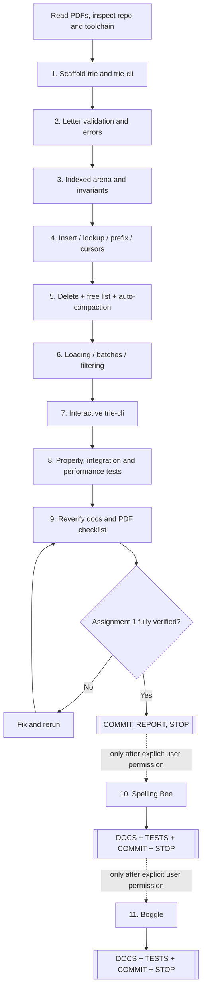
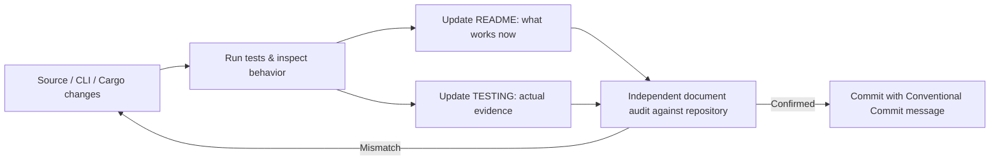

# Word Trie / Word Games — Agent-Executable Implementation Plan

**Purpose:** A dependency-ordered, test-first implementation runbook for a Rust agent.  
**Current authorized scope:** **Assignment 1 ONLY** (`Word Games.pdf`: `trie` and `trie-cli`).  
**Hard stop:** After Assignment 1 passes all acceptance gates, update/verify README and TESTING, commit, deliver report, and **wait for explicit instruction**. Stages for Spelling Bee and Boggle are prospective specifications, **not permission to start**.  
**Companion authority:** [`DESIGN_SPECIFICATION.md`](DESIGN_SPECIFICATION.md). This plan gives execution order and objective proof obligations; the design spec gives representation and semantic decisions.

## 0. Agent operational contract

1. Read the source PDFs, `dictionary.txt`, `DESIGN_SPECIFICATION.md`, this plan, and the existing repository before editing anything. Do not overwrite unrelated work. Respect already present source, local modifications, and existing Git history.
2. Confirm checkout, branch, Rust toolchain, workspace members, and available test commands; inspect `.gitignore` and `git status`. If no repo exists and user has authorized new repository creation, initialize one. Do not force-push, rewrite shared history, or delete unrelated files.
3. Work in **small, compiling, independently testable increments**. A function is not done until corresponding positive, negative, edge-case, and invariant tests exist and pass.
4. **Conventional Commits** (examples: `feat(trie): add checked insertion`, `fix(trie): prevent double-free on pruning`, `test(trie): cover free-list churn`, `feat(trie-cli): add present and absent filters`, `docs: verify assignment-1 commands`). Use imperative subjects, coherent scopes, and explanatory bodies for consequential design decisions. Do not record secrets or generated build outputs in Git.
5. Run formatting, compiler/lint checks, unit/integration tests, and release checks at appropriate intervals. Fix warnings introduced by your changes, do not mask test failures.
6. Update `README.md` and `docs/TESTING.md` **as features land**, reflecting only behavior that can be verified in the checkout. No unchecked claims, invented measurements, or future feature labels implying implementation.
7. At **each assignment checkpoint**, independently re-read source code, workspace manifests, CLI help, tests, and relevant PDF; rerun documentation examples and tests; correct documentation before final checkpoint commit.
8. Report completed requirements, exact commands and outcomes, tests with seeds, benchmarking results (if run), any known limitations, final Git commits, and a mapping from each PDF requirement to verification evidence. **STOP**; no autonomous continuation into next assignment.
9. Do not add real game engines or game-specific crates during Assignment 1. It is permitted to keep future designs in Markdown.
10. If instruction conflicts occur, prioritize the user's latest explicit decisions and attached assignment requirements, then the design spec, then this plan. Flag material gaps; do not silently substitute a different representation or ownership model.

## 1. Milestones and dependency graph

## 2. Stage A — Assignment 1 (`trie` and `trie-cli`) [IMPLEMENT NOW]

### A0. Preflight, repository and acceptance setup

**Tasks**
- Locate/read exact attachments or their copies in the user repo: `assignments/Word Games.pdf` is first-stage authority, with future PDFs for architectural awareness. Check for existing code and docs rather than blindly generating.
- Create/select `word-trie/` workspace root with `trie` (library) and `trie-cli` (binary). Use stable Rust edition supported by installed toolchain; declare edition/MSRV assumptions in README. Avoid dependency proliferation; standard library is sufficient for core trie.
- Add `.gitignore` including `/target/`, temporary files, local benchmarks/coverage outputs as appropriate; include `Cargo.lock` for the workspace application.
- Preserve supplied `assets/dictionary.txt` byte-for-byte in a clearly documented asset location (or reference an external location if its license/repo inclusion is uncertain). Do not silently reformat or drop its unterminated last line.
- Establish requirement checklist IDs `WG-01` ... `WG-11` below and an evidence log in `docs/TESTING.md`.
- Create minimal accurate README stating that implementation is underway, with working commands only when they exist.

**Done when:** `cargo metadata --no-deps` shows only `trie` and `trie-cli` as workspace members; `cargo check --workspace` succeeds; repository status is understood; docs do not falsely claim game implementation.

**Suggested commit:** `chore: initialize trie workspace and stage-one documentation`

### A1. ASCII alphabet abstraction, normalization and typed errors

**Files:** `trie/src/letter.rs`, `trie/src/error.rs`, public exports from `lib.rs`.

**Tasks**
1. Define `Letter(u8)` with private field, checked constructor from ASCII `A-Z`/`a-z`, `index() -> usize`, `to_char() -> char`, and `Copy` semantics.
2. Introduce a single canonical word validation/normalization path. Inputs to public APIs are `&str`; allow ASCII alphabetic only; convert lowercase to uppercase; reject empty, non-ASCII, numbers, apostrophes, hyphens, embedded spaces, etc. Ensure lookups can normalize without allocating on common uppercase path; avoid Unicode case folding.
3. Public conversion helper for professor's explicit uppercase requirement; return owned/borrowed string through `Cow<str>` or equally clear API.
4. Define informative `WordError` and `LoadError` types; include offending character/index or source line/column when possible. Do not call `unwrap` on user input.
5. Decide and document `contains(invalid) == false`, `try_contains(invalid) == Err`, `has_prefix("") == true`, and empty-word insertion/removal == `Err`.

**Tests, minimum:** `letter_A-Z`, `letter_a-z`, `letter_invalid_ascii`, `letter_unicode`, `case_upper_identity`, `case_lower`, `case_mixed`, `empty_rejected`, `space_rejected`, `hyphen_rejected`, `apostrophe_rejected`, `digit_rejected`, `unicode_expansion_rejected`, `invalid_lookup_safe`, `normalization_idempotent`. Include a loop over all 26 letters and a table-driven list of malformed tokens.

**Done when:** all validation tests pass; rustdoc explains normalization/error rules.

**Suggested commit:** `feat(trie): add ASCII letter validation and normalization`

### A2. Node arena, allocation and debug invariants

**Files:** `trie/src/node.rs`, private core methods in `lib.rs`.

**Tasks**
1. Implement private `NodeId(u32)`, `Node { children: [u32; 26], is_word: bool, subtree_words: u32 }`, `NO_CHILD=u32::MAX`; check overflow before conversion/index allocation.
2. Initialize exactly one root at index zero; preserve it even when dictionary becomes empty.
3. Implement `allocate_node` using free list before `Vec::push`, and `free_node` that resets slot and appends ID only after the parent's edge is detached. Prevent freeing root, duplicate free, freeing reachable/live nodes.
4. Track `word_count` and `live_node_count`; expose read-only `TrieStats` (words, live nodes, slots allocated, free slots, maybe spare capacity). Stats must distinguish live nodes from vector length.
5. Add test-only invariant walker: reachable graph, no free index reachable, no duplicate free IDs, count recurrence, reachable node counts, terminal words count, no nonroot zero-subtree reachable nodes, child index bounds, root preserved.
6. Avoid pointers/references into `Vec` over operations that may reallocate. Ensure all indexing is safe/checked at the relevant boundary.

**Tests:** fresh root, no free nodes, child map sentinel, ID capacity boundary (with test seam/mocked allocator if needed), allocate/reuse free slot, cannot free root, stats consistency, internal invariant violation detection where practical.

**Done when:** safe allocation primitives compile; property/invariant helper can validate empty and synthetic trees.

**Suggested commit:** `feat(trie): implement indexed arena and allocation invariants`

### A3. Trie operations: creation, insertion, lookup, prefixes, traversal

**Files:** `trie/src/lib.rs`, `trie/src/traversal.rs`, `trie/tests/operations.rs`.

**Tasks**
1. `Trie::new()`, `Default`, `len()`, `is_empty()`, `stats()`.
2. `insert(&mut self, &str) -> Result<bool,WordError>`: validate all input first; detect duplicates; follow/create edges; increment subtree counters only once for successful new terminal; cap-check before mutation; preserve invariants on failure.
3. `contains(&self, &str) -> bool` and `try_contains` fallible variant; distinguish complete words from proper prefixes.
4. `has_prefix(&self, &str) -> bool`: normalize ASCII; permit empty prefix, reject invalid prefix via false.
5. Read-only `TrieCursor` with `advance(Letter) -> Option<Self>`, `is_word`, `has_children`; no public mutable node IDs. Cursor must follow the current immutable trie without allocations.
6. `visit_words` enumerates every active dictionary word exactly once; lexicographic order strongly recommended, with no exposure of dead nodes. Prefer iterative traversal for unbounded word lengths; if recursive, justify stack limitations and test long words.

**Tests:** empty, single word, prefix not full word, prefix itself full word, overlapping branches (`CAR`, `CART`, `CAT`), root branches, duplicate/uppercase/lowercase/mixed input, invalid does not mutate, lexicographic iteration, complete enumeration vs `HashSet`, cursor path validity, absent child, allocation reuse after later deletion. Verify `contains` borrows `&Trie` and does not cause mutations via stats checks.

**Done when:** `cargo test -p trie` passes and every successful insert preserves debug invariants; all APIs documented with examples.

**Suggested commit:** `feat(trie): implement insertion, membership and read-only cursors`

### A4. Deletion, pruning, free-list reuse and automatic compaction

**Files:** trie internals, `trie/tests/deletion.rs`, randomized fixtures.

**Tasks**
1. Implement single-word `remove` with full validation before mutation. Absent word/absent terminal returns `Ok(false)`, no structural changes.
2. Record all `NodeId`s/edge indices along path; clear terminal and decrement root-to-terminal subtree counts exactly once.
3. Walk upward, unlink each zero-subtree child, clear slot, add to free list; stop when surviving subtree found. Never reclaim reachable nodes or root.
4. Repeated insertion after deletion should reuse free slots before growing the arena. Assert stability of lookup and counts through churn.
5. Add threshold-based `maybe_compact`: when at least 4,096 slots free and at least one-third of slots are free (threshold configurable/private), traverse live reachable nodes, build dense arena, rewrite child IDs, clear free list, recompute or verify counters, shrink capacity. Make it automatic in single deletions and once at end of batch deletions. Prefer temporarily disabling the trigger within batch so it doesn't run repeatedly.
6. Test explicit forced-compaction hook in unit tests even on tiny fixtures so compaction is exercised without needing 4,096 frees; keep the hook private/test-only.
7. Do not make public cursors persistable across mutation; borrow checker should prevent a simultaneous long-lived cursor and `&mut Trie` in safe Rust.

**Tests, minimum:** delete absent, delete leaf, delete word that is prefix, delete child while keeping siblings, delete deepest while keeping shorter prefix, delete every word and retain root, reinsert deleted, case-insensitive delete, duplicate delete, invalid delete leaves state unchanged, counts all ancestors, free-list slot reuse, repeated churn 1000+ operations, delete entire branch, force compact, automatic threshold path, compaction reindexes edges safely, root stable, no double-free, large delete-many/insertion alternation. Test documented memory behavior: slot reuse immediate; RSS reduction not guaranteed by allocator.

**Done when:** every case matches reference `HashSet`, invariant walker passes after each operation and each compaction, no stale/free ID is reachable.

**Suggested commit:** `feat(trie): prune deleted paths and reclaim arena storage`

### A5. Text parsing, file loading, batch operations, filtering

**Files:** `trie/src/loading.rs`, `trie/tests/loading.rs`.

**Tasks**
1. Implement parser over `BufRead` with comma and ASCII whitespace delimiters, valid mixed inputs, CRLF, blank lines, final line lacking newline, duplicate words, and reported invalid token locations.
2. Use one shared parser for insertion files, deletion files, presence/absence filter files, and CLI operations. Do not reimplement tokenization in CLI.
3. Implement `Trie::from_reader` (new trie), path convenience wrapper as appropriate, and `extend_from_reader` (existing trie), with errors that prevent partial update due to *validation/I/O* errors.
4. Implement batch deletion of an arbitrary sequence/list and a file wrapper; all input tokens validated before changing the trie. Avoid compaction after every item; compact once at end if needed.
5. Provide membership classification `present` and `absent`: preserve input order and duplicates, return normalized uppercase tokens, share parser and central `contains` logic.
6. Reports: total tokens, newly inserted, already present; number requested/actually removed/not found. Be consistent about duplicates.
7. Empty file -> valid zero-token batch; repeated commas/whitespace -> no phantom empty words; reject semicolons/punctuation and non-ASCII rather than quietly skipping them.

**Tests:** one-per-line, comma-only, mixed separators, tabs, CRLF, blank lines, leading/trailing separators, no final newline, duplicate batch, empty file, invalid token at beginning/middle/end, Unicode, unexpected semicolon, I/O failure mid-read using custom `Read`, atomic append/delete on invalid/IO, filtering all present/all missing/mixed/prefix-only, filtering preserves order/duplicates, uppercase normalization, equivalence of loading a file and manually inserting its tokens.

**Done when:** 100% assignment data-operation coverage, unit/integration tests pass for an in-memory reader and actual temporary files.

**Suggested commit:** `feat(trie): support streaming parsing and atomic batch operations`

### A6. `trie-cli` interactive terminal

**Files:** `trie-cli/src/{main.rs,commands.rs,repl.rs}`, `trie-cli/tests/cli.rs`.

**Tasks**
1. Support optional startup `--dictionary <path>`, retaining an empty trie if no path provided. Startup load failures should report an error and exit nonzero without an unusable partially loaded trie.
2. Provide REPL commands: `help`, `new`, `load`, `add-file`, `insert`, `contains`, `remove`, `remove-file`, `present`, `absent`, `normalize`, `stats`, `quit`/`exit`. Preserve existing PDF's `trie-cli` package name.
3. Clarify that `load` **replaces** dictionary and `add-file` **extends** it; print state-change reports; handle quoted or raw remainder-of-line file paths with spaces where practical.
4. User-friendly errors for invalid words, missing paths, malformed files, unknown commands, missing arguments, extra arguments, EOF, and I/O errors; never dump a Rust panic on normal input.
5. CLI contains reports a boolean; provide helpful explanation for malformed words. `present`/`absent` print normalized entries in original order, including duplicates.
6. REPL works with redirected stdin, making end-to-end integration tests deterministic and allowing scripted demonstrations.
7. Avoid implementing game UI or shared TUI framework now.

**Tests:** spawn binary using Cargo executable path, pipe scripted commands, assert stdout/stderr/exit status, check init/load/add/remove/contains/bulk lists/present/absent/normalization/stats/help/exit, malformed command, missing file, malformed file, path with spaces, empty input, EOF, no silent loss after failed batch, case normalization. Test representative complete session from README verbatim.

**Done when:** manual walkthrough and scripted subprocess suite pass without requiring interaction with real stdin during tests.

**Suggested commit:** `feat(trie-cli): add interactive dictionary management`

### A7. Rigorous verification and regression suite

**Required layers:**

1. **Unit tests:** isolated alphabet, normalization, node allocation, trie operations, batches, parser, cursors, pruning, compaction.
2. **Integration tests:** public library API from a separate crate/test module; the real supplied dictionary; temp files; binary REPL with redirected input.
3. **Reference-model randomized tests:** fixed-seed operation streams against `HashSet<String>`; compare insert boolean/remove boolean/contains/len/complete iteration after every operation or at checkpoints; deterministic reproducibility via seed logged in output.
4. **Property-style tests:** no invalid input mutates trie; normalization idempotent; an inserted word is present; deleting a word removes exactly that membership; operations on one word do not alter other words; for any word `w` all nonempty valid prefixes exist structurally until all descendant words removed; `root.subtree_words == len`.
5. **Adversarial churn:** deep prefixes, branching and shared prefixes, repeatedly empty/refill, high alphabet fanout, long words and many duplicates, randomized deletion-order permutations, intermittent forced compactions.
6. **File-format fuzz table:** generated comma/space/newline mixes; malformed token injection; chunk boundaries; missing final newline; simulated I/O failure; invalid UTF-8 handling as correct reported error, not silent corruption or crash.
7. **Real corpus regression:** expect 178,691 unique words, word length min 2/max 15, exact normal trie nodes 395,185, every dictionary word present, no stray words in separately generated controls, iterations sorted/unique. Guard against missing last line when using `lines()` or `wc -l`.
8. **Release checks:** `cargo fmt --all -- --check`, `cargo check --workspace`, `cargo clippy --workspace --all-targets -- -D warnings`, `cargo test --workspace`, `cargo build --workspace --release`; where possible also `cargo test --workspace --release`.
9. **Benchmark smoke:** load time, memory via platform facilities if available, valid/invalid lookup throughput, insert/remove throughput, free-list reuse, compaction time. Label hardware, Rust version, optimizer/build settings, repeats, and confidence/distribution. No invented results or unsupported performance claims.
10. **Documentation tests:** run rustdoc doctests; execute exact commands and REPL examples from README; if a command differs from actual output, correct it.

**Suggested deterministic seeds:** at least three distinct documented seeds (e.g., `0xC0FFEE`, `0x5EED2026`, `0xBADC0DE`) and streams of 1k, 10k, and, if CI/resources allow, 100k mixed operations. Use seeded PRNG; random fuzz cases must be reproducible from recorded seed. These counts are goals, not excuses to sacrifice invariant verification.

**Acceptance:** no failing tests, no unaddressed project warnings, no unexplained discrepancy with baseline dictionary facts, no unsupported CLI usage examples.

**Suggested commit:** `test(trie): add model-based and full-dictionary regression coverage`

### A8. Documentation verification and submission gate

**Inspect and reconcile:** actual workspace manifests, public Rust API, executed CLI `help`, README installation/commands, TESTING command records/seeds/results, git diff/status, `Word Games.pdf` line-by-line requirements, and compiled release binary. Do not simply append a “verified” stamp without checking.

**Checkpoint 1 acceptance table (all MUST be checked and evidenced):**

| ID | Source requirement | Minimum evidence |
|---|---|---|
| WG-01 | Create empty trie | `new`, `Default`, CLI `new`, fresh-root test |
| WG-02 | Boolean lookup | `contains`, direct and CLI test |
| WG-03 | Insert single word | `insert`, duplicate and mixed-case tests |
| WG-04 | Build from one-word/line file | real dictionary and fixture load tests |
| WG-05 | Build from comma/whitespace file | mixed-delimiter parsing tests |
| WG-06 | Lowercase → uppercase | public helper and CLI normalization test |
| WG-07 | Delete one word | prefix/sibling/pruning tests |
| WG-08 | Delete list of words | batch and file deletion tests |
| WG-09 | Return words in trie from list file | present filtering test, order/duplicates preserved |
| WG-10 | Return words absent from trie | absent filtering test, order/duplicates preserved |
| WG-11 | Thorough manual/generated testing; modular Rust, docs, Cargo | randomized suite, corpus test, README, TESTING, Cargo release checks |

**One essential adversarial command sequence:** load full dictionary, verify `AA` and `ZZZ`, remove `AA`, verify `AAH` remains, reinsert `AA`, exercise `remove-file` with mixed separators, check `present`/`absent` with duplicates, and exit cleanly. Do not ship if any of these fail.

**Checkpoint outputs:**
- README leads with the current **working trie/CLI**, precise build/run commands, verified examples, and later games under a clearly labeled roadmap (not installation guidance for nonexistent crates).
- TESTING contains executable commands, actual run outcomes (including skipped tests), regression numbers, reproducible seeds, target environment, benchmark results only if measured, and limitations.
- Design and plan remain checked in so an agent/user understands the architecture and stopped stage.
- `git status` clean after meaningful Conventional Commits; if dirty due user work, report rather than overriding.
- Final status report cites requirement IDs, test evidence, exact commits, and states **“Assignment 1 complete; awaiting explicit approval for Spelling Bee.”**

**HARD STOP.** Do not scaffold or implement `spelling-bee`, `boggle`, or shared game UI crates before receiving approval.

---

## 3. Stage B — Spelling Bee [FUTURE ONLY — explicit permission required]

### B0. Stage transition and workspace

Before starting, re-open `Spelling Bee.pdf`, confirm approval, read current docs/working code, ensure Assignment 1 remains passing, and add `spelling-bee` engine crate plus `word-games-cli` only as necessary. Avoid `games-core` until shared code truly exists. Keep `trie-cli` unchanged except bug fixes.

### B1. Immutable puzzle state and solution-generation oracle

- `PuzzleConfig` contains seed, center-choice policy, required pangram count, solution count range, and difficulty category thresholds.
- `SpellingBeeGame` owns seven letters/allowed mask, frozen sorted solution vector, accepted `BTreeSet`, cached score, terminal state. No persistent dictionary reference/lifetime.
- Implement exhaustive dictionary visitor + `u32` masks **first**; manually enumerate tiny fixtures; assert all solutions length≥4, use only seven letters and contain center; detect pangrams by mask equality.
- Model tests: repeated letters allowed; invalid center; fewer/more than seven distinct letters rejected; no solutions; pangram and nonpangram; obscure dictionary words.

### B2. Trie-pruned enumerator

- Add DFS from immutable trie cursor, only exploring allowed-letter edges, recording terminal words of length≥4 including central letter.
- Differential-test complete **sets** against exhaustive filtering on fixed puzzles, random seeds and all seven-letter anchors selected in a manageable sample. Avoid comparing only solution counts.
- Benchmark filtering and pruned traversal with identical puzzles; store method, compiler mode, sample count, min/median/max times, and solution count.

### B3. Pangram-anchored puzzle generator, difficulty, hints

- Pre-index eligible dictionary words having exactly seven distinct letters; choose seed anchor via injected deterministic RNG. Set seven letters from its distinct-letter set, select central letter, compute solutions, test difficulty constraints; bounded retry, explicit “no eligible puzzle” error. Document sampling bias.
- Define user-adjustable targets and reproducible seed override; reject incoherent configurations.
- Hints: starting-letter×length grid and two-letter-prefix counts derived from frozen solution set, never leaked guesses.
- Tests: same seed/config => same puzzle, anchor pangram exists, retry exhaustion, difficulty bounds, hint sums match solution count.

### B4. Interactive play, scoring and CLI

- Validate each guess immediately with typed outcomes; score 4-letter=1, ≥5 letters=length, pangram bonus +7 default, **only once** per new valid guess.
- Maintain `cached_score == sum(score(guesses))`; randomized assertion after every submission. Show guessed words sorted in three columns; Queen Bee and `/quit` early reveal behavior.
- CLI tests: invalid/outside letters, missing center, duplicates, score increments, pangram, no premature Queen Bee, early missed-word report, clean EOF.

### B5. Assignment 2 hard checkpoint

- Re-run all Assignment 1 tests and new engine/CLI tests; verify from `Spelling Bee.pdf` each mandatory requirement; inspect README and TESTING **against repository** and regenerate examples/results; commit.
- Update README primary emphasis to *currently working* trie CLI and Spelling Bee; Boggle/Wordle explicitly future.
- Record performance comparison evidence and known limitations.
- **STOP and wait for explicit Boggle authorization.**

---

## 4. Stage C — Boggle [FUTURE ONLY — explicit permission required]

### C0. Read source and transition

Re-read `Boggle.pdf`, inspect current code and updated docs, verify permission, add `boggle` engine crate. Keep all previously passing functionality intact.

### C1. Validated board, cells, neighbors and tiles

- Grid size `{4,5,6}`, flattened tiles `Vec<Tile>` with `Letter` or `Qu` enum; immutable during round. Reject invalid size/count.
- Precompute 8-neighbor adjacency for every cell, with no self-edge and no duplicate neighbor; verify symmetry, corners/edges/center counts (3/5/8 neighbors).
- Test `Qu` expands to letters `QU` while consuming one cell; string length=2 for scoring and word-minimum purposes.

### C2. Independent on-demand validation oracle

- Given a word already checked against dictionary, backtrack over board paths using a copied `u64` visited mask; never reuse a single cell. Do not incorrectly forbid using two **different** cells bearing same letter.
- Tests: diagonal, reverse path, repeated letters, alternate paths, impossible word that is in dictionary, Q-without-U limitation, `Qu` path, fixed-size boundary and 36th-bit correctness.

### C3. Primary trie-guided DFS enumeration

- Starting at each tile, advance trie cursor by letter(s), stop at invalid prefixes, visit neighbors not in mask; record unique terminal words of length≥3; maintain no game-session borrow after setup.
- Test complete solution **set equality** against independent oracle over fixed/test-generated boards and sampled dictionary subsets. Stress highly repeated/vowel-poor boards, 4/5/6 sizes; bound resource budgets and report search time.
- Benchmark precompute-plus-lookup vs per-guess DFS for varying number of submitted guesses, not just isolated function calls; compare throughput and memory.

### C4. Generation, score, session, interaction

- Uniform A–Z generation first; deterministic seed injection; log board seed/config for reproduction.
- Scoring: 3–4→1, 5→2, 6→3, 7→5, 8→11, 9–12→2L, 13–14→3L, 15→4L; verify each boundary. Qu contributes two spelled letters.
- Immediate feedback; accept comma/space/newline-separated guesses; reject malformed; record accepted guesses irreversibly, no duplicate score, clean `/quit`, track cached score with invariant.
- Leave timed gameplay, frequency-weighted/dice board generation, and difficulty-based timed settings for **subsequent extensions** unless separately approved.

### C5. Optional later performance extensions (DO NOT automatically start)

- Weighted letter distribution and dice-style generation; compare playable-word counts, reachable score, long words, vowel balance, and runtime under fixed seeds. Difficulty-based board selection with explicit, measurable targets.
- Timer with strict deadline requires nonblocking input/thread/event architecture; no premature concurrency in untimed implementation.

### C6. Assignment 3 hard checkpoint

- Run entire workspace tests, randomized/differential cases, original assignment CLI/manual checks, release checks and benchmarking where applicable.
- Re-check README/TESTING **with executed outputs and actual files**, update first-page feature list to reflect three implemented assignments and clearly separate optional future work.
- Commit/record exact commit IDs. **STOP; do not implement Wordle/TUI/GUI without explicit authorization.**

---

## 5. Living documentation protocol (applies at every stage and every significant change)

**README must always:** explain project purpose/current stage; precisely list current working crates and features; installation prerequisites, build and run commands; genuinely runnable examples; current architecture summary; testing quickstart; status of optional games/UI; known limitations; links to design/plan/testing; licensing/asset provenance. Prefer a newcomer-focused README over an exhaustive design dump.

**TESTING must always:** maintain test layers, exact commands actually run, scope/seed/fixture counts, last verified date/commit when known, the actual pass/fail/skip status, benchmark methodology/results with provenance, and unresolved issues. Mark planned cases as `NOT YET IMPLEMENTED` rather than claiming they passed. Explain how someone else can reproduce tests. Do not fabricate dates, results, runtime, memory, or Git commit IDs.

**Checkpoint audit:** view actual files; run `cargo metadata`, `cargo test`, `cargo clippy`, release build and `--help`/REPL; run README command samples; compare PDFs and feature checklist; write evidence; review documentation diff; commit. If actual execution is unavailable, accurately report `NOT RUN` and do not declare checkpoint passed.

## 6. Git working conventions

- Default small commits at module or cohesive behavior boundary; test changes bundled with related feature or separate `test(scope)` commits; docs updated with each relevant feature.
- Prefixes: `feat`, `fix`, `test`, `docs`, `refactor`, `perf`, `chore`, `ci`; use conventional `type(optional-scope): short imperative description`, ideally ≤72-character subject.
- No secrets, binaries, `target/`, machine-specific paths, or synthetic benchmark results committed.
- Before each commit: `git diff --check`, inspect diff, run relevant tests, `git status`; commit only owned changes. Never stage unrelated user edits wholesale.
- Do not make dummy commits, alter/remap prior commits, force-push, or promise CI passes without running it.
- At checkpoint, report real commit SHAs from Git and branch, exactly as returned by the repository.

## 7. Final deliverable checklist for each checkpoint

- [ ] Every PDF-mandated function/behavior for **the authorized assignment** exists.
- [ ] Public API has examples, documented errors and ownership semantics.
- [ ] Core invariants checked and regression-tested.
- [ ] Unit, integration, seeded randomized, adversarial, CLI and corpus tests appropriate to current stage pass.
- [ ] `cargo fmt --check`, `cargo check`, `cargo clippy -D warnings`, `cargo test`, and release build completed or accurately marked blocked.
- [ ] Benchmark methodology/results recorded if measurements were run; no unsupported claims.
- [ ] README describes CURRENT capabilities only; examples actually run.
- [ ] TESTING is accurate, reproducible, and records executed verification.
- [ ] Design spec and plan reflect any user-approved deviations.
- [ ] Conventional commits exist for completed work, with clean owned diff.
- [ ] Checkpoint report includes requirement→test mapping, limitations, Git commits.
- [ ] **STOP**; await explicit authorization for the next assignment.
