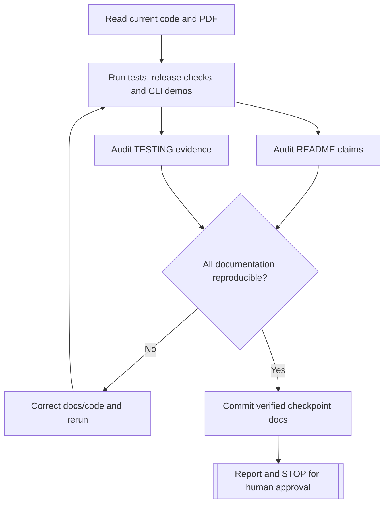

# Testing, Invariants and Verification Record

**Status: PRE-IMPLEMENTATION — NOTHING EXECUTED.** This document provides a rigorous test plan and a template for **actual** evidence. It does **not** claim any Rust unit tests, benchmarks, release builds, or CLI demonstrations have passed. An implementing agent must update status and results during development, and independently reconcile this document with the repository at each assignment checkpoint.

## 1. What makes a claim verified?

A test/check is **VERIFIED** only when its corresponding code/fixture exists in the repository, the exact command has actually been executed in a known environment, the observed outcome is recorded, and failures are resolved or explicitly described. Mark other cases **PLANNED**, **NOT RUN**, **BLOCKED**, or **FAILED**—never infer success from intended code or previous versions. Record Git SHA if a real repo is available; otherwise leave as `not available`.

### Evidence fields for each checkpoint

| Field | Value (fill only with observed facts) |
|---|---|
| Checkpoint | Pre-implementation document preparation |
| Verified against Git commit | Not available |
| Rust version (`rustc --version`) | Not run |
| OS / architecture | Not recorded |
| Compiler profile | Not run |
| Full test command | Not run |
| Unit/integration test counts | Not run |
| Random test seeds / operation counts | Planned only; see below |
| CLI scripted interaction | Not run |
| Release binary check | Not run |
| Source PDF requirement audit | Planned for each assignment |
| README example execution | Not run |
| Benchmark runtime/memory | Not measured |
| Blockers/limitations | Implementation not started |

**Important distinction:** Independent Python inspection of supplied `dictionary.txt` during design produced reference input statistics. This is **not** Rust trie verification and must not be represented as a passed implementation test.

## 2. Requirements-based test index — Assignment 1

| ID | Capability | Required tests | Present status |
|---|---|---|---|
| WG-01 | Empty trie | fresh root, `len==0`, `is_empty`, empty word behavior | PLANNED |
| WG-02 | Boolean lookup | found/missing, proper prefix, casing, invalid token | PLANNED |
| WG-03 | One-word insertion | new, duplicate, overlapping prefix, all letters, invalid atomicity | PLANNED |
| WG-04 | One-word-per-line file build | small fixture, full real corpus, no last newline | PLANNED |
| WG-05 | Comma/whitespace file build | comma, tabs, mixed delimiters, blank/repeated separators | PLANNED |
| WG-06 | Lowercase-to-uppercase conversion | public helper, mixed-case insertion/lookup, CLI output | PLANNED |
| WG-07 | One-word deletion | absent, leaf, prefix, shared branch, root preservation | PLANNED |
| WG-08 | List deletion | repeats, present/missing mix, malformed batch atomicity | PLANNED |
| WG-09 | Filter present words from file | exact output, ordered/duplicate entries, normalization | PLANNED |
| WG-10 | Filter absent words from file | exact output, prefixes not considered words, invalid token | PLANNED |
| WG-11 | Extensive tests + code/docs/Cargo | randomized, integration, release, ownership review, evidence | PLANNED |

## 3. Library unit tests — required cases

### 3.1 Letter validation and normalization

- All 26 uppercase letters round-trip `Letter::index()`, `to_char()`.
- All 26 lowercase letters map to their uppercase counterpart.
- Reject ASCII control chars, digits, punctuation (`-`, `'`, `;`, `.`, `@`), whitespace embedded in a single word, UTF-8 non-ASCII characters, and Unicode case-folding edge cases.
- Empty word rejected for insertion and removal; query `contains("")` returns `false`; `has_prefix("")` returns `true`.
- Repeated normalization is idempotent; already-uppercase input must not be changed; `try_contains` returns informative error for malformed input.
- Random valid ASCII words normalizing to uppercase retain exactly the original length.

### 3.2 Insertion and lookup

- An empty trie has exactly one reachable root and no terminal word.
- First insertion changes membership and increments size by one; repeated insertion returns `false` and leaves size/counters unchanged.
- `CAR`, `CART`, `CAT` can coexist; `CA` is a valid prefix but not necessarily a complete word.
- Distinct first-letter branches coexist; mixed-case insertion and lookup are equivalent to uppercase.
- Every successfully inserted word enumerates once, in documented order.
- Invalid input causes no additional nodes, no changed free-list size, and no changed word count.
- Traverse all present and absent child pointers via immutable cursor; after a failed `advance`, no invalid cursor can be fabricated publicly.

### 3.3 Deletion and reclamation (critical)

- Removing absent word/prefix returns `Ok(false)` and does not change structure.
- Removing terminal word which is itself prefix of another word clears only that terminal flag.
- Removing long leaf while shorter prefix remains prunes only unused suffix.
- Removing middle branch preserves siblings and ancestors required by other words.
- Removing last word frees every non-root reachable node, leaves root and sets word count zero.
- After pruning, every reclaimed slot ID is unique in the free list and unreachable.
- Reinsertion reuses free slots *before* increasing `nodes.len()`; repeated churn does not create unreachable live IDs or double-free.
- Subtree-word counts equal terminal count in every subtree after each operation.
- Forced compaction on a test-sized trie remaps every child ID, keeps all live words, clears free list, and preserves correct enumeration.
- Automatic compaction threshold behavior tested without allocating huge fixtures where a private test seam is feasible; no unexpected compactions on trivial mutations.
- Test delete/reinsert sequences with roots across all 26 letters and large suffix sharing.
- Unexpected capacity errors/validation errors must not leave partial insertions or corrupt counts.

### 3.4 Cursor and traversal

- All active words appear exactly once and lexicographically if promised.
- Proper prefix structural traversal behaves consistently after logical terminal removal and physical branch deletion.
- Iteration never yields freed nodes, dead words, stale IDs, or illegal UTF-8.
- Compare iterated word set with reference set after randomized mutation sequences.

## 4. Parser, bulk operations, and failure atomicity

**Valid format fixtures:**

```text
DOG\nCAT\nBIRD          (one word per line)
DOG,CAT,BIRD             (comma separated)
DOG, CAT\tBIRD\nFOX    (mixed comma/whitespace)
\n\tDOG,, CAT,\n\n        (empty separators ignored)
DOG\r\nCAT\r\n           (Windows newlines)
ZZZ                      (EOF without final newline)
```

**Invalid fixtures:** `DOG;CAT`, `DOG-HEAD`, `DOG2`, `C@T`, non-ASCII letters, embedded punctuation, invalid UTF-8 and custom reader that fails midway. Errors must identify where the problem is and must not silently ignore invalid tokens. A byte-order mark is optional at file beginning only as documented by implementation; test actual policy.

**Required assertions:**

1. `from_reader` with valid fixtures produces same content as one-by-one insertion of tokens.
2. Input order and duplicates do not alter dictionary set; reports count all tokens and changed/unchanged correctly.
3. `extend_from_reader` and batch deletion with malformed input leave the preexisting trie completely unchanged. Compare full enumeration, counts, and internal invariants.
4. Simulated I/O error during a reader operation leaves destination trie unchanged.
5. `present/absent` return exactly the correct normalized tokens, preserving input sequence and duplicates; proper prefix that is not a word is classified absent.
6. File containing only delimiters makes zero changes and does not attempt inserting empty words.
7. Loading `dictionary.txt` preserves last word despite lack of trailing `\n`.
8. File paths containing spaces and missing/unreadable paths receive informative terminal errors.

## 5. Reference-model and randomized testing

**Oracle:** independent `HashSet<String>` containing uppercase ASCII valid words. The hash set is a **test oracle**, not the selected trie representation. For each generated step, apply equivalent operation to both and assert:

- `insert` reports changed iff `HashSet::insert` did;
- `remove` reports changed iff `HashSet::remove` did;
- `contains` matches `HashSet::contains` for random present/absent candidates;
- `len` matches set cardinality;
- sorted trie word enumeration equals sorted oracle elements;
- debug-only internal invariants pass after every step or sampled checkpoints (document sampling policy).

**Planned deterministic seeds:**

| Seed | Scenario | Planned size | Status |
|---|---|---:|---|
| `0xC0FFEE` | balanced insert/find/delete | 1,000 operations | PLANNED |
| `0x5EED2026` | shared-prefix-heavy churn | 10,000 operations | PLANNED |
| `0xBADC0DE` | many duplicates/delete/reinsert | 100,000 operations | PLANNED |

No random number generator choice is fixed at documentation stage; select a seedable PRNG available in the actual test build, record crate/version (if third-party), and ensure deterministic sequences. Include a failure message with the seed and operation index to reproduce bugs.

**Other generated cases:** random insertion order permutations; random deletion order; 26-letter fanout; long common prefixes; invalid-character injection; mixed-delimiter token generation; compaction between operations; differing case forms of the same dictionary words. An optional property-testing crate is acceptable if its benefits justify dependency cost.

## 6. Real supplied corpus integration tests

These are independent input reference facts already inspected, not Rust test outcomes:

| Input property | Expected |
|---|---:|
| Unique words | 178,691 |
| Minimum word length | 2 |
| Maximum word length | 15 |
| Standard uncompressed trie reachable nodes (incl. root) | 395,185 |
| Leaf nodes | 116,079 |
| One-child nodes | 214,926 |
| Two-child nodes | 39,966 |
| Last line has trailing newline | No |

**When implemented:** load the complete supplied file using actual public Rust load API; verify `len`, all 178,691 membership queries, representative known missing words constructed deterministically, sorted enumeration equality, node count and `stats`; independently rebuild same dictionary from reversed order and a shuffled deterministic order and ensure same content and reachable node count. Never impose expected upper word length of 15 as a hard-coded API restriction. Delete a sizeable sampled subset, compare membership to a set oracle, verify free list/compaction, and reinsert to restore set equality.

**Important:** A `u32` count might overflow with a hypothetical larger corpus, and a `u32` ID sentinel puts a maximum on allocations; capacity check cases should be tested through a seam rather than attempting to allocate billions of nodes.

## 7. `trie-cli` end-to-end tests

Spawn actual compiled `trie-cli` with piped stdin/stdout/stderr using a crate integration test harness. Test both exit codes and output contracts. At minimum:

- `help` exposes each PDF requirement; `quit` and EOF exit without a panic.
- `new` creates an empty dictionary and reports zero words.
- `insert CAT` and `contains cat` agree, duplicate insert does not change count.
- `remove CAR` does not remove `CART`; remove and reinsert work.
- `load <path>` replaces dictionary; `add-file <path>` extends it.
- `remove-file` handles mixed format and reports requested/removed/missing entries.
- `present <path>` and `absent <path>` give exactly expected order/duplicates.
- `normalize bIrD` prints `BIRD`.
- `stats` distinguishes words, reachable nodes, arena slots and free slots.
- Unknown command, too few/many arguments, empty word, unexpected punctuation and nonexistent file display friendly diagnostics without process crashes.
- Error in `add-file` or `remove-file` does not partially change trie; probe membership afterward.
- Absolute/relative paths with spaces, CRLF input, EOF mid-session, input redirection all behave predictably.
- Run at least one scripted **real dictionary** load and operations, and compare `help`/README command samples to actual CLI output.

## 8. Rust quality checks — exact commands and statuses

Run at checkpoint and relevant increments:

```bash
cargo fmt --all -- --check
cargo check --workspace
cargo clippy --workspace --all-targets -- -D warnings
cargo test --workspace
cargo test --workspace --release
cargo build --workspace --release
cargo doc --workspace --no-deps
```

**Current status of every command above: NOT RUN**, because the planning pack contains no Cargo project. The agent must fill in observed toolchain version, command exit codes, errors, and dates. Where feasible, supplement with coverage tooling, `cargo test` filtering to relevant package and verbose output for documented evidence, and sanitizer/Miri tests if available; do not make optional tools a blocker unless their use was agreed.

**Maintain no-crash and no-unsafe goals:** avoid unnecessary `unsafe`, raw pointers, unbounded recursive traversal on external input, and `unwrap`/`expect` in user-data paths. A `panic!` inside a test that intentionally checks invariant failures is not an ordinary runtime panic.

## 9. Benchmarks and reproducibility

Benchmark only **implemented** code using a release build and a documented, repeatable workload:

| Metric | Workload | Status |
|---|---|---|
| Dictionary construction wall time | load same full file repeatedly, separate I/O and build where possible | NOT MEASURED |
| Successful lookups/sec | sampled present words, mixed lengths | NOT MEASURED |
| Failed lookups/sec | deterministic absent words | NOT MEASURED |
| Insert/delete throughput | scripted unique/shared-prefix operations | NOT MEASURED |
| Slot reclamation/reuse | delete/reinsert branch; compare `TrieStats` | NOT MEASURED |
| Auto-compaction impact | delete enough to trigger policy | NOT MEASURED |
| Memory footprint | `size_of`, arena capacity, OS RSS if tool exists | NOT MEASURED |

Record environment (CPU, RAM, OS, Rust compiler), exact build profile, seeds, iterations, warm-up and reported distribution. Do not claim 26-way arena is optimal until future boxed/adaptive/map comparisons are actually built and benchmarked. Subsequent games will have differential solution-generation, per-board/guess solver, and board quality benchmarks separately recorded.

## 10. Future-stage test gates (not executable now)

### Spelling Bee (after authorization)

- Exhaustive dictionary filter vs pruned trie DFS must produce **identical sorted solution sets**, not merely counts, across fixed puzzles and deterministic randomized samples.
- Seven distinct letters, center mandatory, repetition permitted, length≥4; pangram iff all seven distinct letters used; anchor generator always supplies eligible pangram with center; deterministic seed and bounded retries; difficulty/target count obey configuration or return explicit error.
- Cached score equals recomputed sum after every unique accepted guess; duplicates/invalid/out-of-set guesses do not change it. Queen Bee only when all frozen solutions accepted. Quit reports missed words and current score; hints reconcile exactly to solution counts.
- CLI feedback and sorted three-column output verified against current code.

### Boggle (after authorization)

- Board sizes 4/5/6, immutable grid, precomputed symmetric neighbors; corner/edge/interior neighbor counts 3/5/8 where applicable.
- Repeated *letters* allowed at different cells; never revisit *same cell*; diagonal adjacency allowed; `u64` visited handles bit index 35.
- `Qu` traverses `Q` then `U` while consuming one tile, counts two letters for length and score; explain limitation for Q-without-U entries.
- Trie-guided DFS solution set equals independent per-guess board validator on fixed/generative board fixtures; benchmarks report both approaches and puzzle-size effects.
- Scoring boundaries: 3–4=1, 5=2, 6=3, 7=5, 8=11, 9–12=2L, 13–14=3L, 15=4L. Fail clearly if a later source dictionary introduces >15-letter valid board words without a defined score.
- Immediate terminal feedback, mixed-separator input, duplicate/no-retraction behavior, `/quit`; untimed first. Later sampling methods/quality evaluation only after separately authorized work.

## 11. Mandatory per-checkpoint independent documentation audit

After the test suite is green (and **again**, independently of routine incremental updates):

1. Read actual `Cargo.toml` manifests and `src/` files, inspect `cargo metadata` and CLI help; compare current stage to source PDF.
2. Cross-check every README feature/command/path/example with actual source and running executable. Execute the README copy/paste commands; correct errors or mark blocked.
3. Cross-check every TESTING assertion/seed/test count/benchmark result with real test definitions and observed execution logs. Clear obsolete green-status claims after code changes that invalidate them.
4. Make current README primarily useful to a new user **right now** (not a template or aspirational feature list). Keep future projects under a concise roadmap.
5. Update both documents with actual evidence and Git commit after test execution; maintain requirements-to-test links and known limitations.
6. Run release/Clippy/check/test commands and rerun relevant CLI demos; review diff, commit documentation correction, and record actual commit ID.
7. Only declare checkpoint completed if all source-PDF requirements and verification gates pass. Otherwise mark incomplete, describe blocker and do **not** start the next assignment.



## 12. Checkpoint verification log (append factual entries here)

### Design-stage entry

- **Stage:** Before Rust implementation.
- **Source inspection:** Supplied assignment PDFs and dictionary were inspected to prepare implementation specifications.
- **Rust commands executed:** None.
- **Rust unit/integration test outcomes:** None.
- **CLI sessions executed:** None.
- **Benchmark measurements executed:** None.
- **Current confidence:** Architectural decisions and comprehensive testing requirements are documented; runtime behavior is unverified until implementation.

### Assignment 1 checkpoint — TEMPLATE (replace only with evidence)

- Date/time and Git commit:
- Source PDF requirement audit WG-01..WG-11:
- Rust version, OS/CPU:
- Commands executed and exit status:
- Test names/counts, failures/skips:
- Random seeds, operations and reference-model verdict:
- Real dictionary counts and arena statistics:
- Deletion/compaction memory observations:
- `trie-cli` scripted interaction results:
- README examples independently executed:
- Remaining known limitations:
- Final verification result: NOT YET RUN

### Assignment 2 checkpoint — TEMPLATE

- Date/time and Git commit:
- Original Spelling Bee PDF coverage:
- Differential enumeration results, seeds and runtime:
- Puzzle difficulty tests and score invariants:
- CLI tests and new user-facing README commands:
- Prior Assignment 1 regression suite results:
- README/TESTING independent re-verification:
- Final verification result: NOT YET RUN

### Assignment 3 checkpoint — TEMPLATE

- Date/time and Git commit:
- Original Boggle PDF coverage:
- Board/path/Qu/scoring test results:
- Trie-guided vs on-demand solver differential and benchmark evidence:
- Full workspace regression and release checks:
- README/TESTING independent re-verification:
- Final verification result: NOT YET RUN
