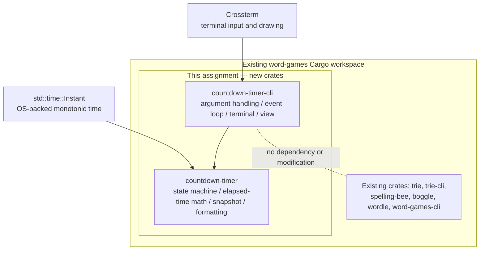
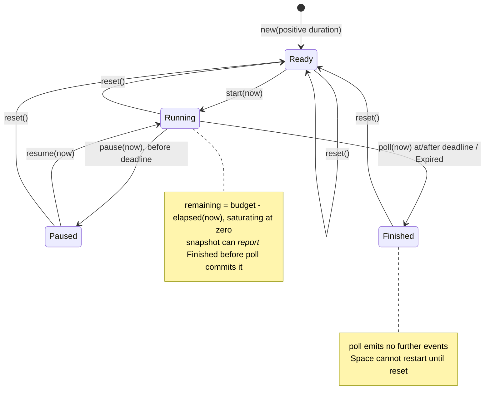
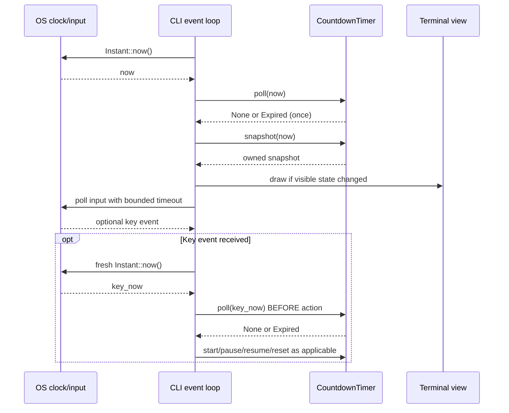

# Countdown Timer — Design Specification

**Status:** Approved architectural decisions  
**Scope:** Reusable Rust countdown **engine** and independent **standalone terminal application** only  
**Target repository:** [`ironLegion88/word-games`](https://github.com/ironLegion88/word-games)  
**Related documents:** [`IMPLEMENTATION_PLAN.md`](IMPLEMENTATION_PLAN.md), [`TESTING.md`](TESTING.md), [`../../prompts/TIMER_AGENT_PROMPT.md`](../../prompts/TIMER_AGENT_PROMPT.md)  
**Source assignment:** [`../../assignments/Countdown-timers.pdf`](../../assignments/Countdown-timers.pdf). The assignment requires a configurable countdown in seconds based on the system clock, start/pause/resume, a visible countdown to zero and completion indication; original-duration display is suggested. Concurrent and sequential timers and 100-ms updates are extensions, not this phase.

> **Scope firewall:** Do not change `trie`, `trie-cli`, `spelling-bee`, `boggle`, `wordle`, `word-games-cli`, their tests, benchmark algorithms, or their behavior. Do not integrate timers into games. Do not build future GUI, concurrent-timer, sequence, sound, or async infrastructure. The core must be reusable later without depending on game types.

## 1. Goals and non-goals

### Goals

- Accurate countdown from user-selected positive duration, using the OS-supported monotonic `std::time::Instant` clock.
- Start, pause, resume, reset, expiration, and one-time expiration notification.
- Standalone interactive terminal UI with prominent remaining time, smaller initial duration, visible status, and a message at zero.
- Core independent of terminal libraries; deterministic tests using synthetic progression of ordinary `Instant` values without sleeps.
- Explicit Rust states and ownership, minimal dependencies, no `unsafe`, clear errors, portable terminal cleanup.
- Remain correct even when render/input loop is delayed: elapsed time, not number of redraws, drives the countdown.
- Integrate cleanly as two additional members of the existing Rust 2021 Cargo workspace; preserve existing CI conventions.

### Non-goals

- Modifying or timing games, integrating with their inputs, game-result semantics or benchmarks.
- Notification sounds, audio libraries, OS notifications, background services, persistent timers, alarm scheduling, or wall-clock persistence.
- Concurrent timer execution, sequential exercise routines, configurable multiple clocks, `Clock` trait, `Rc`, `Arc`, `Mutex`, Tokio, Ratatui, or GUI frameworks.
- Sub-second **display** precision (internal precision is `Duration`); optional 100-ms experimental mode is deferred.
- Guarantees that a laptop's sleep/suspend counts as elapsed time equally on every OS (Rust does not specify that).

## 2. Context and crate boundaries

The repository's root `Cargo.toml` is a workspace with `resolver = "2"` and existing members `trie`, `trie-cli`, `spelling-bee`, `boggle`, `wordle`, and `word-games-cli`. Add two **sibling** members and do not rename existing members:

- `countdown-timer`: a Rust library (`std` only), the sole owner of countdown semantics.
- `countdown-timer-cli`: standalone executable depending on `countdown-timer` and `crossterm`; no dependency on game crates. A small local `lib.rs` is allowed/recommended to make parsing, view generation and app reactions easy to test independently of the binary.



The engine is not allowed to emit text, play a sound, sleep, spawn threads, read input, manage raw mode, or call `Instant::now()` internally. The standalone application acquires actual `Instant::now()` values, owns the engine, produces user-visible side effects, and controls refresh frequency.

## 3. Architectural decision record

| ID | Chosen design | Rationale / rejected alternatives |
|---|---|---|
| D01 | `std::time::Duration` throughout engine | Strong unit semantics, nanosecond granularity, checked/saturating arithmetic; reject counters as authoritative time, `f64`, manually managed millisecond integers. |
| D02 | `std::time::Instant` supplied by caller | Suitable for elapsed time; wall-clock `SystemTime` can be adjusted. Explicit injection allows deterministic tests. |
| D03 | Store `remaining_at_start` plus `started_at` per running interval | Accurate despite missed ticks; pause/resume avoids accidental accumulation of input/render delays. |
| D04 | Private enum with `Ready`, `Running`, `Paused`, `Finished` | State-specific payloads prohibit contradictory booleans or optional timestamps. |
| D05 | Typed `Result` errors for invalid operations | Makes illegal transitions visible; UI may disable such actions. |
| D06 | `&self` snapshots, `&mut self` transitions | Unidirectional ownership, no interior mutability; simple borrow checker behavior. |
| D07 | Explicit `poll(now)` emits `Some(Expired)` exactly once | Keeps pure observations side-effect-free and avoids callbacks/channels for a single timer. |
| D08 | One timer owned by one application controller | No `Clone` of active timers, no sharing/locks; snapshots are copied values. |
| D09 | Concrete public engine type; no trait/generics yet | Minimal API, easier later reuse; explicit timestamp injection supplies testability. |
| D10 | Core rejects zero, no arbitrary maximum; CLI accepts 1..=86,400 integer seconds | Reusable core and a clear 24-hour standalone UI bound. |
| D11 | `ceil` remaining seconds for display, saturating at integer maximum | Zero is shown only on actual expiration, not within the last fractional second. |
| D12 | Workspace sibling library and CLI crates | UI dependency does not leak into the pure engine. |
| D13 | Single-threaded Crossterm event loop, 50–100 ms target responsiveness | No blocking `read_line` during countdown, no thread shutdown/locking complexity. |
| D14 | One key (`Space`) toggles Start/Pause/Resume; `r` resets; `q`/Esc quits | Fulfills start/pause button; state-specific actions under the hood. |
| D15 | Completion message, **no sound** in this milestone | Required notification without portable audio dependency. |
| D16 | `cargo fmt`, strict Clippy, debug/release tests, Ubuntu/Windows CI | Matches existing repository verification style. |

**Trade-off retained for possible later revision:** A `Clock` trait is useful if a timer eventually acquires its own time source; a separate trait is unnecessary here. The current public API accepts `Instant`, preserving clock-control in tests without generics. `Crossterm` (not `Ratatui`) is selected for the deliberately simple standalone screen.

## 4. Types, visibility, mutability and ownership

### Engine types

```rust
use std::time::{Duration, Instant};

#[derive(Debug, Clone, Copy, PartialEq, Eq)]
pub enum TimerStatus {
    Ready,
    Running,
    Paused,
    Finished,
}

#[derive(Debug, Clone, Copy, PartialEq, Eq)]
pub struct TimerSnapshot {
    pub initial: Duration,
    pub remaining: Duration,
    pub status: TimerStatus,
}

#[derive(Debug, Clone, Copy, PartialEq, Eq)]
pub enum TimerEvent {
    Expired,
}

#[derive(Debug, Clone, Copy, PartialEq, Eq)]
pub enum TimerAction {
    Start,
    Pause,
    Resume,
}

#[derive(Debug, Clone, Copy, PartialEq, Eq)]
pub enum TimerError {
    ZeroDuration,
    InvalidTransition { action: TimerAction, status: TimerStatus },
    DeadlineReached,
}

// Private implementation details; not publicly constructible.
enum TimerState {
    Ready,
    Running { started_at: Instant, remaining_at_start: Duration },
    Paused { remaining: Duration },
    Finished,
}

pub struct CountdownTimer {
    initial: Duration,  // immutable except replacing the entire object
    state: TimerState,  // mutated exclusively by lifecycle methods
}
```

`TimerError` must implement `std::fmt::Display` and `std::error::Error`. All listed public enum and snapshot types should derive the traits shown. The actual enum/struct declarations belong in `state.rs`, `error.rs`, and `timer.rs` or similarly small files; re-export public types from crate root (`lib.rs`). Keep `TimerState` and `CountdownTimer` fields private. Avoid unnecessary setters/getters and blanket `Clone` on a live timer (duplicating ownership would also duplicate event semantics).

### Field ownership and lifetimes

| State/field | Owner | Mutability rule | Invariant |
|---|---|---|---|
| `initial: Duration` | timer | constant after `new` | strictly greater than zero |
| `state` | timer | changed only with `&mut self` | exactly one variant active |
| `Running.started_at: Instant` | current `Running` variant | replaced on every new run interval | reference for elapsed time |
| `Running.remaining_at_start: Duration` | current `Running` variant | immutable for interval | `0 < budget <= initial` |
| `Paused.remaining: Duration` | `Paused` variant | frozen while paused | `0 < remaining <= initial` |
| `TimerSnapshot` | by-value consumer | no interior mutation | describes state **at supplied `now`** |
| `TimerEvent::Expired` | `poll` caller | consumed as a value | emitted at most once per run/reset cycle |
| CLI screen data | CLI controller | mutable locally | derived from snapshots, never authoritative |
| CLI event loop | CLI main thread | owns timer and terminal | no worker threads, locks, channels |

Use `Duration::saturating_sub` and `Instant::saturating_duration_since`; avoid constructing `started_at + initial` because large durations may overflow platform-specific `Instant` ranges. A caller-provided timestamp preceding `started_at` is treated as zero elapsed time; callers should provide nondecreasing instants. Synthetic timestamps must advance nondecreasingly in tests. Clock suspension semantics are OS-specific and are outside this milestone's guarantee.

## 5. Precise temporal semantics and invariants

For a running interval started at `t_start` with a budget `B`:

```text
elapsed(now)    = now.saturating_duration_since(t_start)
remaining(now)  = B.saturating_sub(elapsed(now))
expired(now)    = remaining(now) == Duration::ZERO
```

`Ready` reports `initial`; `Paused` reports its stored `remaining`; `Finished` reports zero. A running timer at/after its deadline has **logically expired** even before `poll()` has committed `Finished`. Therefore `snapshot(now)` must report `TimerStatus::Finished` and zero in that case, **without mutating `self` or consuming an event**.

`poll(now)` is the *event commitment point*: if internal state is `Running` and elapsed time has reached or exceeded `remaining_at_start`, change to `Finished` and return `Some(TimerEvent::Expired)`. Otherwise return `None`. It must never emit twice. There is no background callback: if the caller never polls, no notification occurs, though snapshots can still show logical expiration. The CLI polls at each loop iteration and again immediately before applying a key event.

**Atomic action/event policy:** `start`, `resume`, and `pause` must never silently commit expiration. `pause(now)` while the running interval has already expired returns `Err(TimerError::DeadlineReached)` **without mutating state**; the subsequent `poll(now)` remains able to emit `Expired`. A reset is an explicit cancellation and may discard an unpolled expiration, intentionally. The CLI must call `poll(now)` first, then handle a user's action using the same `now`. This prevents lost event notifications when keys arrive at the deadline. The library's `pause()` protective check is still mandatory for direct API users.

Valid operational behavior:

| Current internal state | Operation | Result |
|---|---|---|
| Ready | `start(now)` | `Running {started_at: now, remaining_at_start: initial}` |
| Ready | `pause`, `resume` | `InvalidTransition` |
| Running before deadline | `pause(now)` | `Paused {remaining: remaining(now)}` |
| Running before deadline | `start`, `resume` | `InvalidTransition` |
| Running at/after deadline | `poll(now)` | `Finished`, `Some(Expired)` |
| Running at/after deadline | `pause(now)` | `DeadlineReached`; unchanged until `poll` |
| Paused | `resume(now)` | Running with frozen budget and fresh starting instant |
| Paused | `start`, `pause` | `InvalidTransition` |
| Finished | `start`, `pause`, `resume` | `InvalidTransition` |
| Any | `reset()` | `Ready`; original duration restored; pending expiry cancelled |
| Any | `snapshot(now)` | Nonmutating owned snapshot, no notification |
| Non-running | `poll(now)` | `None`, no state change |

A Ready timer does not decrement. Paused elapsed time never changes its stored remaining duration. After reset a timer has no pending events. Timing never depends on refresh frequency or number of input events.

### State machine



### Expiration versus user input ordering



## 6. Exact public API contract

The following is the **binding target signature** for the initial library, barring a documented compatibility adjustment necessary to compile under the repository's Rust edition/toolchain:

```rust
impl CountdownTimer {
    pub fn new(initial: Duration) -> Result<Self, TimerError>;
    pub fn initial_duration(&self) -> Duration;
    pub fn snapshot(&self, now: Instant) -> TimerSnapshot;
    pub fn poll(&mut self, now: Instant) -> Option<TimerEvent>;
    pub fn start(&mut self, now: Instant) -> Result<(), TimerError>;
    pub fn pause(&mut self, now: Instant) -> Result<(), TimerError>;
    pub fn resume(&mut self, now: Instant) -> Result<(), TimerError>;
    pub fn reset(&mut self);
}

pub fn display_seconds_ceil(remaining: Duration) -> u64;
pub fn format_countdown(duration: Duration) -> String;
```

`initial_duration` is a convenience read-only accessor. No public `set_duration` in this milestone; replace a timer with a fresh value to change its initial duration. No `tick()` alias, `toggle()` inside the engine, callback registration, `sleep`, or `Instant::now()` inside the engine. The standalone CLI implements `Space` as dispatch based on the current status.

### Display conversion

- The engine calculates precise subsecond `Duration` values. Formatting is **pure**, and does not affect expiration.
- `display_seconds_ceil` returns `remaining.as_secs()` plus one when `subsec_nanos() > 0` (use `saturating_add` for the extreme upper bound).
- `format_countdown` uses the rounded-up number of seconds, `MM:SS` for under an hour (zero-padded two-digit minutes and seconds), `HH:MM:SS` for at least one hour (hours at least two digits, not capped to two digits).
- Examples: `0` → `00:00`; `1 ns` → `00:01`; `59.1 s` → `01:00`; `60 s` → `01:00`; `3599 s` → `59:59`; `3600 s` → `01:00:00`; `86400 s` → `24:00:00`.
- The initial duration is displayed in smaller text and remains unchanged throughout the run. When the timer expires, the **remaining** display is exactly `00:00`.

## 7. Standalone CLI behavioral specification

### Launch and input

- Example launch: `cargo run --locked -p countdown-timer-cli -- --seconds 180`.
- `--help` and `-h` print usage and controls, then exit `0` without requiring a terminal.
- `--seconds N` requires a **single decimal integer** in inclusive range `1..=86400`. Leading zeros are permitted (`01` means 1); reject signs, fractions, empty strings, extra tokens or unknown flags. Errors explain expected range and exit with code `2`.
- Without `--seconds`, prompt in normal line mode for seconds **before enabling raw mode**. Reject invalid input with a useful message and allow retry. EOF cancels cleanly. For redirected/nonterminal input, don't enter an indefinite prompt: show a usage error requesting `--seconds`, exit `2`.
- After resolving the duration, require both stdin and stdout to be interactive terminals (`std::io::IsTerminal`); otherwise print a clear error and exit `1`, without writing alternate-screen escape codes.
- App starts in **Ready** state at the configured full duration. It does not start automatically.

### Keyboard map

| Input | Ready | Running | Paused | Finished |
|---|---|---|---|---|
| Space | Start | Pause | Resume | No-op; show reset hint |
| `r` / `R` | Reset | Reset | Reset | Reset |
| `q` / `Q` or Esc | Quit | Quit | Quit | Quit |
| Ctrl+C | Quit gracefully | Quit gracefully | Quit gracefully | Quit gracefully |
| Other keys | Ignore | Ignore | Ignore | Ignore |

Handle `KeyEventKind::Press` only to avoid toggling repeatedly due to held keys / release events; ignore unrelated event variants, handle `Resize` by redrawing. Status is `READY`, `RUNNING`, `PAUSED` or `FINISHED` and instructions remain visible. On first expiration, display `Time's up!` (and `00:00`). No beep/audio. In Finished state, only reset/quit act; no implicit restart. The user must reset before starting another countdown.

### Render / event loop

Use Crossterm's raw mode, alternate screen, cursor hide/show, `event::poll(Duration::from_millis(50))` and same-thread `event::read()` only after `poll` says input is available. The interval is a responsiveness **cap**, not an artificial countdown tick. Use a fresh `Instant::now()` before each `poll` and when an event arrives. A 50 ms cap is a target, **not** a guaranteed hard real-time deadline; terminal scheduling and OS load can delay notification.

Draw only on changed whole-second value, status, message, or terminal size, with an initial forced draw. Avoid CPU-heavy busy-polling and unnecessary frames. The view should remain legible on a small terminal and never panic from coordinate underflow. Favor plain text with a large, prominent centered time rather than a complex text-art dependency. Terminal view code consumes `TimerSnapshot`, status message and terminal size; it must not own/modify the engine.

### Terminal resource lifetime

Create an RAII terminal guard and ensure cleanup both on ordinary return and on error after partial initialization. Disable raw mode, show cursor, leave alternate screen, and flush as appropriate. If entering alternate screen succeeds but enabling raw mode fails, unwind/rollback successfully entered operations. Do not call `std::process::exit` while the guard exists. Avoid `unwrap` on terminal I/O. Note: no implementation can guarantee terminal restoration after `SIGKILL`, process abort, or total terminal failure. On a recoverable error, restore then print the error to stderr. `main` may return `ExitCode` / `Result` after the guard drops.

### CLI event model

The CLI's controller owns `CountdownTimer` by value; no thread, shared mutable state, callback, async runtime, or event channel. It may maintain a last-rendered screen view and one informational message. These are **derived UI state**, not alternative countdown state. Do not mutate `TimerSnapshot` to drive time.

## 8. Security, portability and failure behavior

- Treat argument and prompt input as untrusted. No panics, integer overflows, or unbounded allocations for malformed input.
- Cross-platform stable Rust 2021. Cargo package `crossterm = "0.29"` is a suggested compatible minor version; inspect actual resolution/lockfile and check documentation before pinning, and update `Cargo.lock` normally.
- UI should behave in Windows Terminal/PowerShell and common Linux/macOS terminals; document actual verified platforms, don't claim unexecuted validation.
- The library must remain `std`-only. The CLI must not depend on any existing game crate.
- `SystemTime`, floating-point counts, one thread per countdown, state-changing observation, and busy waits are prohibited.
- Timer math avoids unchecked addition on `Instant` and subtracts using saturating duration arithmetic. Use controlled time values for all commands.

## 9. Requirements traceability

| ID | Assignment / approved requirement | Owner | Evidence required |
|---|---|---|---|
| CT-01 | User chooses initial value; maximum chosen by implementation | CLI parser/prompt | boundary and error tests |
| CT-02 | Countdown seconds with system clock | Engine + event loop | deterministic elapsed tests and manual live check |
| CT-03 | Start/pause toggle and resume | Engine + CLI | transitions, keyboard checks |
| CT-04 | Frozen time while paused | Engine | synthetic long-pause test |
| CT-05 | Finish at zero and indicate completion | Engine event + CLI view | exact-boundary and visible-finish checks |
| CT-06 | Prominent remaining time and original duration | CLI view | snapshot/view tests, terminal inspection |
| CT-07 | Reusable timer design | Independent library | dependency and API checks |
| CT-08 | Testable and no accumulated drift | Explicit `Instant` parameter | synthetic irregular-update tests |
| CT-09 | Correct terminal cleanup | CLI terminal guard | manual and controlled error-path checks |
| CT-10 | Existing games unaffected | Workspace boundaries | full workspace regression tests |

Optional concurrent timers, sequential routines, 100-ms display, and sound remain **deferred**, with no scaffolding required.

## 10. Dependencies and source references

- Original attached *Countdown Timer* PDF (assignment authority; treat optional extensions as optional).
- Repository: https://github.com/ironLegion88/word-games (root `Cargo.toml`, `README.md`, `.github/workflows/ci.yml`, `docs/TESTING.md`).
- Rust `Instant` documentation: https://doc.rust-lang.org/std/time/struct.Instant.html (suspend behavior is platform-dependent).
- Rust terminal detection: https://doc.rust-lang.org/std/io/trait.IsTerminal.html.
- Crossterm event polling: https://docs.rs/crossterm/0.29.0/crossterm/event/fn.poll.html.
- Crossterm raw mode: https://docs.rs/crossterm/0.29.0/crossterm/terminal/index.html.

This design document is **normative** for implementation semantics; the plan defines execution order and the testing document defines verification evidence. Where a detail is genuinely impossible or inconsistent with current repository state, record the difference with justification instead of silently substituting a new architecture.
