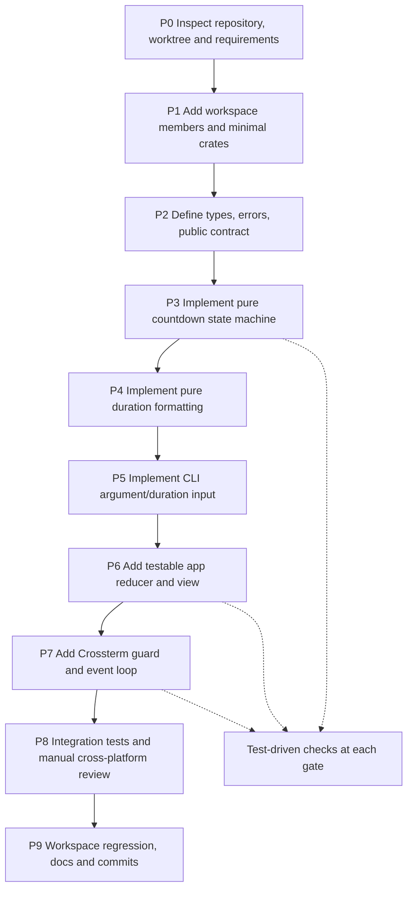

# Countdown Timer — Implementation Plan

**Status:** **PLANNED, NOT IMPLEMENTED**. Checkboxes and evidence fields are intentionally unverified.  
**Repository:** https://github.com/ironLegion88/word-games  
**Binding technical specification:** [`DESIGN_SPEC.md`](DESIGN_SPEC.md)  
**Binding test protocol:** [`TESTING.md`](TESTING.md)  
**Coding-agent instructions:** [`../../prompts/TIMER_AGENT_PROMPT.md`](../../prompts/TIMER_AGENT_PROMPT.md)

> **Current assignment only:** Implement the reusable Rust countdown library and one standalone terminal application. **Never implement or integrate with** `spelling-bee`, `boggle`, `wordle`, `word-games-cli`, `trie` or `trie-cli`. Existing game code and benchmarks remain unchanged. Do not implement optional concurrency, sequences, audio, persistence, GUI, or 100-ms countdown display.

## 0. Task, precedence and definition of done

The one-page *Countdown Timer* assignment requires user-configurable seconds, real system-clock timekeeping, start/pause/resume, visible countdown to zero, and completion indication. We have approved a stronger but focused implementation: a reusable `std`-only engine, backed by `Duration` and caller-supplied `Instant`, plus a stand-alone responsive Crossterm UI. The initial value is shown in smaller text. The application supports reset.

**Priority when documents differ:** (1) the assignment's actual mandatory requirements, (2) approved decisions in `/docs/timer/DESIGN_SPEC.md`, (3) precise behavior here, (4) tests in `/docs/timer/TESTING.md`, (5) existing repository conventions. If a conflict remains, preserve existing behavior and document the issue rather than inventing a redesign. Do not claim anything passed unless you ran it.

**Definition of done:**

- [x] New `countdown-timer` crate provides documented, `std`-only, deterministic engine API.
- [x] New `countdown-timer-cli` crate provides interactive countdown UI, duration selection, pause/resume, reset, quit, and end notification.
- [x] `Cargo.lock` updated correctly and only two new workspace members added.
- [x] All boundary, state-machine, clock and formatting tests pass without `sleep()`.
- [x] CLI argument tests and pure controller/view tests pass; live TTY checks performed where available.
- [x] Workspace formatting, strict Clippy, debug and release tests pass; no game crate modifications.
- [x] Existing CI covers the new crates by using `--workspace` (verify, don't assume).
- [x] Documentation updated with **actual** verification evidence, commands, OS/Rust versions and limitations.
- [x] Work committed in small conventional commits; no push unless separately authorized.

## 1. High-level dependency and execution flow



**Never proceed to the next numbered phase with knowingly failing tests from the current phase.** If a previously agreed exact file arrangement conflicts with an existing local file, preserve the existing file and adapt paths while keeping crate/API contracts.

## 2. Proposed repository delta

```text
word-games/
├── Cargo.toml                         # edit: append 2 workspace members
├── Cargo.lock                         # update via Cargo, don't hand edit
├── README.md                          # short new 'Standalone Timer' section
├── countdown-timer/                   # NEW standalone, std-only library
│   ├── Cargo.toml
│   ├── src/
│   │   ├── lib.rs                    # exports, crate-level docs
│   │   ├── timer.rs                  # CountdownTimer implementation
│   │   ├── state.rs                  # TimerStatus, TimerSnapshot, TimerEvent, private TimerState
│   │   ├── error.rs                  # TimerAction, TimerError; Display/Error impl
│   │   └── format.rs                 # display_seconds_ceil, format_countdown
│   └── tests/
│       ├── lifecycle.rs              # transitions and exact-boundary tests
│       ├── temporal_properties.rs    # invariants, seeded timelines
│       └── formatting.rs             # rounding, hours, edge cases
├── countdown-timer-cli/              # NEW standalone application
│   ├── Cargo.toml
│   ├── src/
│   │   ├── main.rs                   # thin entry point and exit codes
│   │   ├── lib.rs                    # expose testable CLI internals
│   │   ├── args.rs                   # CLI flags and duration validation
│   │   ├── app.rs                    # owns timer, pure command handling
│   │   ├── view.rs                   # render view from snapshots / viewport
│   │   └── terminal.rs               # RAII guard + Crossterm event loop
│   └── tests/
│       ├── args_cli.rs               # real subprocess help/error tests
│       └── app_logic.rs              # synthetic timestamps, reducer/view tests
├── docs/
│   ├── TESTING.md                     # EXISTING, append/link evidence only
│   └── timer/
│       ├── DESIGN_SPEC.md             # this package
│       ├── IMPLEMENTATION_PLAN.md     # this package
│       └── TESTING.md                 # this package
└── prompts/
    └── TIMER_AGENT_PROMPT.md          # this package
```

Keep the root `AGENT_PROMPT.md` router intact unless a **small link addition** is clearly necessary. The new `prompts/TIMER_AGENT_PROMPT.md` is the active prompt for this separate timer task; old game prompts must not be executed. Don't introduce empty planned game integration files.

## P0 — Repository audit and safe Git setup

- [ ] `git status --short --branch`; identify original branch, current HEAD, and pre-existing modifications. Do not overwrite or stage unrelated changes.
- [ ] Inspect `Cargo.toml`, `Cargo.lock`, existing crate manifest conventions, `.github/workflows/ci.yml`, `README.md`, `docs/TESTING.md`, and the new docs.
- [ ] Locate original assignment PDF if committed; otherwise use the attached specification available to the agent. Record whether source was available.
- [ ] Confirm the public repo's current workspace still has six pre-existing members; adjust only if actual local checkout differs.
- [ ] Create working branch `feat/countdown-timer` **only if it does not already exist** and branching will not disturb pending work; otherwise report the existing branch and continue safely.
- [ ] Establish baseline: `cargo fmt --all -- --check`, `cargo clippy --workspace --all-targets --locked -- -D warnings`, `cargo test --workspace --locked` (and release if practical). If baseline fails, record pre-existing failures; never claim your changes caused or fixed them without evidence.
- [ ] Record Rust/Cargo versions with `rustc --version`, `cargo --version` and OS target with `rustc -vV`.

**Gate P0:** Working tree and baseline understood; intended changes restricted to the two new crates, root manifest/lockfile, and timer documentation/README.

## P1 — Scaffold crates and manifest boundaries

- [ ] Add `"countdown-timer"` and `"countdown-timer-cli"` to existing root `[workspace].members`; retain `resolver = "2"`.
- [ ] Add `countdown-timer/Cargo.toml`: package `name = "countdown-timer"`, `edition = "2021"`, compatible with repo version/metadata conventions; no runtime/dev dependencies initially.
- [ ] Add `countdown-timer-cli/Cargo.toml`: package `name = "countdown-timer-cli"`, `edition = "2021"`; dependencies `countdown-timer = { path = "../countdown-timer" }` and `crossterm = "0.29"` **if the current toolchain resolves it**. No dependencies on word-game/trie crates. Prefer no `clap`, `tokio`, `ratatui`, or other crates.
- [ ] Create minimal compilable library and executable targets, `src/lib.rs` for both packages (CLI local library for testability), and `src/main.rs` for CLI.
- [ ] Let Cargo create/update `Cargo.lock` rather than editing it manually.
- [ ] Run `cargo metadata --no-deps --format-version 1` and `cargo check --workspace`.

**Gate P1:** Both packages are visible to Cargo, all original packages still exist, new CLI depends on engine but not vice versa, old crate manifests untouched. Commit an independently compiling scaffold if appropriate.

## P2 — Define the engine's public data model

The binding interface (copied here so there is no guesswork) is:

```rust
pub struct CountdownTimer { /* private fields */ }
impl CountdownTimer {
    pub fn new(initial: Duration) -> Result<Self, TimerError>;
    pub fn initial_duration(&self) -> Duration;
    pub fn snapshot(&self, now: Instant) -> TimerSnapshot;
    pub fn poll(&mut self, now: Instant) -> Option<TimerEvent>;
    pub fn start(&mut self, now: Instant) -> Result<(), TimerError>;
    pub fn pause(&mut self, now: Instant) -> Result<(), TimerError>;
    pub fn resume(&mut self, now: Instant) -> Result<(), TimerError>;
    pub fn reset(&mut self);
}
pub fn display_seconds_ceil(remaining: Duration) -> u64;
pub fn format_countdown(duration: Duration) -> String;
```

- [ ] Define public `TimerStatus { Ready, Running, Paused, Finished }`.
- [ ] Define public `TimerSnapshot { pub initial: Duration, pub remaining: Duration, pub status: TimerStatus }`.
- [ ] Define public `TimerEvent { Expired }`.
- [ ] Define public `TimerAction { Start, Pause, Resume }`.
- [ ] Define public `TimerError { ZeroDuration, InvalidTransition { action: TimerAction, status: TimerStatus }, DeadlineReached }`, with `Debug`, `Display`, `std::error::Error`, and equality traits where applicable.
- [ ] Define private `TimerState { Ready, Running { started_at, remaining_at_start }, Paused { remaining }, Finished }` and private fields `initial`/`state`.
- [ ] Re-export intended public items from `lib.rs`; document all public API with Rustdoc examples.
- [ ] Add a `new(Duration::ZERO)` error test and positive construction/read-only accessor test.

**Gate P2:** The API compiles, all public types have documented meaning, no contradictory boolean/`Option<Instant>` flags, and `new` preserves the strictly positive duration invariant.

## P3 — Implement deterministic timekeeping and state transitions

### P3.1 Core calculation and snapshot

Implement a private read-only helper for `Running`:

```rust
let elapsed = now.saturating_duration_since(started_at);
let remaining = remaining_at_start.saturating_sub(elapsed);
```

- [ ] `snapshot(&self, now)` must be pure: Ready→initial/Ready; Paused→frozen/Paused; Finished→zero/Finished; Running with remaining>0→remaining/Running; Running at zero→zero/**Finished** (logical expiration before poll).
- [ ] `initial_duration()` returns original unmodified `Duration`.
- [ ] Never use `thread::sleep`, a frame counter, mutable whole seconds, `SystemTime` or `Instant` addition for deadline math.
- [ ] Test `now == started_at`, intermediate timestamps, skipped tick, exact deadline and 1-ns-before/after deadline.

### P3.2 Mutating transitions

- [ ] `start(now)` only from Ready → Running with original budget. From every other internal state, return `InvalidTransition` without changing it.
- [ ] `pause(now)` only from Running **before** the deadline → Paused with exact fractional remaining. At/after deadline, return `DeadlineReached` and DO NOT consume an expiration event or change internal state. In non-running states, return `InvalidTransition` unchanged.
- [ ] `resume(now)` only from Paused → Running with saved budget and fresh `started_at`. Every other state → `InvalidTransition` unchanged.
- [ ] `reset()` from any state → Ready, restoring original duration and discarding pending expiration (explicit cancellation).
- [ ] `poll(now)` only changes a Running timer that has exhausted its budget → Finished and `Some(Expired)`. Never emits more than once per run, while Ready/Paused, or after already Finished.
- [ ] A side-effect-free `snapshot` cannot consume the event. `pause` cannot consume it either; `poll` is the *only* expiration commit operation.
- [ ] Add unit/integration tests before considering implementation complete. Test the transition matrix including invalid operations and error variants.

**Gate P3:** A 10-second timer paused after 2.25 seconds and resumed after an arbitrarily long pause expires exactly 7.75 seconds of subsequent running time later; querying snapshots any number of times does not change it; event is emitted once; invalid actions leave state untouched.

### P3.3 Intentional lazy-expiration subtlety

The private `TimerState::Running` can outlive its deadline until a caller invokes `poll(now)`. Consequently, `snapshot(now)` may return public status `Finished` while internally still `Running`. This is **intentional**, not a bug. It prevents a read-only call from changing state and preserves one-time expiration delivery. The CLI must always execute `poll(now)` before attempting to map a key to a lifecycle action, including at the boundary between input and expiration. If a user calls `reset` before polling, it explicitly cancels any pending expiration. `pause(now)` at/after deadline rejects while leaving a later `poll(now)` free to emit the event.

## P4 — Implement display helpers as pure functions

- [ ] Implement `display_seconds_ceil(Duration) -> u64`; round whole seconds upwards on any nonzero fractional nanoseconds, using saturating integer addition at the extreme upper bound.
- [ ] Implement `format_countdown(Duration) -> String`: under an hour `MM:SS` with exactly two-digit minutes/seconds; from one hour upward `HH:MM:SS` with hours at least two digits; zero→`00:00`.
- [ ] Test nanosecond and millisecond boundaries, `59.1s`→`01:00`, `59.999s`→`01:00`, 60s, 3599s, 3600s, 86400s, and very large representable durations. Avoid floating-point conversions.
- [ ] Run `cargo test -p countdown-timer --locked`, strict Clippy and Rustdoc doctests.

**Gate P4:** Display rounding cannot cause early apparent zero; the core remains independent of terminal I/O and of CLI policy limits.

## P5 — Build CLI parsing and pre-TUI duration selection

Use `--seconds <N>` as the only configuration flag, plus `--help` / `-h`.

- [ ] Parse `std::env::args_os()` or a testable iterator; ensure non-Unicode arguments fail gracefully with a useful error.
- [ ] Allow `--seconds N` where `N` is a decimal integer from **1 to 86400 inclusive**, no sign/fraction/suffix. Reject zero, overflow, missing value, repeated/unknown flags and unexpected positional arguments with usage diagnostics and code `2`.
- [ ] `--help` prints clear usage, status/control keys and examples, exits `0` **before any terminal setup**.
- [ ] If no `--seconds`, prompt for seconds using ordinary `stdin.read_line` *only* when stdin and stdout are terminals. On invalid entry, describe the problem and re-prompt; on EOF, exit normally without entering raw mode. Do not use line input after entering the countdown loop.
- [ ] If neither prompt nor interactive UI can run (redirected stdin/stdout), exit without hanging, with an explanatory diagnostic. With explicit `--seconds` but non-TTY, code `1` and a TTY error; without explicit seconds and non-TTY, code `2` and a usage error.
- [ ] Isolate parser in `args.rs`; write subprocess tests for non-TTY `--help`, invalid flags and malformed numbers.

**Gate P5:** CLI argument handling can be tested in pipes without accidentally opening raw/alternate mode. All invalid inputs exit cleanly and predictably.

## P6 — Build a testable application controller and presentation model

Create `App` (or a similarly named controller) owning exactly one `CountdownTimer` and a small status/message object, not shared mutable state. Model input as a pure application enum, e.g. `AppCommand { Toggle, Reset, Quit }`. Ensure CLI-specific commands do not leak into timer library.

- [ ] `App::new(duration)` constructs timer in Ready state, storing no extra authoritative remaining-time count.
- [ ] `App::on_tick(now)` calls `timer.poll(now)` and updates transient message when `Expired` is emitted, once.
- [ ] `App::on_command(cmd, now)` calls `timer.poll(now)` first; `Toggle` maps Ready→start, Running→pause, Paused→resume, Finished→no-op with reset hint. `Reset` restores initial duration and clears expiration message. Quit sets app-exit intention. Favor tiny, testable methods returning `Result` for unexpected engine errors.
- [ ] All rendering uses an owned `TimerSnapshot`, `initial`, optional message and terminal size; never mutates timer or relies on draw frequency. Build a pure `ViewModel` / `render_lines()` where feasible.
- [ ] UI includes prominent remaining time, smaller original time, status text, a single-line instruction for Space/r/q, and `Time's up!` upon expiration. Adapt gracefully to narrow/small terminals; do not use unchecked `width - text.len()`.
- [ ] Redraw when timer's displayed value, status, message, or terminal size changes. First draw always occurs.
- [ ] Controller tests simulate `Instant` jumps and key actions with no real I/O or sleep. Test `Toggle` in all four states, reset from each, and arrival at exact deadline.

**Gate P6:** Controller and layout logic are independently verifiable without physical terminal input; timer state is not copied into an alternative mutable countdown counter.

## P7 — Implement safe Crossterm lifecycle and responsive event loop

### Terminal guard

- [ ] Verify stdin and stdout are terminals with `std::io::IsTerminal` before TUI setup.
- [ ] Enter alternate screen, enable raw mode, hide cursor, and track which steps actually succeeded.
- [ ] Implement RAII guard that disables raw mode, shows cursor and leaves alternate screen on drop; on a partially failed init, immediately rollback completed steps.
- [ ] Use proper order/flush, handle recoverable output errors, avoid `std::process::exit` before guard drop, avoid unguarded `unwrap` or `panic!` on I/O. Document inherent limitations for `SIGKILL`/abort/power loss.

### Main loop (single thread)

```text
initialize App in Ready state
enter guarded terminal
set last-rendered view = none
while not quitting:
    now = Instant::now()
    app.on_tick(now)                 # commits Expired exactly once
    snapshot = app.timer.snapshot(now)
    if view needs redraw: draw(snapshot, view size, message)
    if crossterm::event::poll(50 ms)? returned true:
        event = crossterm::event::read()?
        if Key Press:
            key_now = Instant::now()
            app.on_command(map_key(event), key_now)   # polls BEFORE acting
        else if Resize: mark redraw required
leave guarded terminal
return exit status
```

- [ ] Use Crossterm `event::poll` and `event::read` on the same thread. Do not combine with `EventStream` and do not use a terminal input worker thread.
- [ ] Listen for `Space`, `r/R`, `q/Q`, `Esc`, Ctrl+C. Only `KeyEventKind::Press` changes commands. Ignore releases/repeats and irrelevant input.
- [ ] 50 ms is the maximum requested poll wait between loop iterations, **not** a source of clock truth or hard real-time guarantee. Do not busy loop.
- [ ] A completed countdown is visible even if the next input never arrives. Show completion message; Space does not restart; `r` resets.
- [ ] Preserve original terminal after normal quit, errors, and normal unwinding wherever feasible.
- [ ] Ensure errors from drawing/input terminate through the guard and surface on stderr.

**Gate P7:** Time decreases while user is idle; pause freezes; resume continues; reset restores configured value; timeout message appears without Enter; normal exit restores the user's shell prompt. Use a real terminal for this gate when available.

## P8 — Independent and end-to-end test coverage

Implement all detailed cases in [`TESTING.md`](TESTING.md). Minimum modules:

1. Engine construction and read-only access.
2. All legal and illegal transitions.
3. Exact nanosecond boundary and pause/resume arithmetic.
4. Event liveness and at-most-once delivery; snapshot does not consume event; `pause` at deadline does not swallow it.
5. Pure formatting boundary cases and large-duration overflow resilience.
6. Seeded deterministic command/timestamp streams compared against a simple independent reference oracle.
7. CLI flag validation and subprocess exit-code diagnostics.
8. Controller keyboard map, completion message, reset and Quit.
9. Small-terminal layout handling and redraw decisions.
10. Manual TTY smoke verification on available OS, including cleanup after normal quit; separately note untested Windows/Linux platforms.

**Automation constraint:** Don't write tests that `sleep` for whole countdown durations and then assert tight timing. Windows and CI scheduling make them flaky. Synthetic `Instant` offsets provide exact checks; manual smoke is allowed for UI responsiveness only. If automated pseudo-terminal (PTY) testing is feasible on a platform, make it platform-gated and resilient rather than a mandatory brittle test on every OS.

**Gate P8:** Every binding test matrix item is covered or explicitly marked manual/not tested; test names and results recorded as actually executed.

## P9 — Workspace regression, documentation, and delivery

Run from workspace root, after updating the lockfile and **before committing**:

```bash
cargo fmt --all
cargo fmt --all -- --check
cargo check --workspace --locked
cargo clippy --workspace --all-targets --locked -- -D warnings
cargo test --locked -p countdown-timer
cargo test --locked -p countdown-timer-cli
cargo test --workspace --locked
cargo test --workspace --release --locked
cargo build --workspace --release --locked
cargo doc --workspace --no-deps --locked
```

- [ ] If any command fails, fix code or explain an external pre-existing/environmental cause; don't label as passed.
- [ ] Confirm `git diff --name-status` does **not** list changes to game/trie crates or benchmark source/results. If present, revert only your accidental edits, not pre-existing user changes.
- [ ] Confirm existing GitHub Actions matrix includes Ubuntu/Windows and `--workspace` commands. Do not needlessly rewrite CI; add only if coverage is genuinely missing.
- [ ] Add concise timer commands/feature description to root `README.md` and links to timer docs. Preserve existing content.
- [ ] Fill *new* dated evidence section in `docs/timer/TESTING.md` with actual commands, pass counts, OS, Rust/Cargo versions, commit SHA, and remaining manual gaps. Do not replace or rewrite historical `docs/TESTING.md`; optionally add a link to the new timer testing document.
- [ ] Add brief Rustdoc usage example demonstrating a timer, synthetic time passage, and one-time expiration event.
- [ ] Run `git diff --check`, review staged hunks, commit coherent units with conventional headers and small bulleted bodies.
- [ ] Produce final report: branch/commit IDs, new files, key choices, exact tests and results, screenshots only if actually captured, limitations, and whether anything remains not run.

**Gate P9 / done:** Entire existing workspace passes checks, two new crates provide complete standalone timer behavior, docs accurately reflect verification status, and no game code was touched.

## 3. Mandatory acceptance scenarios

| ID | Scenario | Required observable result |
|---|---|---|
| A01 | `new(0)` | `Err(ZeroDuration)` |
| A02 | Ready with 90 seconds | `snapshot(now).remaining == 90s`, status Ready; no decrement |
| A03 | Start at t0, query at t0+2.5s | Remaining 87.5s, Running; display `01:28` |
| A04 | Pause at t0+2.25s | Remaining 87.75s, Paused; large pause gap unchanged |
| A05 | Resume at t1, query at t1+7.75s | Remaining 80s (from A04), Running |
| A06 | Poll before and at expiration | `None` before deadline, `Some(Expired)` once at deadline, then `None` forever until reset |
| A07 | Call snapshot after deadline, before poll | `Finished`, zero; later poll still emits Expired |
| A08 | Call pause exactly at deadline without prior poll | `Err(DeadlineReached)`; later poll still emits Expired |
| A09 | Reset running/paused/finished | Ready with original duration; no stale expiration event |
| A10 | Start twice, resume Ready, pause Paused | Appropriate typed invalid-transition errors; no state changes |
| A11 | Format duration 1 nanosecond | `00:01`; 0 duration → `00:00` |
| A12 | App launched with `--seconds 0`, 86401, noninteger | Exit code 2, usage diagnostic, no raw mode |
| A13 | App with `--help` in piped subprocess | Code 0, help printed, no TTY required |
| A14 | App with `--seconds 3` but no TTY | Clean code 1 error, no ANSI alternate-screen codes |
| A15 | Real TTY: 3-second timer, idle user | Decrements; at zero displays `Time's up!` without Enter |
| A16 | Real TTY: Space, wait, Space, wait, Space | Countdown freezes during pause, resumes correctly |
| A17 | Real TTY: r and q | Reset restores initial; quit restores terminal |
| A18 | Existing word games | All prior tests and benchmarks code unchanged; workspace regression passes |

These cases and `TESTING.md` are the acceptance contract. `A03` uses upward display rounding: 87.5 seconds becomes **88** displayed seconds, `01:28`.

## 4. Conventional commit checkpoints

Use small **Conventional Commits** headers: `type(scope): imperative summary`, no final period, preferably ≤72 chars. Follow each header with a blank line, then 1–3 short bullet lines describing material changes, rationale and/or validation. Example:

```text
feat(timer): add elapsed-time countdown state machine

- Model ready, running, paused, and finished states explicitly.
- Derive remaining time from Instant and Duration without tick drift.
- Test transitions and deadline boundaries with synthetic timestamps.
```

Suggested sequence (adapt to meaningful implementation boundaries; don't force unnecessary commits):

1. `chore(workspace): scaffold countdown timer crates`
2. `feat(timer): implement countdown state transitions`
3. `test(timer): cover timing invariants and formatting`
4. `feat(timer-cli): add duration input and interactive view`
5. `test(timer-cli): verify CLI controls and failure paths`
6. `docs(timer): record design, usage and verification`

Do not commit `target/`, random screenshots, generated temporary logs, or secrets. Stage specific paths, inspect diffs, avoid `git add -A` if the user has unrelated changes, and never amend/rewrite shared history or push without explicit authorization. On failure, preserve the work and give an accurate status instead of fabricating a green checkmark.

## 5. Implementation risks and mitigations

| Risk | Prevention / mitigation |
|---|---|
| Accumulated drift | Derive time from `Instant`, never decrement on redraw |
| Early visible zero | Ceil display seconds, use exact Duration for expiration |
| Expiration lost by pause at deadline | Reject late pause without state mutation; `poll` emits event |
| Expiration duplicate from repeated snapshots | Snapshot pure; committed Finished state gates subsequent events |
| Terminal stuck in raw/alternate screen | Guard with tracked partial initialization and `Drop` cleanup |
| Input blocks while countdown runs | Crossterm event poll; no in-loop `read_line` |
| Cross-platform repeat key toggles | Only react to key Press, ignore Repeat and Release |
| Unchecked terminal size arithmetic | Saturating/checked layout and compact fallback |
| Tests flaky from real time | Synthetic instants, no sleep-driven assertions |
| Rust workspace regressions | Full `--workspace --locked` CI-equivalent commands |
| Scope creep into games | No dependency on game crates; diff audit before commits |
| False verification claims | Evidence log starts NOT RUN and requires actual outputs |

## 6. End-of-task report template

```text
Branch:
Commits:
Rust/Cargo/OS:
Implemented:
Deviation from approved specification (if any):
Verification commands executed and exit results:
Unit/integration test counts (from actual output):
Interactive terminal checks, with platform:
Existing workspace regression status:
Known limitations/untested environments:
Files modified outside the two new crates and timer docs (why):
```

**Do not start games integration after completing this plan. Stop and report.**
