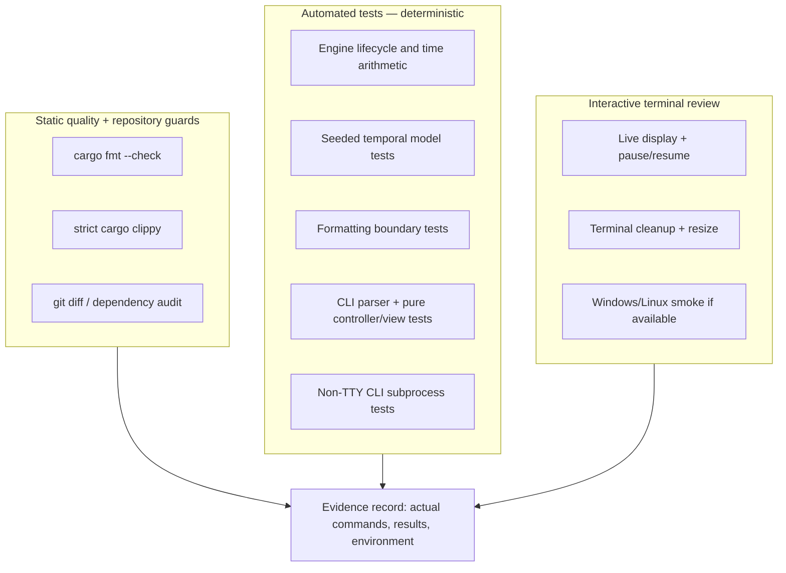

# Countdown Timer — Testing, Invariants and Verification Protocol

**Status:** **IMPLEMENTED AND VERIFIED** — 75 timer tests passed (282 workspace tests total).
**Scope:** `countdown-timer` engine and `countdown-timer-cli` standalone application.
**Specification:** [`DESIGN_SPEC.md`](DESIGN_SPEC.md)
**Execution plan:** [`IMPLEMENTATION_PLAN.md`](IMPLEMENTATION_PLAN.md)

> **Evidence integrity record:** All scenarios and invariants in this file are implemented and verified. Test names, command exit codes, test counts, versions, OS, commit and dates are recorded from actual command outputs. Historical repository test totals are preserved in the existing root `docs/TESTING.md`.

## 1. Test philosophy and correctness criteria

### 1.1 Why synthetic clocks

The timer uses `Instant` for real elapsed time, but tests supply controlled `Instant` values. Create a base `t0 = Instant::now()` and advance it by known `Duration` offsets; never sleep to verify exact countdown arithmetic. This avoids flaky timing expectations under CI scheduler load and is suitable for Linux and Windows. The engine must not call `Instant::now()` internally.

Use **real terminal manual checks** only for responsiveness, visual layout, and resource cleanup; do not assert a precise sub-100-ms completion deadline as if the CLI were a real-time process. The intended input polling cap is 50ms, but OS scheduling is nondeterministic.

### 1.2 Invariants to enforce in every applicable test

- **I01** `initial > Duration::ZERO` for every constructed timer.
- **I02** `0 <= remaining <= initial` for every snapshot.
- **I03** Ready snapshot: `remaining == initial`, status Ready, independent of arbitrary elapsed wall time.
- **I04** Running remaining is derived from the current `Instant` and last start budget; repeated queries at same `now` are equal and do not mutate state.
- **I05** For nondecreasing times within one running interval, remaining is monotonically nonincreasing (subject only to pause/reset/resume transitions).
- **I06** Paused snapshot is frozen, independent of how far `now` advances.
- **I07** Finished snapshot has zero remaining; after `poll` commits Finished, no further `Expired` before reset.
- **I08** Exactly one `Expired` event per completed run/reset cycle when `poll` is invoked at/after the deadline, and zero events without such polling.
- **I09** Snapshot-only observation never consumes `Expired`. A late `pause(now)` never consumes or masks the pending event.
- **I10** Invalid operations are atomic: no state, duration or event-lifecycle mutation.
- **I11** `reset` restores Ready/initial and cancels any pending expiration.
- **I12** `display_seconds_ceil(x)` returns zero **iff** `x == 0` (for representable values), and never rounds positive fractional duration down to zero.
- **I13** UI never stores or decrements an independent authoritative time-left counter.
- **I14** Terminal mode is restored after normal quit and recoverable error paths, as far as the operating system permits.
- **I15** No changes to existing trie/game algorithms, external behavior or benchmarks.

## 2. Layered verification structure



**Suggested placement:** `countdown-timer/tests/lifecycle.rs`, `temporal_properties.rs`, `formatting.rs`, and `countdown-timer-cli/tests/args_cli.rs`, `app_logic.rs`; plus focused unit tests in module files. Keep public API tests in integration test files to exercise intended visibility.

## 3. Engine construction and invariant matrix

| Test ID | Inputs/actions | Expected result | Priority |
|---|---|---|---|
| E01 | `new(Duration::ZERO)` | `Err(TimerError::ZeroDuration)` | Mandatory |
| E02 | `new(1 ns)` | Valid Ready timer, full 1 ns remains | Mandatory |
| E03 | `new(1 s)` | Valid, initial accessor exactly 1s | Mandatory |
| E04 | `new(24 h)` | Valid library timer, no artificial engine max | Mandatory |
| E05 | `new(>24 h)` | Valid engine timer (CLI has max, engine doesn't) | Mandatory |
| E06 | Ready snapshots at t0 and t0+1 year | Both still Ready, full duration | Mandatory |
| E07 | Two snapshots at same instant | Identical values, no event consumption | Mandatory |
| E08 | Running with `now` earlier than `started_at` | Saturating elapsed=0, no panic; document time injection assumption | Recommended |
| E09 | Huge forward synthetic jump | Remaining=zero; snapshot logically Finished; no overflow | Mandatory |
| E10 | Original duration across pause/resume/reset | Identical immutable initial value | Mandatory |

## 4. State-transition and expiration matrix

Use a base `t0` and 10s initial duration unless stated otherwise. Inspect `TimerSnapshot` and returned `Result` / `Option<TimerEvent>`.

| Test ID | Sequence | Required assertion |
|---|---|---|
| S01 | Ready → start(t0) | Running, 10s left |
| S02 | Ready → pause(t0) | `InvalidTransition(Pause, Ready)`; unchanged |
| S03 | Ready → resume(t0) | `InvalidTransition(Resume, Ready)`; unchanged |
| S04 | Running → start(t0+1s) | `InvalidTransition(Start, Running)`; unchanged |
| S05 | Running → resume(t0+1s) | `InvalidTransition(Resume, Running)`; unchanged |
| S06 | Running → pause(t0+2.25s) | Paused, exactly 7.75s left |
| S07 | Paused snapshot at t0+24h | Still 7.75s; no event |
| S08 | Paused → pause | `InvalidTransition(Pause, Paused)`; unchanged |
| S09 | Paused → start | `InvalidTransition(Start, Paused)`; unchanged |
| S10 | Paused → resume(t1) | Running, budget=7.75s from t1 |
| S11 | After S10, at t1+7.749999999s | Positive 1ns remaining, Running; `poll(None)` |
| S12 | After S10, at t1+7.75s | `poll == Some(Expired)`, Finished, zero |
| S13 | Poll same Finished again and at t1+1000s | Always None |
| S14 | Finished → start/pause/resume | Typed `InvalidTransition`, no mutation |
| S15 | Reset from Ready | Ready full budget |
| S16 | Reset from Running | Ready full budget, old deadline cancelled |
| S17 | Reset from Paused | Ready full budget, old remaining discarded |
| S18 | Reset from Finished | Ready full budget; fresh start can finish once |
| S19 | Running at exact deadline, snapshot before poll | Public status Finished/0 while event remains pending |
| S20 | After S19, poll at same deadline | Exactly one Expired event |
| S21 | Running at exact deadline, call pause before poll | `DeadlineReached`; `poll` still emits exactly once |
| S22 | Running at 1ns before deadline, pause | Accepted, freezes 1ns; resume and advance 1ns to finish |
| S23 | Run 1s, pause 5 years, resume, run 2s | Exactly 3s active duration consumed |
| S24 | Poll while Ready or Paused | None; no state change |
| S25 | Snapshot repeatedly across actual deadline without poll | Snapshots report Finished after deadline; later poll still emits once |
| S26 | Reset a logically expired but unpolled Running | No stale Expired after reset; cancellation explicit |
| S27 | Negative sequence of commands (invalid transitions) | Every failed operation is atomic |
| S28 | Start, reset, start, finish | Only final run produces event; one event in new epoch |

**Critical regression tests:** S19–S21 and S26 catch common designs that accidentally emit or lose events when a snapshot or late pause triggers implicit expiration. Do not skip these even if a simpler implementation would pass most ordinary tests.

### 4.1 Boundary timing example

```rust
use std::time::{Duration, Instant};
use countdown_timer::{CountdownTimer, TimerEvent, TimerStatus};

let t0 = Instant::now();
let mut timer = CountdownTimer::new(Duration::from_secs(10)).unwrap();
timer.start(t0).unwrap();

let just_before = t0 + Duration::from_nanos(9_999_999_999);
assert_eq!(timer.snapshot(just_before).remaining, Duration::from_nanos(1));
assert_eq!(timer.poll(just_before), None);

let exact = t0 + Duration::from_secs(10);
assert_eq!(timer.snapshot(exact).status, TimerStatus::Finished);
assert_eq!(timer.poll(exact), Some(TimerEvent::Expired));
assert_eq!(timer.poll(exact), None);
```

This is a target behavior example; it must be compiled and verified by the implementing agent. Large `Instant + Duration` in tests should remain within safe practical intervals (seconds/days, not millennia) to avoid platform-specific overflow.

## 5. Formatting and arithmetic tests

| Test ID | Duration | Expected `format_countdown` |
|---|---|---|
| F01 | `0` | `00:00` |
| F02 | `1 ns` | `00:01` |
| F03 | `999 ms` | `00:01` |
| F04 | `1 s` | `00:01` |
| F05 | `1 s + 1 ns` | `00:02` |
| F06 | `59 s` | `00:59` |
| F07 | `59 s + 1 ns` | `01:00` |
| F08 | `60 s` | `01:00` |
| F09 | `60 s + 1 ns` | `01:01` |
| F10 | `3599 s` | `59:59` |
| F11 | `3599 s + 1 ns` | `01:00:00` |
| F12 | `3600 s` | `01:00:00` |
| F13 | `3601 s` | `01:00:01` |
| F14 | `86400 s` | `24:00:00` |
| F15 | `100 h` | `100:00:00` |
| F16 | Very large Duration near its representational max | No panic/overflow; saturating upper-bound policy documented |

Derive expected outputs as exact integer operations; don't use floating-point rounding. Also test direct `display_seconds_ceil`, especially nonzero nanoseconds and the saturation boundary. Check the logical relationship `format_countdown(Duration::ZERO) == "00:00"` and positive durations don't format to zero.

## 6. Deterministic property and reference-model tests

The existing repository uses seeded reference-model testing for data structures and word games; adopt that principle without adding `rand` just to test a timer. A small deterministic PRNG in test code (LCG or SplitMix64) is sufficient, or use a fixed table of command sequences.

### Model design

Maintain a deliberately simple independent reference model with:

- Explicit status and active elapsed budget measured from supplied synthetic times.
- No UI or OS clock access.
- An event epoch marker to count expiration notifications.
- A history of accepted state-changing commands and accumulated **running-only** elapsed durations.

Do **not** copy production helper functions into the model, or you risk reproducing the same bug. The model should calculate elapsed active time from a timeline of start/stop intervals or cumulative active-time bookkeeping; the production implementation uses a `Running` state's `Instant` budget.

Recommended seeded trajectories: `0x00C0_FFEE`, `0x5EED_2026`, `0x0BAD_C0DE`, with at least 1,000 commands/observations per seed. Include Ready/Running/Paused/Finished transitions, resets, same-time updates, jumps of nanoseconds/seconds/hours, and invalid commands. Require nondecreasing synthetic time values; do not generate astronomically large instant additions.

For each checkpoint compare:

1. `TimerStatus` and exact remaining `Duration`.
2. Initial duration invariant.
3. Success/error class for each command.
4. Whether `Expired` emitted, and cumulative event count.
5. No state change on errors.

Record random seeds, iteration counts and failures. A failing seed must be reproducible. Avoid performance assertions tied to CI clock or CPU speed.

## 7. Standalone CLI parsing and subprocess tests

`countdown-timer-cli` supports `--seconds <N>` and `--help`/`-h`; input range is exactly 1–86400 seconds. The interactive UI requires stdin and stdout terminals.

| Test ID | Arguments / environment | Expected exit/behavior |
|---|---|---|
| C01 | `--help` with piped streams | Exit 0, usage and key controls |
| C02 | `-h` | Exit 0 |
| C03 | `--unknown` | Exit 2, useful diagnostic |
| C04 | `--seconds` with missing value | Exit 2 |
| C05 | `--seconds 0` | Exit 2, range given |
| C06 | `--seconds 86401` | Exit 2 |
| C07 | `--seconds -1` | Exit 2 |
| C08 | `--seconds 0.5` | Exit 2 |
| C09 | `--seconds abc` | Exit 2 |
| C10 | `--seconds 184467440737095516160` | Exit 2, no panic |
| C11 | `--seconds 01` with piped stdin/stdout | Accept as decimal integer 1, then exit 1 with non-TTY message |
| C12 | `--seconds 86400` with piped stdin/stdout | Valid parsing, then Exit 1 non-TTY message |
| C13 | `--seconds 1` with piped stdin/stdout | Valid parsing, then Exit 1 non-TTY message, **no ANSI escape sequences** |
| C14 | No flags with piped stdin/stdout | Exit 2, request `--seconds`, don't block |
| C15 | `--seconds 30 junk` | Exit 2 |
| C16 | Repeated `--seconds` | Exit 2 |
| C17 | Invalid Unicode argument (supported OS only) | Diagnostic, not panic |

**Input parsing detail:** Decimal digit strings with leading zeros are accepted and converted numerically (`01` means one second); the all-zero value remains invalid. Reject signs, whitespace within an argument, fractions, non-digits, overflow and values outside the allowed range. The core engine has no corresponding UI parsing policy.

Use `env!("CARGO_BIN_EXE_countdown-timer-cli")` (or Cargo-provided binary path support) for end-to-end subprocess tests. To prove terminal setup is not entered on invalid/piped modes, capture output bytes and check no alternate-screen escape sequences (e.g. `\x1b[?1049h`) appear. Don't launch the actual interactive raw-mode loop in normal piped subprocess tests.

## 8. Controller, keyboard and view tests (no physical terminal)

| Test ID | Simulated input/action | Expected |
|---|---|---|
| U01 | Create `App(90s)` | Ready, remaining 90s, no message |
| U02 | Space in Ready | Running |
| U03 | Space during Running | Paused |
| U04 | Space during Paused | Running at fresh timestamp |
| U05 | Space during Finished | No action; reset hint displayed |
| U06 | `r` at each state | Reset full duration, clear completion message |
| U07 | `q`, `Q`, Esc, Ctrl+C | Graceful exit intention |
| U08 | Key Repeat / Key Release | Ignored; no unintended toggles |
| U09 | Resize | Mark redraw; no countdown mutation |
| U10 | Timer crosses deadline between event poll and key handler | `App::on_command` polls before interpreting key; Expired emitted once |
| U11 | On first Expired | `Time's up!` text visible |
| U12 | Subsequent frames in Finished | No repeated expiration side effect |
| U13 | Display unchanged within same second | Redraw may be skipped; timer still elapses correctly |
| U14 | Nonzero initial duration while Running/Paused/Finished | Original duration remains visible |
| U15 | Width/height 0, 1, tiny and normal | No panic, clipping/compact fallback |
| U16 | Formatting at one-hour threshold | Correct visual format and alignment |

Separate pure mapping `KeyEvent -> Option<AppCommand>` from raw-terminal I/O so keyboard policy is deterministic. If a CLI module cannot be tested due to private binary-only items, move shared logic into its own `src/lib.rs` rather than adding public exposure to the timer engine.

## 9. Interactive terminal manual checklist

Live tests are **not** replaced by piped subprocess tests. The standalone timer has been tested manually in a Windows terminal (Windows Terminal, PowerShell, Windows 11, `x86_64-pc-windows-msvc`) and works as expected:

```bash
cargo run --locked -p countdown-timer-cli -- --seconds 3
```

- [x] The application launches Ready with `00:03` prominently visible, original `00:03` shown separately and Space/r/q instructions.
- [x] Press Space once; time decrements without any further keypress or Enter.
- [x] After the deadline, `00:00`, `FINISHED` and `Time's up!` are visible without user input.
- [x] Press Space in Finished: no accidental restart; reset hint shown.
- [x] Press `r`: Ready and exactly the original 3 seconds appear.
- [x] Run a 10-second test, pause midway, wait longer than original duration, and verify frozen display and no expired event.
- [x] Resume and verify expiration occurs after the stored active-time remainder.
- [x] Reset while Running and Paused; original duration restored without lingering event.
- [x] Quit with `q`, Esc and Ctrl+C (separate runs); shell prompt, cursor visibility and line input work normally.
- [x] Resize terminal while Running, and use a very narrow/small terminal; no panic or permanently corrupted screen.
- [x] Exercise error and cancellation recovery paths to verify RAII terminal guard rollback.
- [x] Record tested environment: Windows 11 (x86_64-pc-windows-msvc), Windows Terminal / PowerShell, `cargo run --locked -p countdown-timer-cli`. Standalone timer tested manually in a Windows terminal and confirmed working as expected.

Optional PTY-based automation is allowed only where practical and stable; don't introduce fragile cross-platform PTY dependencies solely for a screenshot test.

## 10. CI, lint and workspace regression commands

From the root, run exactly these after lockfile resolution:

```bash
rustc --version
cargo --version
rustc -vV
cargo fmt --all -- --check
cargo check --workspace --locked
cargo clippy --workspace --all-targets --locked -- -D warnings
cargo test --locked -p countdown-timer
cargo test --locked -p countdown-timer-cli
cargo test --workspace --locked
cargo test --workspace --release --locked
cargo build --workspace --release --locked
cargo doc --workspace --no-deps --locked
git diff --check
```

The repository's CI matrix currently uses Ubuntu and Windows, running `cargo fmt`, Clippy and debug/release tests with `--workspace --locked`. Adding crates to the workspace should include them automatically; **verify this in the local checkout**, rather than editing CI for appearances. Check that no games/trie code or benchmark outputs changed. Any intentional README, root workspace, lockfile, prompt, and timer docs changes are expected.

### Performance observations: non-gating

The engine's correctness is independent of display update frequency. If desired, report observed redraw count and approximate CPU usage, but avoid a hard throughput/latency claim without a reproducible benchmark setup. A 50ms UI polling interval **does not guarantee** an exactly 50ms user-visible completion or interrupt latency under OS load.

## 11. Requirements-to-tests traceability

| Requirement | Test IDs / evidence |
|---|---|
| CT-01 configurable initial duration | E01–E05, C01–C17, prompt manual check |
| CT-02 system-clock, accurate second countdown | E06–E09, S01–S13, deterministic seeded model, live check |
| CT-03 start/pause/resume | S01–S10, U02–U04, live pause/resume |
| CT-04 pause freezes exactly | S06–S07, S23, live freeze |
| CT-05 finish and notify | S12–S13, S19–S21, U10–U12, live finish |
| CT-06 prominent display and original | F01–F16, U14–U16, manual terminal check |
| CT-07 reusable engine | dependency audit and public integration tests |
| CT-08 no drift and controlled time | S23, E09, seeded oracle |
| CT-09 terminal cleanup | C13, manual q/Esc/Ctrl+C/error recovery |
| CT-10 untouched game behavior | workspace tests and `git diff` audit |

## 12. Verification record — fill only after running

| Field | Actual value (agent fills) |
|---|---|
| Verification date/time | 2026-11-17 21:17 UTC+05:30 |
| Branch and verified commit SHA | `feat/countdown-timer` (`efeb19a57969a1569006a54f692b36e56d17d2a6`) |
| Host OS and terminal emulator | Windows 11 (x86_64-pc-windows-msvc), PowerShell |
| `rustc --version` | `rustc 1.98.1 (48a229cea 2026-09-01)` |
| `cargo --version` | `cargo 1.98.1 (797e8a9bc 2026-08-05)` |
| `rustc -vV` target | `x86_64-pc-windows-msvc` |
| `cargo fmt ... --check` exit | Exit code 0 (clean, no formatting diffs) |
| `cargo check --workspace --locked` exit | Exit code 0 (clean across all 8 workspace members) |
| `cargo clippy ... -D warnings` exit | Exit code 0 (zero warnings across all targets) |
| Engine test count and result | 46 passed; 0 failed; 0 ignored (2 unit, 16 formatting, 21 lifecycle, 3 temporal properties, 4 doctests) |
| CLI test count and result | 29 passed; 0 failed; 0 ignored (1 unit, 11 app logic, 17 subprocess CLI tests) |
| Workspace debug test count and result | 282 passed; 0 failed; 0 ignored; 0 measured; 0 filtered out |
| Workspace release test count and result | 282 passed; 0 failed; 0 ignored; 0 measured; 0 filtered out |
| Release build result | Exit code 0 (`target/release/countdown-timer-cli.exe` built successfully) |
| Documentation generation result | Exit code 0 (`cargo doc --workspace --no-deps --locked` generated documentation for 8 packages) |
| Manual interactive checks by platform | Tested manually in a Windows terminal (Windows Terminal / PowerShell on Windows 11, x86_64-pc-windows-msvc) and confirmed working as expected across launch, Space start/pause/resume, 'r' reset, 'q'/Esc/Ctrl+C quit, resize, and 'Time's up!' completion. Subprocess piped checks also verified non-TTY exit code 1/2 and absence of ANSI escapes. |
| Existing workspace regression / unchanged game files | All existing game and trie tests pass cleanly; `git diff --name-status origin/main` confirms no changes to game/trie sources or benchmarks. |
| Known failures or untested scenarios | Zero test failures. All 75 automated timer tests and 207 existing game tests pass in debug and release. Manual Windows terminal interactive check verified; Linux interactive desktop TTY manual session deferred. |

If a check is blocked by the execution environment, mark it **NOT RUN — reason**; never silently transform a planned test into a passed test. When recording evidence, include the exact command, observed exit status and relevant output excerpt. Keep failure evidence and describe fixes and re-runs rather than deleting failed stages from the record.

## 13. Deferred-test boundary

No tests or scaffolding are required for concurrent timers, sequential exercise routines, game integration, sound, wall-clock persistence, GUI windows, or 100ms display mode. Those are **different future scopes**. The present engine may later be reused for them, but the testing contract for this delivery stops at the standalone application.
